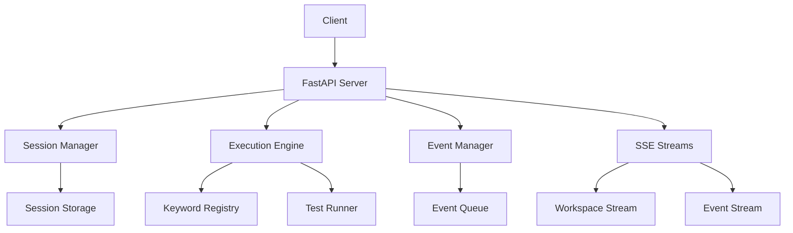
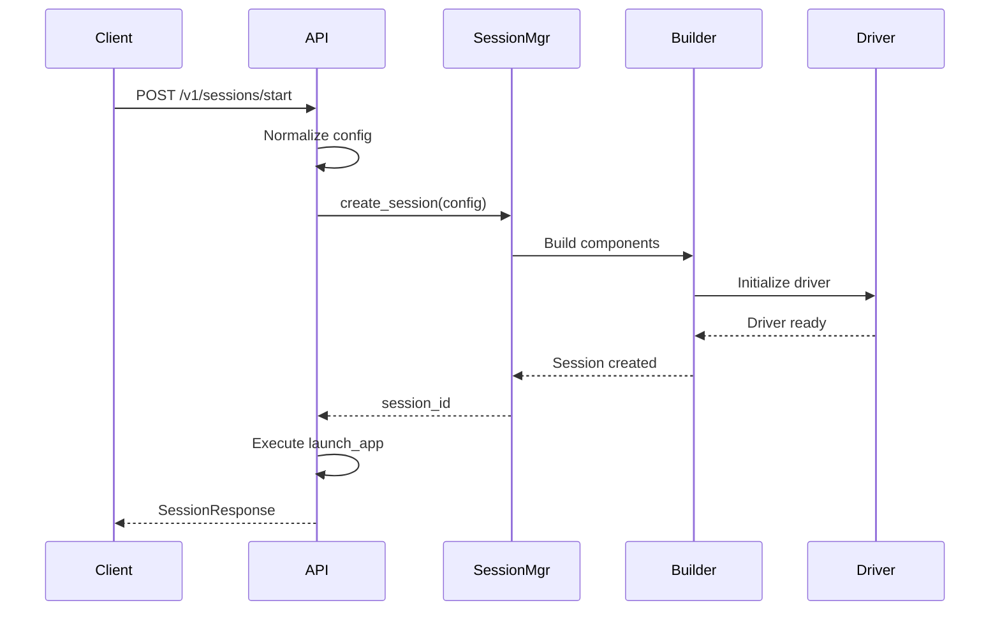
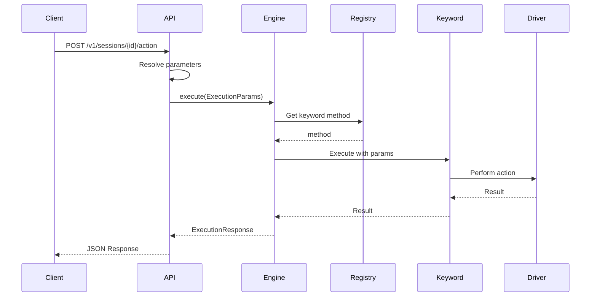

# REST API layer

> How `optics serve` turns HTTP requests into sessions, keyword runs and event streams on top of the core framework.

Optics has a REST API layer built on FastAPI. It gives programs access to the framework over HTTP. This page explains the design of the API: its parts, the request and response flows, and how it uses the core framework. For every endpoint, field and status code from a client's point of view, see the [HTTP API reference](https://optics-framework.org/docs/reference/http-api) and the [OpenAPI document](https://optics-framework.org/openapi.json).

## Overview

The REST API layer provides:

1. **Session management**: create, manage and terminate sessions
2. **Keyword execution**: execute keywords from a program
3. **Workspace streaming**: real-time workspace updates through SSE
4. **Event streaming**: real-time execution events through SSE
5. **Workspace inspection**: get screenshots, elements and page source

## API architecture

`The parts of the API server`:



**Location:** `optics_framework/common/expose_api.py`

The module holds one `SessionManager` for the process. Sessions live in that process's memory, so a client must reach the same process for every call.

## API server

The API server is a FastAPI app:

`optics_framework/common/expose_api.py`:

```python
from fastapi import FastAPI

session_manager = SessionManager()

app = FastAPI(title="Optics Framework API", version="1.0", lifespan=_end_sessions_on_shutdown)

add_http_guards(app)
```

`_end_sessions_on_shutdown` ends every open session when the server stops, so remote browsers and devices are released at once instead of at their provider's idle timeout. `add_http_guards` adds the CORS allowlist and the Host check. See [Security considerations](#security-considerations).

### Server startup

Start the API server from the CLI:

```bash
optics serve --host 0.0.0.0 --port 8000
```

Or from Python:

```python
from optics_framework.helper.serve import run_uvicorn_server

run_uvicorn_server(host="0.0.0.0", port=8000, workers=1)
```

`run_uvicorn_server` runs Uvicorn on the app string `optics_framework.common.expose_api:app` with the Optics log format. On a host other than loopback, such as `0.0.0.0`, it logs a warning that the server has no authentication.

## Request/response flow

### Session creation flow

`What POST /v1/sessions/start does`:



### Keyword execution flow

`What POST /v1/sessions/{id}/action does`:



## Session management

### Session creation

**Endpoint:** `POST /v1/sessions/start`

**Request body** (`SessionConfig`):

```json
{
  "driver_sources": [{"appium": {"enabled": true, "url": "...", "capabilities": {...}}}],
  "elements_sources": [{"appium_find_element": {"enabled": true}}],
  "text_detection": [{"easyocr": {"enabled": true}}],
  "image_detection": [{"templatematch": {"enabled": true}}]
}
```

`SessionConfig` also takes `ai_self_heal`, `llm_provider` and `llm_model` (self-heal for this session), `strict_element_match`, and `api_data` (inline API definitions; a file path is not accepted). It still accepts `project_path`, but `optics serve` refuses it with `E0501` because it names a folder on the server. Upload template images with `POST /v1/sessions/{session_id}/templates` instead. Only a local stdio MCP server (`optics mcp`) may read server files.

**Response:**

```json
{
  "session_id": "uuid-string",
  "driver_id": "driver-session-id",
  "status": "created"
}
```

**Implementation details:**

1. **Configuration normalization**: Converts the accepted input formats to the internal format. See [Configuration normalization](#configuration-normalization).
2. **Self-heal settings**: Each field takes the per-session value first, then the service default from `OPTICS_AI_SELF_HEAL`, `OPTICS_LLM_PROVIDER` and `OPTICS_LLM_MODEL`, then the built-in default (`gemini`). LLM credentials never travel in the request; each engine reads its own from the server environment.
3. **Session creation**: Creates the session with the normalized configuration in a worker thread. The session logs at `DEBUG`, does not save screenshots or page sources (`save_captures=False`), and writes its other output to its own temporary folder, which is deleted when the session ends.
4. **Logging configuration**: Reconfigures logging for the session. The log shows the sources with URLs cut to scheme and host and secret values masked.
5. **Auto-launch**: Executes the `launch_app` keyword automatically. Its result becomes `driver_id`.

A creation that fails with an `OpticsError` returns that error's status and payload. Any other failure returns 500 with `Session creation failed: ...`.

### Session termination

**Endpoint:** `DELETE /v1/sessions/{session_id}/stop`

**Response:**

```json
{
  "status": "terminated"
}
```

**Implementation details:**

1. Runs the `close_and_terminate_app` keyword. If it fails, the endpoint returns the error and keeps the session, so the client can call it again.
2. Retrieves the session from `SessionManager` and terminates the driver connection.
3. Cleans up session resources.
4. Removes the session from storage, and removes its entry from the workspace hash table.

### Other session endpoints

The API also has these endpoints. The [HTTP API reference](https://optics-framework.org/docs/reference/http-api#endpoints) gives their request and response bodies.

| Method | Path | What it does |
|---|---|---|
| `GET` | `/` and `/health` | Health check: `{"status", "version"}` |
| `POST` | `/v1/sessions/{session_id}/templates` | Uploads a template image (`TemplateUploadRequest`) for vision keywords |
| `POST` | `/v1/sessions/{session_id}/api` | Replaces the session's API definitions, as the `Add API` keyword does |
| `GET` | `/v1/sessions/{session_id}/driver-id` | Runs `get_driver_session_id` |
| `GET` | `/v1/sessions/{session_id}/variables` | Returns the session's `${variable}` values |
| `GET` | `/v1/sessions/{session_id}/elements` | Runs `get_interactive_elements`, with `filter_config` and `compact` |

## Keyword execution

### Execute keyword

**Endpoint:** `POST /v1/sessions/{session_id}/action`

**Request body** (`ExecuteRequest`):

```json
{
  "mode": "keyword",
  "keyword": "Press Element",
  "params": ["submit_button"]
}
```

Only `"mode": "keyword"` is supported. Any other mode, or a missing `keyword`, returns 400. The optional `template_images` field maps names to base64 images for vision keywords during this one request.

**Response:**

```json
{
  "execution_id": "uuid-string",
  "status": "SUCCESS",
  "data": {
    "result": "action completed"
  }
}
```

When the keyword returns a dict, that dict is `data` itself, not `data.result`. When AI self-heal recovered the keyword, `data` also carries `healed`, `heal_summary` and `suggested_steps`.

For each request, the handler builds a `KeywordRegistry` from the session's `ActionKeyword`, `AppManagement`, `Verifier` and `FlowControl`, and looks up the keyword by its slug (`Press Element` → `press_element`). An unknown keyword raises `E0402`. It puts a `RUNNING` event on the session's event queue before the run and a `SUCCESS` or `FAIL` event after it.

### Parameter formats

The API supports more than one parameter format.

#### Positional parameters

```json
{
  "params": ["element_id", "30", "button_clicked"]
}
```

#### Named parameters

For a keyword such as `Detect and Press`, whose parameters are `element`, `timeout` and `event_name`:

```json
{
  "params": {
    "element": "submit_button",
    "timeout": "30",
    "event_name": "button_clicked"
  }
}
```

#### Fallback parameters

Any value can be a list of alternatives. A flat list is three positional values, not three fallbacks:

```json
{
  "params": ["value1", "value2", "value3"]
}
```

Put the alternatives for one parameter in a nested list:

```json
{
  "params": [["value1a", "value1b"], "value2"]
}
```

Named parameters take lists the same way:

```json
{
  "params": {
    "element": ["submit_button", "Submit"]
  }
}
```

### Parameter resolution

The API automatically:

1. **Detects the format**: A dict is named parameters, and a list is positional parameters. A list value inside either one holds fallbacks.
2. **Normalizes values**: Converts every value to a list for fallback support. For a named parameter whose type is a list, the whole list is sent as one JSON value instead.
3. **Resolves named parameters**: Converts named parameters to positional ones in the order of the method signature, and fills defaults. A missing required parameter raises an error, and a name that is not in the signature is ignored without an error. Positional parameters are checked against the signature first; too many raise `E0403`.
4. **Generates combinations**: Creates the fallback combinations with `itertools.product`, one at a time and at most 20 (`MAX_ATTEMPTS` in `optics_framework/common/fallback.py`).
5. **Tries each combination**: Executes until one succeeds or all fail. Only "element not found" errors (`E02xx` and `X0201`) move on to the next combination; any other error is raised at once.

### Fallback execution

`optics_framework/common/fallback.py`:

```python
async def run_async[R](candidates: Sequence[Sequence[Any]], call: Callable[[Combo], Awaitable[R]], subject: str) -> R:
    ladder = _Ladder(candidates, subject)
    for combo in ladder:
        try:
            return await call(combo)
        except Exception as exc:
            ladder.failed(combo, exc)
    raise ladder.exhausted()
```

`_Ladder` iterates `islice(product(*candidates), MAX_ATTEMPTS)`. `ladder.failed()` keeps the last five element-not-found failures and re-raises any other error. When every combination fails, `ladder.exhausted()` returns a `FallbackExhausted` error with the code and status of the last failure. Its message is one sentence when there were at most five tries and every value missed in the same way, such as `None of '//button[@id='login']', 'Sign in' and 'css=#nope' is on the screen.`, and else `All <n> tries of keyword '<keyword>' failed:` with one line for each failure. See [Components](https://optics-framework.org/docs/contribute/components#error-aggregation).

## Server-sent events (SSE)

The API uses server-sent events for real-time streaming.

### Event streaming

**Endpoint:** `GET /v1/sessions/{session_id}/events`

**Response:** SSE stream of execution events

**Event format** (`ExecutionEvent`):

```json
{
  "execution_id": "uuid-string",
  "status": "RUNNING|SUCCESS|FAIL|HEARTBEAT",
  "message": "Event message"
}
```

The status can also be `ERROR` or `CANCELLED` when the stream itself stops.

**Implementation:**

```python
async def event_generator(session: Session):
    HEARTBEAT_INTERVAL = 15  # seconds
    while True:
        try:
            event = await asyncio.wait_for(session.event_queue.get(), timeout=HEARTBEAT_INTERVAL)
            yield {"data": json.dumps(event)}
        except asyncio.TimeoutError:
            # Send heartbeat
            yield {"data": json.dumps(ExecutionEvent(
                execution_id="heartbeat",
                status="HEARTBEAT",
                message="No new event, sending heartbeat"
            ).model_dump())}
```

The source wraps this loop in more `except` branches. An unexpected error sends an `ERROR` event and ends the stream; a cancelled stream sends `CANCELLED`. Each event is taken from the queue once, so with two clients on one session each event reaches only one of them.

### Workspace streaming

**Endpoint:** `GET /v1/sessions/{session_id}/workspace/stream`

**Query parameters:**

- `interval_ms` (int, default: 2000): Polling interval (minimum 500ms)
- `include_source` (bool, default: false): Include page source
- `filter_config` (List[str], optional): Filter element types

**Response:** SSE stream of workspace updates

**Workspace data format:**

```json
{
  "screenshot": "base64-encoded-image",
  "elements": [...],
  "screenshotFailed": false,
  "source": "..." // if include_source=true
}
```

The screenshot and the element bounds come from the same frame, so a client can draw the bounds on the image without scaling them.

**Change detection:**

The API emits an update only when the workspace data changes. `_compute_workspace_hash` takes a SHA-256 of the screenshot, the elements and, if included, the source.

```python
# Compute hash of current workspace
current_hash = _compute_workspace_hash(workspace_data)
last_hash = workspace_hashes.get(session.session_id)

# Only emit if changed
if last_hash is None or current_hash != last_hash:
    workspace_hashes[session.session_id] = current_hash
    yield {"data": json.dumps(workspace_data)}
    last_heartbeat = asyncio.get_event_loop().time()
else:
    # Send heartbeat if no change
    now = asyncio.get_event_loop().time()
    if now - last_heartbeat >= HEARTBEAT_INTERVAL:
        yield {"data": json.dumps({"type": "heartbeat", "timestamp": now})}
        last_heartbeat = now
```

A heartbeat goes out only after 15 seconds (`HEARTBEAT_INTERVAL`) without a change, not on every unchanged poll. An error sends `{"type": "error", "message": ...}` and the stream tries again after one interval. The stream ends when the session ends.

**Benefits:**

- Less network traffic
- Less load on the driver
- Real-time updates at a low cost

## Workspace inspection

### Get screenshot

**Endpoint:** `GET /v1/sessions/{session_id}/screenshot`

**Response:**

```json
{
  "execution_id": "uuid-string",
  "status": "SUCCESS",
  "data": {
    "result": "base64-encoded-image"
  }
}
```

### Get page source

**Endpoint:** `GET /v1/sessions/{session_id}/source`

The `capture_pagesource` keyword returns a dict, so the dict is `data` itself.

**Response:**

```json
{
  "execution_id": "uuid-string",
  "status": "SUCCESS",
  "data": {
    "page_source": "<html>...</html>",
    "timestamp": "..."
  }
}
```

### Get screen elements

**Endpoint:** `GET /v1/sessions/{session_id}/screen_elements`

This endpoint takes no query parameters. It runs `get_screen_elements`, which captures one frame and returns the screenshot and its elements together, as `data` itself.

**Response:**

```json
{
  "execution_id": "uuid-string",
  "status": "SUCCESS",
  "data": {
    "screenshot": "base64-encoded-image",
    "elements": [
      {
        "type": "button",
        "text": "Submit",
        "bounds": {...},
        "clickable": true
      }
    ]
  }
}
```

The element fields depend on the element source. To filter elements, use `GET /v1/sessions/{session_id}/elements`:

- `filter_config` (List[str], optional): Filter types (all, interactive, buttons, inputs, images, text)
- `compact` (bool, default false): Return a short list of the elements you can act on, plus read-only text. It ignores `filter_config`.

## Error handling

### Error response format

The API converts an `OpticsError` to an HTTP response:

```python
except OpticsError as e:
    raise HTTPException(status_code=e.status_code, detail=e.to_payload(include_status=True)) from e
```

Any other exception becomes a 500 with a plain string `detail`, such as `Execution failed: <first line of the message>`. Before it raises, the action endpoint puts a `FAIL` event on the session's event queue. Its message is `<keyword>: <summary>`.

### Error response structure

```json
{
  "detail": {
    "type": "optics:element",
    "code": "E0201",
    "status": 404,
    "message": "None of 'btn1', 'btn2' and 'btn3' is on the screen.",
    "hint": "Make sure that the screen shows the element when this step starts, or correct its locator.",
    "details": null,
    "meta": null,
    "cause": null
  }
}
```

`type` is `optics:` plus the error category. `message` is the error's `summary`: what went wrong, in plain words, without the code. `hint` is the next step, or `null`. `cause` is the root cause when `message` does not already say it, or `null`.

### Common error codes

- **404**: Session not found, keyword not found (`E0402`), element not found (`E0201`)
- **400**: Invalid parameters (`E0403`), configuration error, a request that asks the server to read its own files or environment (`E0501`)
- **409**: A popup stopped the step (`E0206`, `E0407`, `E0408`)
- **421**: The `Host` header is not allowed (see [Host check](#host-check))
- **500**: Driver error, execution error
- **503**: The camera does not see the device screen (`E0305`)
- **504**: Timeout errors

See [Errors](https://optics-framework.org/docs/contribute/errors) for how errors are built, and [Error codes](https://optics-framework.org/docs/reference/errors) for the complete error code reference.

## Keyword discovery

### List keywords

**Endpoint:** `GET /v1/keywords`

**Response:**

```json
[
  {
    "keyword": "Press Element",
    "keyword_slug": "press_element",
    "description": "Press a specified element...",
    "parameters": [
      {
        "name": "element",
        "type": "str",
        "default": null,
        "required": true,
        "variadic": false
      }
    ],
    "returns": false,
    "deprecated": false
  }
]
```

**Implementation:**

The API discovers keywords by:

1. Scanning the `optics_framework.api` package
2. Extracting public methods from API classes (names that start with `_` or `test` are skipped)
3. Inspecting method signatures for parameters
4. Extracting docstrings for descriptions

```python
def discover_keywords() -> List[KeywordInfo]:
    api_pkg = "optics_framework.api"
    keywords = []
    api_path = __import__(api_pkg, fromlist=[""]).__path__[0]
    for _, modname, ispkg in pkgutil.iter_modules([api_path]):
        if ispkg or modname.startswith("__"):
            continue
        module = importlib.import_module(f"{api_pkg}.{modname}")
        keywords.extend(_extract_keywords_from_module(module))
    return keywords
```

For each method, `_extract_keywords_from_class` builds a `KeywordInfo`: `keyword=_humanize_keyword(method_name)`, `keyword_slug=method_name`, `description` from the docstring, `parameters=_get_keyword_parameters(sig)`, `returns` (false when the return annotation is `None`) and `deprecated` (true when the docstring has `.. deprecated::`). `optics list` uses the same function.

## Configuration normalization

The API normalizes the accepted configuration formats to one internal format: a list of `{name: DependencyConfig}` mappings for each source list.

### Supported formats

#### Simple string list (deprecated)

```json
{
  "driver_sources": ["appium", "selenium"]
}
```

Each name becomes an enabled source with no URL or capabilities.

#### Detailed dictionary

```json
{
  "driver_sources": [
    {
      "appium": {
        "enabled": true,
        "url": "http://localhost:4723",
        "capabilities": {
          "platformName": "Android"
        }
      }
    }
  ]
}
```

The value can also be `true` or `false`, which sets only `enabled`.

#### Deprecated format (with warnings)

```json
{
  "driver_sources": ["appium"],
  "appium_url": "http://localhost:4723",
  "appium_config": {
    "platformName": "Android"
  }
}
```

`appium_config` is the capabilities object itself. It applies to any `driver_sources` entry that has no `capabilities` of its own, and `appium_url` applies to an `appium` entry that has no `url`. Neither field does anything without a `driver_sources` entry. Using either one logs a warning and raises a `DeprecationWarning`.

### Normalization process

```python
def normalize_sources(self) -> Dict[str, List[Dict[str, DependencyConfig]]]:
    driver = [self._normalize_item(i, top_level_url=self.appium_url, top_level_capabilities=self.appium_config) for i in (self.driver_sources or [])]
    elements = [self._normalize_item(i) for i in (self.elements_sources or [])]
    text = [self._normalize_item(i) for i in (self.text_detection or [])]
    image = [self._normalize_item(i) for i in (self.image_detection or [])]
    return {
        "driver_sources": driver,
        "elements_sources": elements,
        "text_detection": text,
        "image_detection": image
    }
```

`_normalize_item` calls `_make_dependency_entry`, which also refuses values that would make the server read its own environment or files. See [Security considerations](#security-considerations).

## Integration with core framework

### Session manager integration

```python
session_manager = SessionManager()

@app.post("/v1/sessions/start")
async def create_session(config: SessionConfig):
    session_id = await asyncio.to_thread(
        session_manager.create_session,
        session_config,
        test_cases=None,
        modules=None,
        elements=ElementData(),
        apis=apis,
        templates=templates,
    )
    ...
    return SessionResponse(session_id=session_id, driver_id=...)
```

See [SessionManager](https://optics-framework.org/docs/contribute/components#sessionmanager) for the session lifecycle.

### Execution engine integration

Each action request builds its own engine over the shared session manager:

```python
async def execute_keyword(session_id: str, request: ExecuteRequest):
    engine = ExecutionEngine(session_manager)
    execution_id = str(uuid.uuid4())
    ...
    result = await _execute_keyword_with_fallback(
        engine, session_id, request.keyword, request.params, method, session
    )
    return ExecutionResponse(
        execution_id=execution_id,
        status="SUCCESS",
        data={"result": result} if not isinstance(result, dict) else result
    )
```

`_execute_keyword_with_fallback` builds one `ExecutionParams` for each combination it tries and runs it with `await engine.execute(...)`:

```python
ExecutionParams(
    session_id=session_id,
    mode="keyword",
    keyword=keyword,
    params=param_list,
    runner_type="keyword",
    use_printer=False,
)
```

See [Execution](https://optics-framework.org/docs/contribute/execution) for the engine.

### Event manager integration

The event stream reads the session's own `event_queue`. It does not go through the event manager:

```python
@app.get("/v1/sessions/{session_id}/events")
async def stream_events(session_id: str):
    session = session_manager.get_session(session_id)
    if not session:
        raise HTTPException(status_code=404, detail="Session not found")
    return EventSourceResponse(event_generator(session))
```

The event manager (`get_event_manager(session_id)` in `optics_framework/common/events.py`) carries the engine's execution events to subscribers such as the JUnit writer. See [Events](https://optics-framework.org/docs/contribute/events).

## Performance considerations

### Connection pooling

- Sessions reuse driver connections
- Many API requests share the same session
- Driver connections stay open until the session is terminated
- Sessions live in one process, so keep `--workers` at 1

### Streaming efficiency

- Workspace streaming emits only on changes
- A heartbeat stops idle connections from timing out
- The polling interval is configurable

### Parameter resolution

- The method signature is read, and the keyword registry built, on each request; nothing is cached
- Fallback combinations are generated lazily, at most 20
- Execution stops at the first combination that succeeds

### Error handling

- Errors are caught and converted to HTTP responses
- No exception reaches the client unhandled
- Error responses have a fixed structure for debugging

## Security considerations

### CORS configuration

CORS is off by default: no web page can call the server. To allow web origins, list them in `OPTICS_CORS_ORIGINS`, separated by commas. A `*` stops the server with `E0501`.

`optics_framework/common/http_guard.py`:

```python
def add_http_guards(app: Any) -> None:
    origins = cors_origins()
    if origins:
        app.add_middleware(
            CORSMiddleware, allow_origins=origins, allow_credentials=True, allow_methods=["*"], allow_headers=["*"],
        )
    app.add_middleware(HostGuard, hosts=allowed_hosts())
```

### Host check

`HostGuard` refuses a request whose `Host` header is not a loopback name, with `421 Misdirected Request`. Without it, a web page could point its own domain at `127.0.0.1` and drive the server. The check runs on a loopback-bound server, and on any server once `OPTICS_ALLOWED_HOSTS` lists the extra host names to answer.

### Authentication

The API has no authentication. On a host other than loopback, `optics serve` logs a warning. To expose it, put it behind a gateway that adds authentication, such as:

- API key authentication
- Bearer token authentication
- Session-based authentication

### Refused server-side reads

Because any caller can reach the API, it refuses requests that would make the server read its own files or environment. Each refusal is `E0501` (400):

- `project_path` in `SessionConfig`
- `$NAME` references in a source `url` or in `headers` values
- `storage_state` as a file path, `user_data_dir`, `credentials_path` and a browser `profile`
- A camera URL or `camera_index`; the server reads the camera set in `WEBCAM_SCREENSHOT_URL`
- A BLE dongle by `port`, or a `serial` that is not plugged in
- `Read Data` with an `ENV:` source

Over HTTP, `Read Data` also refuses a file source, and a browser cannot open local URLs such as `file:`. The [HTTP API reference](https://optics-framework.org/docs/reference/http-api#errors) lists every refusal.

### Input validation

- Pydantic models validate all inputs
- Parameter types are checked
- Configuration is normalized and validated
- Template names cannot contain path segments, and template images must decode as images

## Best practices

### Session management

- Create sessions for logical test groups
- Terminate sessions when done
- Reuse sessions for many operations

### Error handling

- Check response status codes
- Handle `OpticsError` responses
- Retry transient errors

### Streaming

- Use a suitable polling interval
- Handle heartbeat events
- Reconnect when a stream drops

### Parameter passing

- Use named parameters for clarity
- Use fallback parameters for resilience
- Validate parameters before you send them

## Troubleshooting

### Session not found

**Problem**: A 404 error when you call session endpoints.

**Solutions**:

1. Make sure the session ID is correct.
2. Make sure the session was not terminated.
3. Make sure the session was created successfully.
4. Make sure every request reaches the same server process (`--workers 1`).

### Keyword execution fails

**Problem**: Keyword execution returns an error.

**Solutions**:

1. Make sure the keyword name is correct (`GET /v1/keywords`).
2. Make sure the parameters match the method signature.
3. Read the error details in the response.
4. Make sure the driver is initialized.

### Streaming issues

**Problem**: The SSE stream disconnects or does not emit.

**Solutions**:

1. Make sure the session is still active.
2. Check the network connection.
3. Read the server logs for errors.
4. Make sure the client handles SSE correctly.

## Related pages

- [HTTP API reference](https://optics-framework.org/docs/reference/http-api): complete REST API endpoint reference
- [Keyword reference](https://optics-framework.org/docs/reference/keywords/): every keyword and its parameters
- [Session management](https://optics-framework.org/docs/contribute/components#sessionmanager): the session lifecycle
- [Fallback parameters](https://optics-framework.org/docs/contribute/components#fallback-parameter-system): the fallback parameter system
- [Execution](https://optics-framework.org/docs/contribute/execution): execution engine details
- [Keyword registry](https://optics-framework.org/docs/contribute/execution#keyword-registry): keyword registration
- [Errors](https://optics-framework.org/docs/contribute/errors): error codes and handling
- [Architecture decisions](https://optics-framework.org/docs/contribute/decisions): API design decisions
