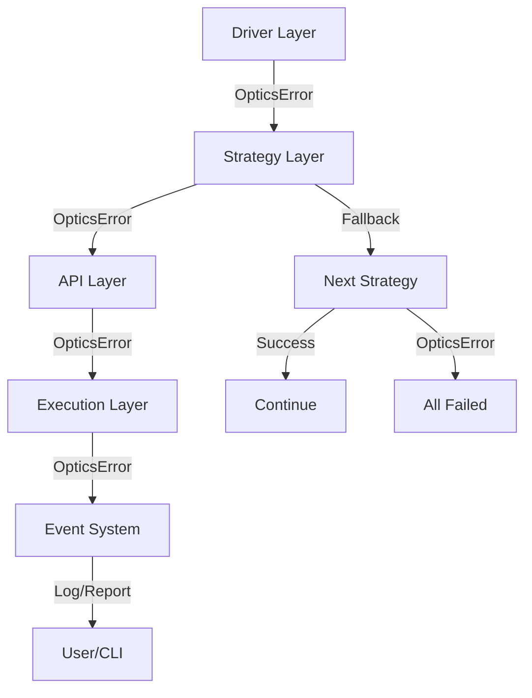

# Handle errors in Optics code

> How Optics names, raises, carries and reports errors, from a driver call up to the CLI and the HTTP API.

Optics uses one structured error type in all layers. Each error has a code, a category and an HTTP status. This page explains the design for contributors. For what each code means to a user and what to do about it, see [Error codes](https://optics-framework.org/docs/reference/errors).

## Overview

The error handling system has five parts:

1. **Error codes**: structured error identifiers with categories.
2. **OpticsError**: the exception class that carries the code and its metadata.
3. **Error registry**: the one place that defines every code.
4. **Error propagation**: how an error moves through the layers.
5. **Error recovery**: the fallback and retry mechanisms.

All of it is in [`optics_framework/common/error.py`](https://github.com/mozarkai/optics-framework/blob/main/optics_framework/common/error.py).

## Error code structure

**Location:** `optics_framework/common/error.py`

### Error code format

Each code has this format:

```text
[Severity][Category][Number]
```

### Severity prefixes

- **E**: Error (the default severity).
- **W**: Warning (not fatal).
- **X**: Exception (critical or not handled).

`ErrorSpec` does not store the severity. Optics reads it from the first character of the code.

### Categories

The two digits after the prefix give the category. Each one is a value of the `Category` enum.

| Digits | Category | `Category` value |
|---|---|---|
| **01** | Driver issues | `driver` |
| **02** | Element location issues | `element` |
| **03** | Screenshot issues | `screenshot` |
| **04** | Keyword execution issues | `keyword` |
| **05** | Config/File issues | `config` |
| **06** | Module/Factory issues | `module` |
| **07** | Test case issues | `test` |
| **08** | General issues | `general` |
| **09** | Live (interactive session) issues | `live` |

### Examples

```text
E0101 - The driver is not ready (Error, Driver category)
W0104 - The driver configuration is incomplete (Warning, Driver category)
X0201 - The element was not found with any of its locators (Exception, Element category)
E0402 - Keyword not found (Error, Keyword category)
```

## Error registry

The error registry (`ERROR_REGISTRY`) holds the specification of each code. The source is one tuple per code, `(code, category, status, default message, hint)`:

```python
_NOT_FOUND_HINT = "Make sure that the screen shows the element when this step starts, or correct its locator."

_SPECS = (
    (Code.E0101, Category.DRIVER, 500, "The driver is not ready",
     "Start a new session. If this error occurs again, examine the driver entry in config.yaml."),
    # ...
    (Code.E0201, Category.ELEMENT, 404, "The element is not on the screen", _NOT_FOUND_HINT),
    # ...
)

ERROR_REGISTRY: Dict[str, ErrorSpec] = {
    code: ErrorSpec(code=code, category=category, default_status=status, default_message=message, hint=hint)
    for code, category, status, message, hint in _SPECS
}
```

### ErrorSpec structure

`ErrorSpec` is a frozen pydantic model. Each specification has these fields:

- **code**: the `Code` enum value.
- **default_message**: the message when the caller gives none. It is one plain sentence without the code.
- **category**: the error category (`Category.DRIVER`, `Category.ELEMENT` and so on).
- **default_status**: the HTTP status code for API responses. The default is `500`.
- **hint**: the next step a person can take for this code, or `None`.
- **meta**: optional metadata.

## OpticsError exception

`OpticsError` is the primary exception type in the framework. Its constructor is:

```python
OpticsError(code: str | Code, message: str | None = None, details: Any = None, cause: BaseException | None = None, meta: dict | None = None, hint: str | None = None)
```

### Creating OpticsError

```python
from optics_framework.common.error import OpticsError, Code

# Using error code
raise OpticsError(Code.E0101, message="Custom message", details={"driver": "appium"})

# Using string code
raise OpticsError("E0101", message="Could not start the driver")

# With a cause and a hint for this case
raise OpticsError(
    Code.E0102,
    message="Could not connect to the driver",
    cause=original_exception,
    hint="Start the Appium server, then run again.",
)
```

For an element that is not on the screen, raise `ElementNotFound(locator, code=Code.E0201, cause=None, hint=None)`. It writes the message from the locator and from the element name in the project (see [Element not found](#element-not-found)).

The module also has two helpers. `from_code(code, message=None, details=None)` returns an `OpticsError`, and `raise_code(code, message=None, details=None)` raises one.

### OpticsError attributes

- **code**: the `Code` enum value. A string code becomes its `Code` member.
- **category**: the error category.
- **status_code**: the HTTP status code.
- **message**: what this layer says, as a plain sentence. It is the `default_message` of the code when you do not give one.
- **own_hint**: the `hint` that you gave to the constructor, or `None`.
- **details**: additional error context. It is `None` when you do not give it.
- **meta**: optional metadata. It is the `meta` of the spec when you do not give it.
- **cause**: the original exception, if there is one. `OpticsError` keeps it as `__cause__`, not as a `cause` attribute.

These properties are calculated from the chain of causes:

- **summary**: `message`, then the summary of the cause after `: `. It drops the cause when `message` already contains it, and it uses only the cause when the cause contains `message`. It has no codes. A subclass with `show_cause = False` (such as `ElementNotFound` and `FallbackExhausted`) shows only its own message.
- **hint**: the own hints in the chain, innermost first, joined. When no layer gave one, it is the registry hint of the innermost code that has one.
- **cause_text**: the root of the chain as one line, such as `ConnectionError: Connection refused`. It is `None` when there is no cause, when `show_cause` is false, or when the summary already says it.

`str(error)` is `<code>: <summary>`:

```python
>>> e = OpticsError(Code.E0102, message="Could not connect to the driver", cause=ConnectionError("Connection refused"))
>>> str(e)
'E0102: Could not connect to the driver: Connection refused'
>>> e.hint
"Make sure that the device and its driver server are on and that you can reach them. Run 'optics doctor' to examine the setup."
```

### Explain an error

The test runner, its result printers and JUnit report, and `optics serve` read a failure through the same functions:

- `plain(error)`: the summary of an `OpticsError`, or the first line of any other exception's message, cut at 300 characters. For an Apple NSError it uses the `NSLocalizedDescription` value, and it removes a leading `Message: `.
- `explain(error)`: an `Explanation` with `summary`, `hint`, `code` (the outermost Optics code) and `detail`. `detail` has one line for each layer of the chain that adds text, for the debug log:

```python
>>> w = OpticsError(Code.E0401, message="Could not open com.example.app", cause=e)
>>> str(w)
'E0401: Could not open com.example.app: Could not connect to the driver: Connection refused'
>>> explain(w).detail
('E0401: Could not open com.example.app', 'E0102: Could not connect to the driver', 'ConnectionError: Connection refused')
```

`TestRunner` writes `detail` to the execution log at debug level as `Failure detail for <keyword>: <line> <- <line>`.

### Write the message of a layer

A layer that wraps another error says only what it adds, and gives the error as `cause`. Do not put the cause in the message. The summary adds it, and the code then shows only once:

```python
# Good: 'E0401: Could not open com.example.app: Could not connect to the driver: Connection refused'
raise OpticsError(Code.E0401, message="Could not open com.example.app", cause=e)

# Bad: 'E0401: Launch failed: E0102: Could not connect to the driver: Connection refused'
raise OpticsError(Code.E0401, message=f"Launch failed: {e}", cause=e)
```

### Element not found

`ElementNotFound` (code `E0201` by default) writes its own message:

- `'<locator>' is not on the screen.` when the step gave the locator itself.
- `<name> is not on the screen. Looked for '<locator>'.` when a `${name}` parameter gave it. `element_label()` reads the name from `test_context.element_names`.
- The reason itself when an `OpticsError` in the cause chain gives a specific reason, such as an XPath that is not valid XPath 1.0 or a web element that another element covers. `Cannot find <name>: ` comes before it when a `${name}` parameter gave the locator, or when the reason does not name the locator.

`ElementNotFound.merge(errors)` joins plain misses of the same element into one sentence, such as `login_button is not on the screen. Looked for '//button[@id='login']' and 'Sign in'.` `undefined_element(name)` is the `E0201` error for a `${name}` that the project does not define: `${login_button} is not defined in the project's elements`, with the hint `Add login_button to an elements file, or correct the name.`

### Log an error

`OpticsError` can log itself:

```python
error = OpticsError(Code.E0101, message="Driver failed")
error.log()  # Prints a Rich panel
error.log(use_rich=False)  # Writes one line to internal_logger
```

`use_rich` is `None` by default. Then `log()` prints a Rich panel to the console, unless you give `logger`, `level` or `extra`. With one of these, or with `use_rich=False`, it writes one line to a logger. The default logger is `internal_logger`. See [Error logging](#error-logging) for the format.

## Error categories

The tables give the `default_message` and `default_status` of each code in `ERROR_REGISTRY`. [Error codes](https://optics-framework.org/docs/reference/errors) gives the hint of each code.

### Driver errors (01xx)

Driver-related errors:

| Code | Default message | Status |
|---|---|---|
| **E0101** | The driver is not ready | 500 |
| **E0102** | Could not start the session | 500 |
| **E0103** | Could not end the session | 500 |
| **E0104** | The driver configuration is incomplete | 400 |
| **E0105** | This keyword does not work on this platform | 400 |
| **E0106** | The driver session ended | 500 |
| **W0104** | The driver configuration is incomplete | 200 |

**Example:**

```python
if not self.driver:
    raise OpticsError(Code.E0101, message="Appium driver not initialized")
```

### Element errors (02xx)

Element location errors:

| Code | Default message | Status |
|---|---|---|
| **E0201** | The element is not on the screen | 404 |
| **X0201** | The element was not found with any of its locators | 500 |
| **E0202** | The element source cannot do this | 400 |
| **W0203** | The element has an unexpected format | 200 |
| **E0204** | Timed out while looking for the element | 504 |
| **E0205** | The element locator is not valid | 400 |
| **E0206** | Unknown popup on screen | 409 |

`E0206` means that a popup with no rule covers the screen. It is an `E02` code, so keyword fallback still tries the next value of a `${name}`. See [Handle popups](https://optics-framework.org/docs/advanced/popups).

**Example** (from `appium_find_element.py`):

```python
try:
    found_element = self._find_nth(driver, by, value, position)
except NoSuchElementException as e:
    raise ElementNotFound(element, cause=e) from e
```

### Screenshot errors (03xx)

Screenshot-related errors:

| Code | Default message | Status |
|---|---|---|
| **E0301** | Screenshots are off | 400 |
| **W0302** | Using the next camera driver | 200 |
| **E0303** | The screenshot is empty or black | 500 |
| **E0304** | The image is too large or is not a valid image | 422 |
| **E0305** | The camera does not see the device screen | 503 |

`E0305` means that the camera moved, the screen is out of view, or the screen is off.

**Example** (from `ScreenshotStrategy.capture` in `strategies.py`):

```python
if screenshot is not None and not utils.is_black_screen(screenshot):
    return screenshot
# ...
raise OpticsError(
    Code.E0303, message="The screenshot is black"
)
```

### Keyword errors (04xx)

Keyword execution errors:

| Code | Default message | Status |
|---|---|---|
| **E0401** | The action failed | 500 |
| **X0401** | The action failed | 500 |
| **E0402** | Keyword not found | 404 |
| **E0403** | The keyword parameters are not valid | 400 |
| **W0404** | This keyword is deprecated | 200 |
| **E0405** | Action ran, but the screen does not show its result | 500 |
| **E0406** | Expression or filter refused: unsafe or too costly | 400 |
| **E0407** | Popup keeps coming back | 409 |
| **E0408** | Popup stopped the step | 409 |
| **E0409** | Popup dismissed, the step looks for its element again | 409 |

No fallback retries an action that fails with `E0405`.

Optics refuses an expression or a filter with `E0406` when it uses something other than literals, names, indexing, arithmetic, comparisons, `and`/`or`/`not` and `if`/`else`, or when it costs too much. Conditions also allow `len`, `str`, `int`, `float` and `bool` calls.

`PopupGuard` (`optics_framework/common/popup_guard.py`) raises the popup codes:

- `E0407`: a rule matched more than its `max_per_step` or `max_per_run` times.
- `E0408`: the popup stayed after the rule's action, or the rule ended the step or the run (`sensitive`, action `none`, or `then` set to `fail_step` or `stop_run`).
- `E0409`: a rule dismissed the popup. `_popup_step` catches it and runs the step again, for actions and assertions, so it never leaves the keyword.

A rule whose `module` action names a module that the session does not have ends the step with `E0601`. Each error from the guard has `details={"stop_run": <bool>}`.

Keyword fallback does not go to the next value after `E0407` or `E0408`.

**Example** (from `keyword_register.py`):

```python
def keyword_not_found(name: str, slugs: Iterable[str]) -> OpticsError:
    return OpticsError(Code.E0402, message=f"'{name}' is not a keyword.{suggest_keyword(name, slugs)}")
```

The message is, for example, `'Pres Element' is not a keyword. Did you mean 'Press Element'?`. The registry hint adds `Run 'optics list' to see the keywords.`

### Config errors (05xx)

Configuration and file errors:

| Code | Default message | Status |
|---|---|---|
| **E0501** | A required setting or file is missing | 400 |
| **X0502** | Could not read a file | 500 |
| **E0503** | A setting has a value that is not valid | 400 |
| **W0503** | A setting has a value that is not valid; it is ignored | 200 |

**Example:**

```python
if not os.path.exists(config_path):
    raise OpticsError(
        Code.E0501,
        message=f"Configuration file not found: {config_path}",
        details={"path": config_path}
    )
```

### Module/Factory errors (06xx)

Module and factory errors:

| Code | Default message | Status |
|---|---|---|
| **E0601** | Module not found | 404 |
| **W0602** | No valid instance; it is ignored | 200 |
| **E0603** | Could not create an engine | 500 |
| **X0604** | Could not import a module | 500 |

**Example:**

```python
try:
    module = importlib.import_module(module_name)
except ImportError as e:
    raise OpticsError(
        Code.X0604,
        message=f"Failed to import module: {module_name}",
        cause=e
    )
```

### Test case errors (07xx)

Test case execution errors:

| Code | Default message | Status |
|---|---|---|
| **E0701** | The run failed | 500 |
| **E0702** | Test case not found | 404 |
| **E0703** | Could not resolve a parameter | 400 |
| **E0704** | The test case timed out | 504 |
| **W0705** | The test case was skipped | 200 |
| **E0706** | Run stopped before the test case finished | 500 |

Optics raises `E0706` when Ctrl-C or SIGTERM stops the run.

**Example:**

```python
if test_case_id not in session.test_cases:
    raise OpticsError(
        Code.E0702,
        message=f"Test case '{test_case_id}' not found",
        details={"session_id": session.session_id}
    )
```

### General errors (08xx)

General framework errors:

| Code | Default message | Status |
|---|---|---|
| **E0801** | Unexpected error | 500 |
| **E0802** | Unhandled error | 500 |

**Example:**

```python
except Exception as e:
    raise OpticsError(
        Code.E0802,
        message="Unhandled exception occurred",
        cause=e,
        details={"context": "keyword_execution"}
    )
```

### Live errors (09xx)

Errors from an `optics live` session:

| Code | Default message | Status |
|---|---|---|
| **E0901** | Named element not defined in this project | 404 |

Some codes are in the registry, but no current code raises them. [Reserved codes](https://optics-framework.org/docs/reference/errors#reserved-codes) lists them.

## Error propagation flow

Errors move up through the framework layers:

`How an OpticsError moves from a driver to the user`:



### Propagation rules

1. **Driver layer**: raises `OpticsError` for driver-specific issues.
2. **Strategy layer**: catches errors and tries the fallback strategies.
3. **API layer**: wraps errors with context and sends them to the execution layer.
4. **Execution layer**: handles errors, publishes events, and then continues or stops.
5. **Event system**: logs errors and publishes error events.

### Error context preservation

Errors keep their context as they move up:

```python
try:
    element = strategy.locate(element_id)
except OpticsError as e:
    # Add context
    raise OpticsError(
        e.code,
        message=f"{strategy.__class__.__name__} could not look for it",
        details={**(e.details or {}), "strategy": strategy.__class__.__name__},
        cause=e
    )
```

The summary is then `<strategy> could not look for it: <summary of e>`. `details` is `None` when the first error has no details. A line such as `details={**e.details, "strategy": strategy.__class__.__name__},` then fails with `TypeError`. Use `e.details or {}` before you unpack it.

## Error recovery mechanisms

### 1. Strategy fallback

When a strategy fails to locate an element, `StrategyManager.locate` tries the next strategy. It continues after any exception, not only after `E0201`. Two errors change this:

- A dead session (`E0106`, or a driver error that shows the session is gone) stops the loop at once. `raise_if_session_dead` in `session_liveness.py` raises it.
- `E0305` (the camera does not see the screen) is kept. When no strategy finds the element, Optics raises the `E0305` error, because no other strategy can see the screen either.

When no strategy finds the element, `locate` raises an `ElementNotFound` (`E0201`). Its cause is a note that the XPath is not valid XPath 1.0, when that is true, or else the last error. When OCR has no engine and a native lookup also ran, the OCR error is not kept, and the hint says that OCR was off.

This is the shape of the loop:

```python
for strategy in strategies:
    try:
        result = strategy.locate(element)
        return result
    except Exception as e:
        raise_if_session_dead(e)
        last_error = e
        blind = e if _is_blind(e) else blind
        continue  # Try next strategy
raise blind or _not_found(element, effective_element, text_only, last_error, hint)
```

Earlier versions of these docs showed this loop continuing only on `if e.code == Code.E0201:  # Element not found` and had `raise  # Re-raise other errors` for all other errors. Current code does not do that.

### 2. Driver fallback

When you configure more than one driver, `InstanceFallback` (in `base_factory.py`) calls each instance in turn. It moves to the next instance after any exception, not only after driver errors. It logs each failure with `internal_logger.error`. When all instances fail, it raises the last exception.

```python
for driver in driver_fallback.instances:
    try:
        driver.press_element(element, repeat)
        return
    except Exception as e:
        last_exception = e
        continue  # Try next driver
raise last_exception
```

Earlier versions of these docs showed it continuing only on `if e.code in [Code.E0101, Code.E0102]:  # Driver errors`. Current code does not filter on the code. Their call `driver.press_element(element)` also left out `repeat`, which the driver method requires.

### 3. Retry logic

Optics has no general retry helper. Some operations have their own retry loop:

- `EventSDK.send_all_events()` tries 3 times, with a delay of 2 and then 4 seconds. See [Events](https://optics-framework.org/docs/contribute/events#response-handling).
- `capture_base64_screenshot_bytes` in `utils.py` tries a screenshot 2 times, with a 0.5 second delay.

If you add a retry to an operation, use this pattern:

```python
max_retries = 3
for attempt in range(max_retries):
    try:
        return operation()
    except OpticsError as e:
        if attempt < max_retries - 1:
            time.sleep(2 ** attempt)  # Exponential backoff
            continue
        raise
```

### 4. Graceful degradation

Some errors are warnings that let execution continue. This pattern catches a warning code and uses a fallback source:

```python
try:
    screenshot = element_source.capture()
except OpticsError as e:
    if e.code == Code.W0302:  # Warning
        # Try fallback screenshot source
        screenshot = fallback_source.capture()
    else:
        raise
```

**Note:**
`W0302` is in the registry, but no current code raises it. The pattern shows how to handle a warning code. It does not describe a current code path.

### 5. Keyword fallback

When a step gives more than one value for a parameter, `optics_framework/common/fallback.py` runs the keyword once for each combination of values. It tries at most 20 combinations (`MAX_ATTEMPTS`). It moves to the next combination only for element-not-found errors: an `E02` code or `X0201` (`advances()`). Any other error stops the keyword at once. `E0206` (unknown popup) is an `E02` code, so it moves to the next combination too. `E0407` and `E0408` stop the keyword.

When every combination fails, Optics raises `FallbackExhausted`, an `OpticsError` with the code of the last failure. Its message is one of these:

- After one try, the summary of that failure.
- When there were at most five tries (`KEPT_FAILURES`) and each failure is a plain `ElementNotFound`, one sentence for all the values, such as `None of 'btn1', 'btn2' and 'btn3' is on the screen.`
- Else `All <n> tries of <subject> failed:`, then one line for each of the last five failures (`KEPT_FAILURES`). Each line gives only the values that change from one combination to the next.

When there are more than 20 combinations, the message adds ` (tried 20 of <total> combinations)`. See [Components](https://optics-framework.org/docs/contribute/components#error-aggregation) for examples.

## Error handling in API layer

The REST API (`optics_framework/common/expose_api.py`) changes an `OpticsError` into a FastAPI `HTTPException`. The status comes from the code, and the payload goes in `detail`:

```python
from fastapi import HTTPException
from optics_framework.common.error import OpticsError

try:
    result = execute_keyword(keyword, params)
except OpticsError as e:
    raise HTTPException(
        status_code=e.status_code,
        detail=e.to_payload(include_status=True)
    ) from e
```

`to_payload(include_status=False, meta=None)` returns a plain dict. It includes `status` only when `include_status` is true.

### API error response format

FastAPI puts the payload under `detail`:

```json
{
  "detail": {
    "type": "optics:element",
    "code": "E0201",
    "status": 404,
    "message": "None of 'btn1', 'btn2' and 'btn3' is on the screen.",
    "hint": "Make sure that the screen shows the element when this step starts, or correct its locator.",
    "details": null,
    "meta": null,
    "cause": null
  }
}
```

`type` is `optics:<category>`. `message` is the `summary` of the error, without the code. `hint` is the `hint` property, or `null`. `cause` is the `cause_text` of the error, or `null`. For every status the API can return, see [HTTP API errors](https://optics-framework.org/docs/reference/http-api#errors).

## Error handling best practices

### 1. Use appropriate error codes

Use a code from the category of the error:

```python
# Good
raise ElementNotFound(element)

# Bad - wrong category
raise OpticsError(Code.E0101, message=f"'{element}' is not on the screen.")  # Should be E0201
```

The code also controls recovery. Keyword fallback moves to the next value only for `E02` codes and `X0201`.

### 2. Include context in details

Give information that helps to find the cause:

```python
raise OpticsError(
    Code.E0201,
    message=f"'{element_id}' is not on the screen.",
    details={
        "element": element_id,
        "strategies_tried": ["xpath", "ocr"],
        "screenshot_path": "/path/to/screenshot.png"
    }
)
```

### 3. Preserve original exceptions

Use the `cause` parameter to keep the exception chain:

```python
try:
    driver.connect()
except ConnectionError as e:
    raise OpticsError(
        Code.E0102,
        message="Could not connect to the driver",
        cause=e
    )
```

Do not copy the text of `e` into `message`. See [Write the message of a layer](#write-the-message-of-a-layer).

### 4. Use warnings for non-critical issues

Use a warning code for an issue that does not stop execution:

```python
if config.get("optional_setting") is None:
    raise OpticsError(
        Code.W0503,
        message="Optional setting not configured, using default"
    )
```

A raised warning is still an exception. A caller must catch it to continue.

### 5. Handle errors at appropriate levels

Handle an error where recovery is possible:

```python
# Strategy level - try fallback
try:
    return xpath_strategy.locate(element)
except OpticsError:
    return ocr_strategy.locate(element)  # Fallback

# Execution level - stop execution
try:
    execute_test_case(test_case)
except OpticsError as e:
    publish_error_event(e)
    raise  # Stop execution
```

## Error logging

### Structured logging

`OpticsError.log(logger=None, level=None, extra=None, use_rich=None)` connects to the logging system:

```python
error = OpticsError(Code.E0101, message="Driver failed")
error.log()  # Prints a Rich panel
error.log(level=logging.WARNING)  # Custom log level
error.log(extra={"session_id": session_id})  # Additional context
```

When `use_rich` is `None`, `log()` writes to a logger if you give `logger`, `level` or `extra`, and prints the panel if you give none of them. `use_rich=True` or `use_rich=False` forces one of the two.

When it writes to a logger:

- The default level is `logging.ERROR` for an `E` or `X` code and `logging.WARNING` for a `W` code.
- The line is `[<code>] <summary>`, such as `[E0102] Could not start the Appium session: Connection refused`.
- The record `extra` holds `code`, `category`, `status`, `details` and `meta`, plus the keys you give in `extra`.

### Error log format

The panel has the code as its title. The border is red for an `E` or `X` code and yellow for a `W` code. The body is the summary in bold, then the hint, then `details` in dim text when there are details:

```text
╭─ E0102 ──────────────────────────────────────────────────────────────────────╮
│ Could not start the Appium session: Connection refused                       │
│ Make sure that the device and its driver server are on and that you can      │
│ reach them. Run 'optics doctor' to examine the setup.                        │
╰──────────────────────────────────────────────────────────────────────────────╯
```

## Debugging errors

### 1. Enable debug logging

The Optics loggers are `optics.internal` and `optics.execution`. Set `log_level: DEBUG` in `config.yaml`, or set the level in code:

```python
from optics_framework.common.logging_config import LoggingConfig, reconfigure_logging

reconfigure_logging(LoggingConfig(log_level="DEBUG"))
```

`reconfigure_logging` sets the level on both loggers and their console handlers. This snippet from earlier versions of these docs has no effect, because no Optics logger is named `optics_framework`:

```python
import logging
logging.getLogger("optics_framework").setLevel(logging.DEBUG)
```

See [Logging](https://optics-framework.org/docs/contribute/logging).

### 2. Check error details

```python
try:
    operation()
except OpticsError as e:
    print(f"Code: {e.code}")
    print(f"Category: {e.category}")
    print(f"Details: {e.details}")
    print(f"Cause: {e.__cause__}")
```

### 3. Error code lookup

Read the specification of a code from the error registry:

```python
from optics_framework.common.error import ERROR_REGISTRY

spec = ERROR_REGISTRY.get("E0101")
print(f"Message: {spec.default_message}")
print(f"Category: {spec.category}")
print(f"Status: {spec.default_status}")
print(f"Hint: {spec.hint}")
```

## Extending error handling

### Registering custom error codes

`Code` is a closed enum, and `ErrorSpec.code` has the type `Code`. Thus `Code("E0950")` raises `ValueError`, and so does `OpticsError("E0950")`. `register_error(spec)` can only replace the spec of a code that already exists.

To add a new code:

1. Add a member to `Code` in `optics_framework/common/error.py`.
2. Add its `(code, category, status, message, hint)` tuple to `_SPECS`. Write the message as one plain sentence, and the hint as the next step a person can take, or `None`.
3. Add the code to [Error codes](https://optics-framework.org/docs/reference/errors).

To change the default message or status of an existing code at runtime, use `register_error`:

```python
from optics_framework.common.error import ErrorSpec, Category, Code, register_error

spec = ErrorSpec(
    code=Code.E0801,
    default_message="Custom error",
    category=Category.GENERAL,
    default_status=500
)
register_error(spec)
```

Do not use `custom_code = Code("E0901")  # Custom code` as earlier versions of these docs did. `E0901` is now a real code ("Named element not defined in this project"), and the call replaces its spec.

### Custom error classes

```python
class CustomOpticsError(OpticsError):
    def __init__(self, custom_field, **kwargs):
        super().__init__(**kwargs)
        self.custom_field = custom_field
```

Give the code as a keyword argument, for example `CustomOpticsError("value", code=Code.E0401)`. `ElementNotFound` (`error.py`), `FallbackExhausted` (`fallback.py`) and `StepFailed` (`api/flow_control.py`) are subclasses of this kind. Each sets `show_cause = False` and writes a message that already says what its cause adds.

## Related documentation

- [Components](https://optics-framework.org/docs/contribute/components): component error handling.
- [Strategies](https://optics-framework.org/docs/contribute/strategies): strategy fallback mechanisms.
- [Execution](https://optics-framework.org/docs/contribute/execution): execution error handling.
- [API layer](https://optics-framework.org/docs/contribute/api-layer): API error handling.
- [Logging](https://optics-framework.org/docs/contribute/logging): error logging patterns.
- [Architecture decisions](https://optics-framework.org/docs/contribute/decisions): error handling design decisions.
- [HTTP API](https://optics-framework.org/docs/reference/http-api#errors): REST API error responses.
- [Python SDK](https://optics-framework.org/docs/create/python): the Python API.
- [Error codes](https://optics-framework.org/docs/reference/errors): what each code means to a user and what to do.
