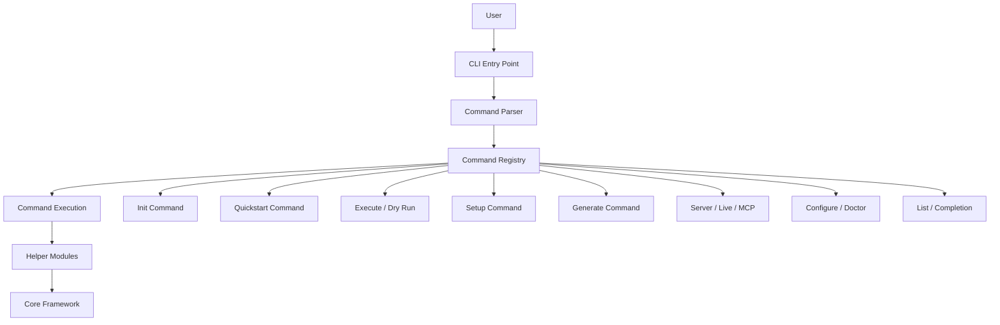
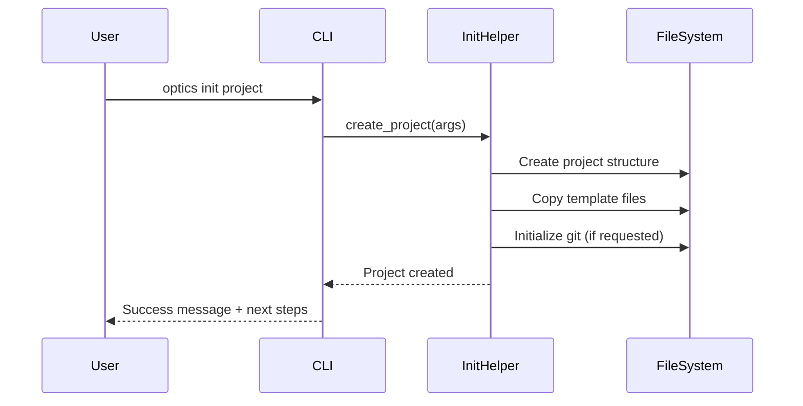
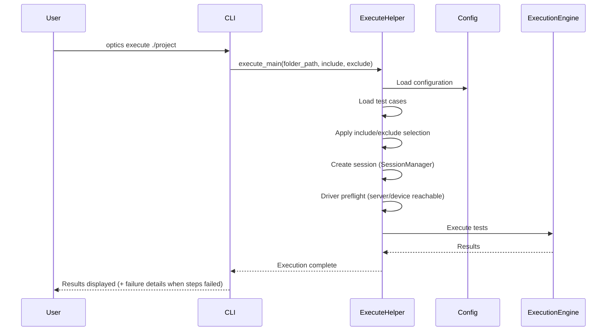
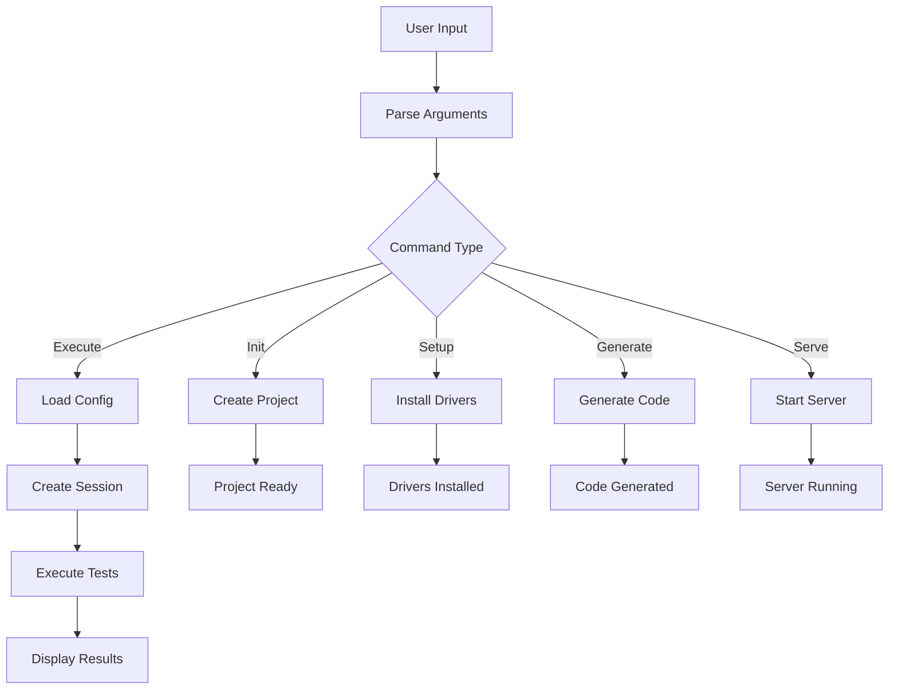

The `optics` command lets people use Optics without writing code. This page explains how the CLI is built: the command structure, the helper modules behind each command, and how commands reach the core framework. For every flag and example from a user's point of view, see the [CLI reference](/docs/reference/cli).

## Overview

The CLI layer covers eight jobs:

1. **Onboarding**: `optics quickstart`, `optics doctor` and `optics configure` take a new user from a fresh install to a runnable project and a healthy setup.
2. **Project management**: `optics init` scaffolds a project from a template.
3. **Test execution**: `optics execute` and `optics dry_run` run and validate test cases.
4. **Engine setup**: `optics setup` installs driver, OCR and LLM backends by name.
5. **Code generation**: `optics generate` writes pytest or Robot Framework code.
6. **Interactive and agent surfaces**: `optics live` for interactive sessions and `optics mcp` for AI-agent control.
7. **API server**: `optics serve` starts the REST API.
8. **Listing and completion**: `optics list` prints keywords; `optics completion` installs shell completions.

## CLI architecture



**Location:** `optics_framework/helper/cli.py`

`main()` builds an `argparse` parser with `prog="optics"`, adds `--version`, and registers each command on one set of subparsers. Run with no command and no arguments, `optics` prints the welcome banner on a first run and a one-line hint after that.

## Command structure

Each command is a subclass of `Command` in `cli.py`. A command is a self-contained unit that:

- Registers itself with the argument parser (`register(subparsers)`)
- Defines its arguments and options
- Executes its work when invoked (`execute(args)`)
- Hands the work to a helper module and the core framework

All commands follow the same pattern: registration, argument parsing, validation, and execution. Most commands copy the parsed arguments into a Pydantic model (`InitArgs`, `ExecuteArgs`, `DryRunArgs`, `GenerateArgs`, `ServerArgs`, `MCPArgs`, `LiveArgs`) before they call the helper, so the values are validated in one place.

## Available commands

### Init command

**Command:** `optics init`

**Purpose:** Initialize a new test project.

**Usage:**

```bash
optics init my_project --path ./tests --template contact --git-init
```

**Arguments:**

- `name` (positional, required unless interactive): Project name (`--name` still works but is deprecated). With no name on an interactive terminal, the command asks for one.
- `--path` (optional): Directory where the project will be created.
- `--template` (optional): Project template to use. If you leave it out on an interactive terminal, a picker is offered. Without a terminal, a blank project is created.
- `--force` (flag): Override if the project exists.
- `--git-init` (flag): Initialize a git repository.

The templates are the folders in `optics_framework/samples/`. `available_templates()` in `optics_framework/helper/initialize.py` reads them, so the `--template` help text and the shell completions always match the packaged samples.

**Flow:**



Without a template, `create_project` writes a starter project instead of copying one: `test_cases/test_cases.csv`, `modules/modules.csv`, `test_data/elements.csv` and a commented `config.yaml`.

### Execute command

**Command:** `optics execute`

**Purpose:** Execute test cases from a project.

**Usage:**

```bash
optics execute ./my_project --runner test_runner --output tree
```

**Arguments:**

- `folder_path` (required): Path to the project folder.
- `--runner` (optional): Test runner to use (default: `test_runner`).
- `--output` (optional): `auto` (default) is the live tree on a terminal and plain lines otherwise; `tree`, `plain`, `jsonl` or `none` pick one. Plain and JSONL send logs to stderr. `--use-printer` is `--output tree` and `--no-use-printer` is `--output none`.
- `--include` / `--exclude` (optional): Select test cases by name (case-insensitive, `*`/`?` wildcards). Either flag replaces the `include`/`exclude` lists from `config.yaml` for the run. Matching lives in `optics_framework/helper/case_selection.py`, and unknown names abort with exit code 3 before a session is created.

**Flow:**



The execute helper finds the project's `config.yaml` by its content, reads it with `load_project_yaml` and `resolve_config_file`, and builds a `Config`. The session then wraps that `Config` in a `ConfigHandler`.

The preflight aborts with a non-zero exit and fix instructions when the enabled driver's backend is unreachable (Appium server / Android device, Selenium remote URL). It checks the first enabled driver only. Playwright needs no check, and an iOS project gets the server check only. `OPTICS_SKIP_PREFLIGHT=1` bypasses it (`true` also works). When the preflight fails, every queued test case is reported as an error in the JUnit report.

### Dry run command

**Command:** `optics dry_run` (alias `optics dry-run`)

**Purpose:** Validate test cases without executing actions.

**Usage:**

```bash
optics dry_run ./my_project --runner test_runner
```

**Arguments:**

- `folder_path` (required): Path to the project folder.
- `--runner` (optional): Test runner to use.
- `--output` (optional): Same choices as `optics execute`.
- `--include` / `--exclude` (optional): Same test case selection as `optics execute`.

**Behavior:** Similar to `ExecuteCommand`, but it validates test cases without performing actual actions. Use it for syntax checking and validation. It checks the keywords, their parameters and the names they use. It does not check locators, the app or the device, and it never runs the driver preflight.

### Setup command

**Command:** `optics setup`

**Purpose:** Install and configure engines: action drivers, OCR engines, LLM engines and the MCP server.

**Usage:**

```bash
optics setup --install appium easyocr
optics setup --list
```

**Arguments:**

- `--install` (list): Engines to install. A name can carry a version pin, such as `appium==6.1.2`. A bundle name installs several engines at once.
- `--list` (flag): List available engines and bundles.

**Modes:**

- **Interactive mode**: With no flag, it launches a TUI (Text User Interface) for engine selection (quit with `q`, `Ctrl+C`/`Ctrl+Q`, or the Quit button).
- **List mode**: Displays all available engines.
- **Install mode**: Installs the named engines through the package manager, as `optics-framework` extras.

**Available engines:** each one is an extra of the `optics-framework` package, defined in `optics_framework/helper/setup.py`.

| Category | Engines (extra name) |
|---|---|
| Action driver | Appium (`appium`), BLE (`ble`, alias `bluetooth`), Selenium (`selenium`), Playwright (`playwright`) |
| OCR engine | Apple Vision (`apple-vision`, macOS only), RapidOCR (`rapidocr`), EasyOCR (`easyocr`), Pytesseract (`pytesseract`), Google Vision (`google-vision`) |
| LLM engine | Gemini (`gemini`), OpenAI (`openai`), Anthropic (`anthropic`) |
| Server | MCP server (`mcp`) |
| Bundles | `mobile`, `web`, `vision`, `llm`, `all` |

TemplateMatch, RemoteOIR and RemoteOCR are not in this list. They ship with the base package, so they need no install.

### Generate command

**Command:** `optics generate`

**Purpose:** Generate test framework code from a project.

**Usage:**

```bash
optics generate ./my_project --framework pytest --output test_generated.py
```

**Arguments:**

- `project_path` (required): Path to the project.
- `--framework` (optional): Framework to use (`pytest` or `robot`; default `pytest`).
- `--output` (optional): File name of the generated test. Default `test_generated.py`, or `test_generated.robot` for Robot Framework.

**Behavior:** Reads test cases, modules, elements and configuration from the project and generates executable test code in the specified framework format. It writes the file to `<project_path>/generated/Tests/`, writes a `requirements.txt` to `<project_path>/generated/`, and copies the project's `input_templates` folder if it has one.

### Server command

**Command:** `optics serve`

**Purpose:** Start the REST API server.

**Usage:**

```bash
optics serve --host 0.0.0.0 --port 8000 --workers 1
```

**Arguments:**

- `--host` (optional): Host to bind (default: 127.0.0.1)
- `--port` (optional): Port to bind (default: 8000)
- `--workers` (optional): Number of worker processes (default: 1)

**Behavior:** Starts a FastAPI server that exposes the framework through REST API endpoints. On a host other than loopback, it logs a warning that the server has no authentication. See the [REST API layer](/docs/contribute/api-layer).

### List command

**Command:** `optics list`

**Purpose:** List all available keywords, or show one keyword's parameters.

**Usage:**

```bash
optics list
optics list Assert Presence
```

**Behavior:** Scans the framework API package (`discover_keywords()` in `optics_framework/common/expose_api.py`). Without an argument, it prints every keyword that a test case can use, except deprecated ones. With a keyword name, it prints that keyword's parameters in CSV column order (`param_1`, `param_2`, ...) with their defaults, and its description. An unknown name exits with a "did you mean" hint.

### Configure command

**Command:** `optics configure [folder] [--edit]`

**Purpose:** Write or edit a project's `config.yaml` (configuration is project-specific; there is no global config).

**Usage:**

```bash
optics configure myproject          # guided Q&A → rendered config.yaml
optics configure myproject --edit   # full-field Textual editor
```

**Behavior:** The default path first confirms overwrite when a `config.yaml` already exists (declining aborts before any question is asked). Then it walks the user through platform questions and writes the rendered, commented `config.yaml`. `--edit` launches the interactive configuration manager over every config field of that project. Without a folder, both paths use the current directory.

:::note[Deprecated alias]
`optics config` prints a deprecation notice and forwards to the guided questions for the current directory.
:::

### Doctor command

**Command:** `optics doctor [folder] [--check]`

**Purpose:** Diagnose the environment (Python, engines, adb/Appium, the desktop driver, browsers) and, when a folder is given, validate that project's `config.yaml`.

**Usage:**

```bash
optics doctor                     # environment only
optics doctor myproject           # environment + project config
optics doctor myproject --check   # exit non-zero if a project check fails (CI)
```

**Behavior:** Prints a ✅/⚠️/❌ table with a fix command for each row. Environment gaps are warnings; project-config problems are failures. Run without a project folder, it adds a ⚠️ row pointing you to `optics quickstart` instead of staying silent about the missing config. When the enabled driver's own requirements are unmet (for example, Appium server unreachable or no device attached), the closing line lists exactly those blockers instead of the all-clear reassurance. It parses `config.yaml` with `load_project_yaml`, a safe YAML loader, and never builds a `ConfigHandler`, whose constructor creates `execution_output/`. So it never mutates the project it inspects. `--check` exits non-zero when any project-config row fails.

### Quickstart command

**Command:** `optics quickstart`

**Purpose:** Guided, end-to-end walkthrough for a first project.

**Usage:**

```bash
optics quickstart
```

**Behavior:** Prints the welcome banner, asks what you want to automate, offers to install the matching engine, scaffolds a project, generates a platform-correct `config.yaml` from a short Q&A, runs `doctor` to verify, and prints the next steps. When `doctor` finds nothing blocking, it asks "Run your first test now?" and runs the project only if you say yes.

### Completion command

**Command:** `optics completion`

**Purpose:** Enable shell autocompletion.

**Usage:**

```bash
optics completion
```

**Behavior:** Generates the completion scripts under `~/.optics/` (`optics_completion.sh` and `optics_completion.zsh`), then asks for confirmation before appending the `source` line to the shell RC file (`.bashrc`, `.zshrc`). On decline, or without an interactive terminal, it prints the line to add manually and leaves RC files untouched.

### Live command

**Command:** `optics live [folder]`

**Purpose:** Open an interactive terminal session to run keywords against a live target, with recording always on.

**Usage:**

```bash
optics live                # uses the config.yaml in the current directory
optics live my_project     # uses that project's config.yaml
```

**Behavior:** Driver-agnostic and config-driven: the single enabled driver in `config.yaml` is the target. Each successful keyword is buffered. `/save <test_case> <module_name>` appends the recording to `modules/modules.csv` and `test_cases/test_cases.csv`, and merges new elements into the project's elements CSV. With no elements CSV in the project, it creates `elements/elements.csv`. `Ctrl-N` toggles a natural-language mode where an LLM drives the keywords from a plain-English goal (needs an enabled `llm_models` entry and its extra: `gemini`, `openai` or `anthropic`). See [Record a test](/docs/create/record) and the [`optics live` reference](/docs/reference/cli#optics-live).

### MCP command

**Command:** `optics mcp [install] [--transport stdio|http] [--toolset core|full]`

**Purpose:** Run an MCP server that exposes the keywords as typed tools and device state as resources, so an AI client can drive a real target.

**Usage:**

```bash
optics mcp                                  # stdio transport (default; local clients like Claude Desktop)
optics mcp --transport http --port 8090     # networked
optics mcp install                          # register the stdio server with Claude Code
```

**Behavior:** A thin in-process wrapper over the REST engine: it reuses the keyword machinery, not a reimplementation. `start_session` -> observe (`observe`, `screenshot`, `optics://session/{id}/source`) -> act (`tap`, `type_text`, `press_key`, `batch`, or `run_keyword` for any other keyword) -> `terminate_session`. The default `core` toolset keeps the tool list short; `--toolset full` (or `OPTICS_MCP_TOOLSET=full`) also adds one tool per keyword, such as `press_element` and `enter_text`. `--host` and `--port` (default `127.0.0.1:8090`) apply to the `http` transport only. Sessions are **not** shared with `optics serve`; each is its own process. Requires the optional `mcp` extra (`pip install "optics-framework[mcp]"`). See the [MCP reference](/docs/reference/mcp).

## Helper modules

The CLI layer hands complex operations to helper modules in `optics_framework/helper/`. Each one holds one area of work.

### Execute helper

**Location:** `optics_framework/helper/execute.py`

**Responsibilities:**

- Loads configuration and test cases from the project
- Creates and manages test sessions
- Executes tests through `ExecutionEngine`
- Manages live result printing and output formatting
- Runs the driver preflight before `optics execute`

### Initialize helper

**Location:** `optics_framework/helper/initialize.py`

**Responsibilities:**

- Creates the project directory structure
- Copies template files and configurations
- Initializes a git repository (optional)
- Sets up initial configuration files

### Generate helper

**Location:** `optics_framework/helper/generate.py`

**Responsibilities:**

- Reads test cases, modules and elements from the project
- Converts the project structure to the target framework format (pytest/Robot Framework)
- Generates executable test code
- Writes the generated code to the output file

### Setup helper

**Location:** `optics_framework/helper/setup.py`

**Responsibilities:**

- Lists available engines, their packages and the bundles
- Installs engine packages through the package manager
- Provides the interactive TUI for engine selection
- Validates engine names and version pins before it installs anything

### Config manager

**Location:** `optics_framework/helper/config_manager.py`, with the guided questions and the rendered template in `optics_framework/helper/project_config.py`

**Responsibilities:**

- Interactive configuration file editor (`ProjectConfigTUI`)
- Configuration validation and error checking
- Configuration file management (create, read, update)
- Configuration template generation

### Serve helper

**Location:** `optics_framework/helper/serve.py`

**Responsibilities:**

- Configures and starts the Uvicorn server with `run_uvicorn_server(host, port, workers)`
- Serves the FastAPI application `optics_framework.common.expose_api:app`, which holds the routes
- Runs the server until it stops; there is no restart logic
- Handles server configuration and logging: Uvicorn logs use the Optics console format

## Error handling

`main()` catches errors from every command and maps them to exit codes:

**Exit codes:**

| Code | Meaning |
|---|---|
| `0` | Success |
| `1` | A test failed, the run could not start, or an unexpected error |
| `2` | Argument error |
| `3` | Invalid test selection (`execute`, `dry_run`) or another value error |
| `130` | User cancellation (Ctrl+C) |
| `143` | Stopped with SIGTERM (`execute` and `dry_run` still write the JUnit report) |

See [Exit codes](/docs/reference/cli#exit-codes) for what `optics execute` reports in each case.

An unexpected error prints its type and message, then suggests `optics doctor` and `optics <command> --help`. A missing optional extra prints the install command instead of a traceback. Every message passes through `mask_secrets` before it is printed.

Error handling covers:

- User input validation
- Configuration errors
- Execution failures
- Resource errors
- User interruptions

## Integration with core framework

### Session creation

CLI commands that execute tests create sessions through the `SessionManager`. The session holds all test execution state, including configuration, test cases and component instances.

### Execution

Test execution commands use the `ExecutionEngine` to run tests. The engine handles test case parsing, keyword execution, result collection and event publishing. See [Execution](/docs/contribute/execution).

### Configuration loading

Commands load configuration from the project's own `config.yaml` into a `Config`, which the session wraps in a `ConfigHandler`. There is no global config layer: each project directory is self-contained. See the [config.yaml reference](/docs/reference/config).

## Command execution flow



## Best practices

### Command design

- Use command names that say what the command does
- Give clear help text and documentation
- Validate arguments early in the execution flow
- Use structured models for argument validation

### Error messages

- Give clear error messages that tell the user what to do
- Include suggestions for fixing common errors
- Use the correct exit code for each error type
- Log detailed errors for debugging, and show short messages to the user

### User experience

- Show progress for long operations
- Use the same output format across commands
- Support both interactive and non-interactive modes
- Suggest a next step when a command fails

### Integration

- Reuse core framework components instead of duplicating logic
- Hand complex operations to helper modules
- Keep a clear separation between the CLI layer and the core framework
- Use helper modules for operations that need more than one framework component

## Extending the CLI

To add a new command:

1. **Create a command class**: Subclass `Command` in `optics_framework/helper/cli.py`, register its arguments in `register()` and implement `execute()`.
2. **Register the command**: Add an instance to the `commands` list in `main()`.
3. **Create a helper module** (if needed): For complex operations, create a module in `optics_framework/helper/` that holds the work.

New commands do not change existing ones. Also add the command to the shell completion scripts in `optics_framework/helper/autocompletion.py`. See [Extend Optics](/docs/contribute/extending).

## Troubleshooting

### Command not found

**Problem:** The command is not recognized.

**Solutions:**

1. Make sure the command is registered in the CLI entry point.
2. Check the spelling of the command name.
3. Make sure the CLI installation is complete.

### Argument errors

**Problem:** Invalid arguments.

**Solutions:**

1. Check the argument names and types.
2. Read the command help: `optics <command> --help`.
3. Make sure you give the required arguments.

### Execution failures

**Problem:** The command fails.

**Solutions:**

1. Read the error message for details.
2. Make sure the configuration is correct.
3. Make sure the dependencies are installed.
4. Read the logs for more information.

## Related pages

- [REST API layer](/docs/contribute/api-layer): REST API server architecture
- [Python library layer](/docs/contribute/library-layer): Python library interface
- [Execution](/docs/contribute/execution): test execution architecture
- [config.yaml reference](/docs/reference/config): configuration
- [CLI reference](/docs/reference/cli): CLI usage and examples
