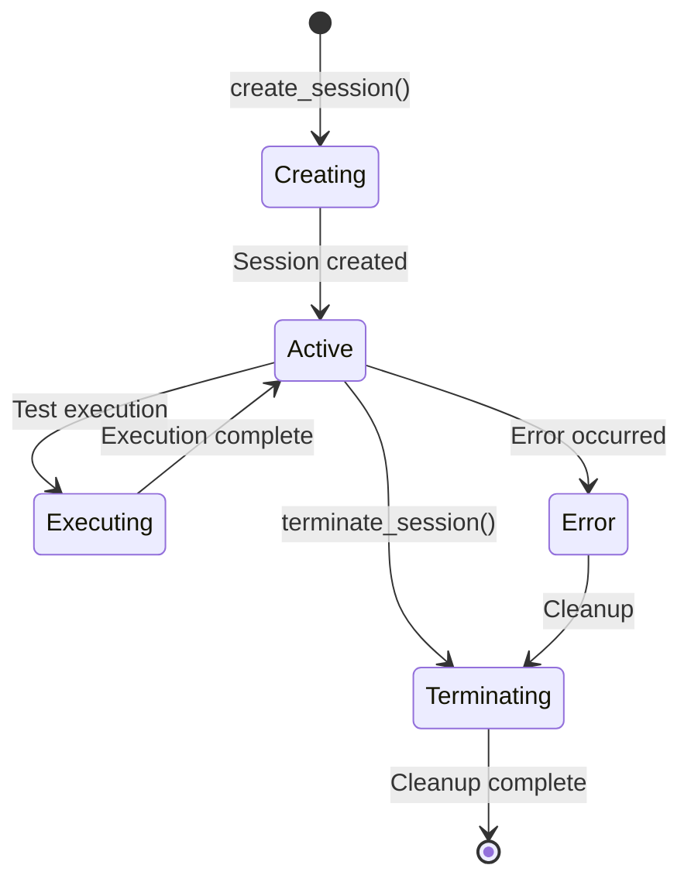
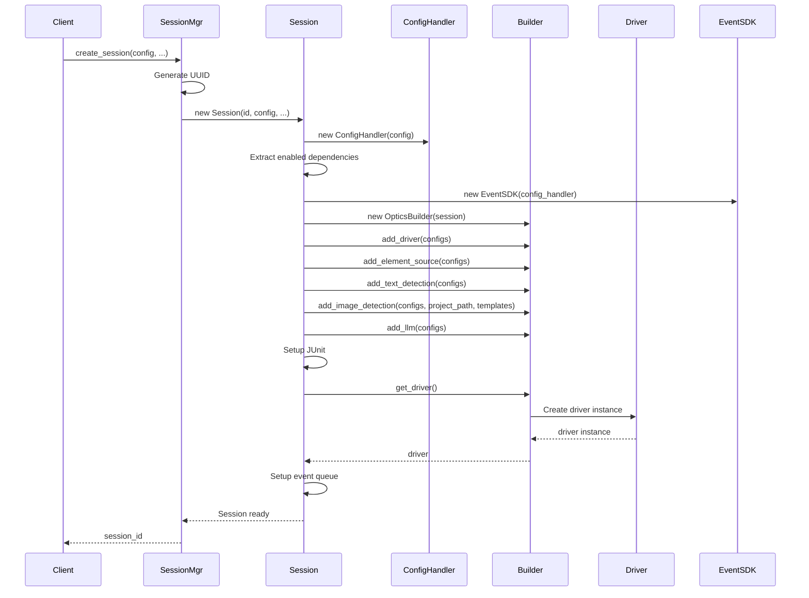
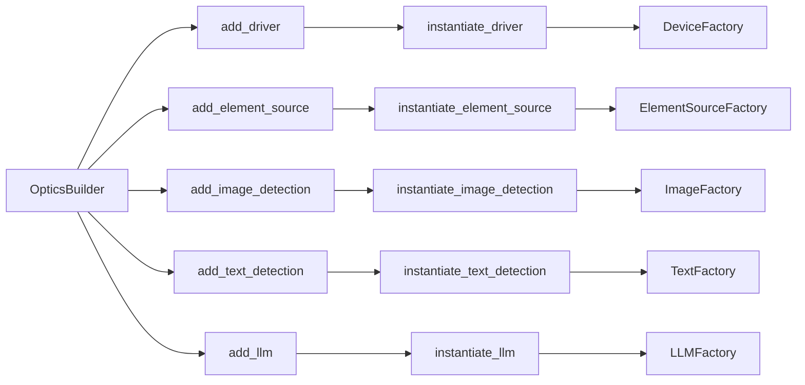
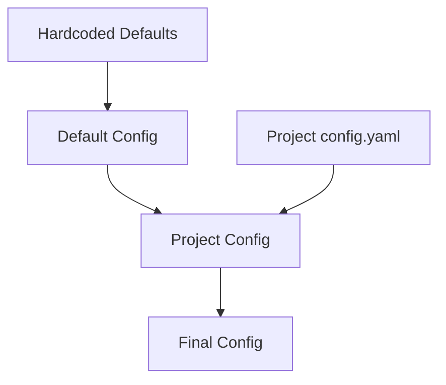
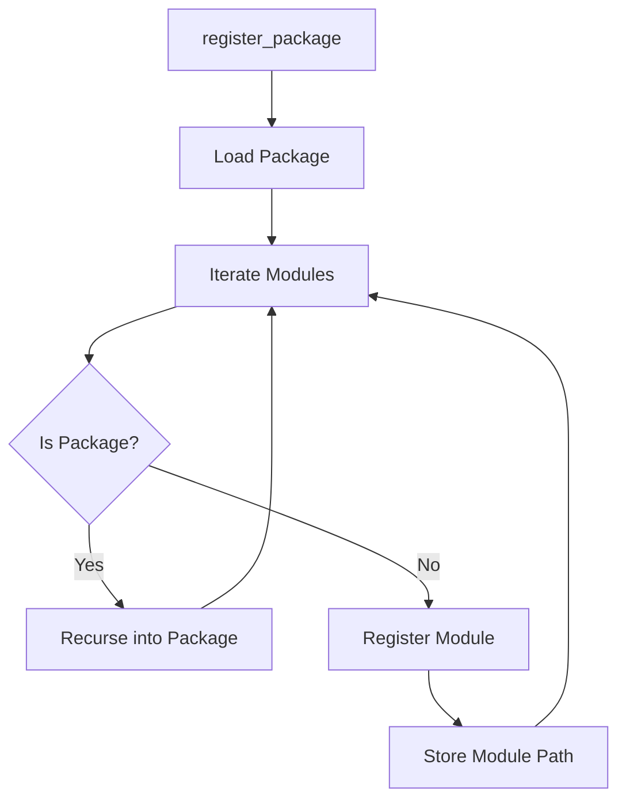
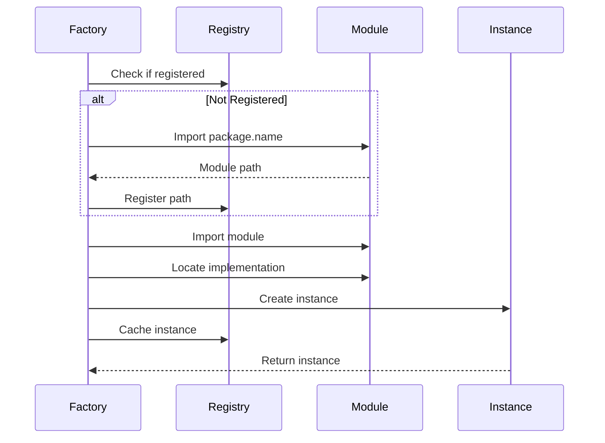
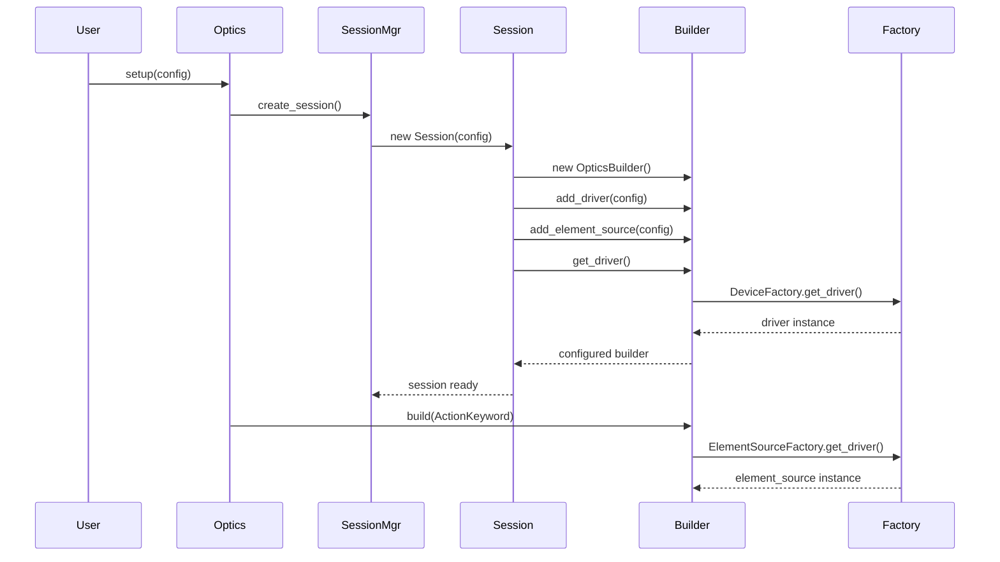
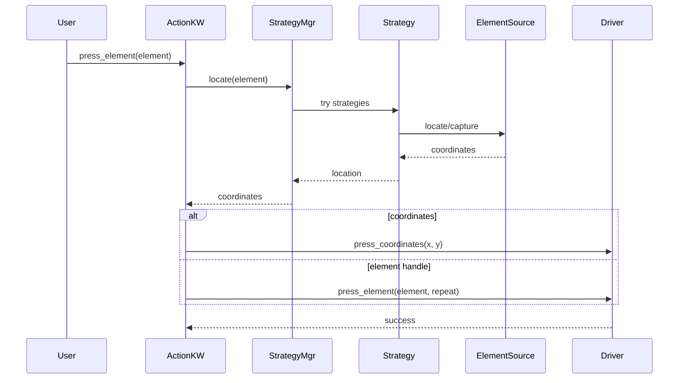

# Components

> Read what each core component of Optics does, how it is built, and how the components work together.

This page describes the component architecture of Optics, one main component at a time: what each one does, how it is built, and how it works with the others. For the high-level view, start at the [Architecture overview](https://optics-framework.org/docs/contribute/architecture).

## Core components

### Optics class

**Location:** `optics_framework/optics.py`

The `Optics` class is the main entry point to Optics. It gives one interface for use from Python and for Robot Framework.

#### Key responsibilities

- Parse and validate the configuration
- Manage the session lifecycle
- Register and expose the keywords
- Discover image templates
- Manage element and API data

#### Key methods

```python
@keyword("Setup")
def setup(self, config: Union[str, Dict[str, Any], None] = None, ...)
    """Configure the framework with driver and element source settings."""

@keyword("Press Element")
@fallback_params
def press_element(self, element: fallback_str, ...)
    """Press an element with automatic fallback support."""

@keyword("Add Element")
def add_element(self, name: str, value: Any)
    """Add or update an element in the current session."""
```

`setup()` takes a configuration as a dict, or as a JSON or YAML string. When you give a dict or a string, it must have `driver_sources` and `elements_sources`, and both must be lists. If not, `setup()` raises `ValueError`. `setup_from_file()` (keyword `Setup From File`) reads the configuration from a file. `quit()` terminates the session, and `Optics` is also a context manager that calls `quit()` when the `with` block ends.

#### Architecture notes

- Uses the `@fallback_params` decorator to accept multiple fallback values.
- Integrates with Robot Framework when it is installed. Without Robot Framework, `@keyword` and `@library` are no-op decorators.
- Keeps the session state through `SessionManager`.
- Sends the actual execution to the API classes (`ActionKeyword`, `AppManagement`, `Verifier`, `FlowControl`).
- `setup()` builds `ActionKeyword`, `AppManagement` and `Verifier` with `session.optics.build()`, then builds `FlowControl` with the keyword map of a `KeywordRegistry`.

### Fallback parameter system

A keyword can try multiple values for a parameter until one value succeeds. This is useful to find an element, because more than one identifier or strategy can work. `common/fallback.py` calls this "fallback level 1". The strategy ladder inside a keyword is level 2 (see [Strategies](https://optics-framework.org/docs/contribute/strategies)).

#### How it works

The `@fallback_params` decorator gives automatic fallback to each parameter with the type `fallback_str` or `Optional[fallback_str]`:

```python
from optics_framework.optics import fallback_str, fallback_params

@keyword("Press Element")
@fallback_params
def press_element(self, element: fallback_str, repeat: fallback_str = "1", ...):
    """Press an element, trying multiple values if needed."""
```

**Type definition:**

```python
fallback_str = Union[str, List[str]]
```

#### Parameter normalization

The decorator normalizes each fallback value:

```python
def _normalize_fallback_values(name: str, val: Any) -> List[str]:
    """
    Normalize fallback parameter values.

    - str -> [str] (single value)
    - List[str] -> List[str] (multiple values)
    - None -> [] (empty, skipped)
    - Empty list -> ValueError
    """
```

A list that has a value that is not a string raises `TypeError`. A value that is not a string or a list also raises `TypeError`. A parameter with the value `None` is not part of the combinations.

**Examples:**

```python
# Single value (no fallback)
press_element("submit_button")  # element = ["submit_button"]

# Multiple values (fallback)
press_element(["submit_btn", "submit_button", "//button[@id='submit']"])
# Tries each value in order until one succeeds

# Mixed parameters
press_element(["btn1", "btn2"], repeat="2")  # Only element has fallback
```

#### Combination generation

When multiple parameters have fallback values, Optics tries the combinations in order. `fallback.run()` in `common/fallback.py` does this for the decorator, and `fallback.run_async()` does it for the REST API:

```python
def run[R](candidates: Sequence[Sequence[Any]], call: Callable[[Combo], R], subject: str) -> R:
    """``call`` on each combination until one succeeds; a non-element error is raised as is."""
    ladder = _Ladder(candidates, subject)
    for combo in ladder:
        try:
            return call(combo)
        except Exception as exc:
            ladder.failed(combo, exc)
    raise ladder.exhausted()
```

`_Ladder` gives the combinations with `islice(product(*candidates), MAX_ATTEMPTS)`, so the order is the order of `itertools.product`.

Two rules control the loop:

- Optics tries a maximum of `MAX_ATTEMPTS = 20` combinations. If there are more, it stops at the limit and says so in the error.
- Only an element-not-found error (codes `E02xx` and `X0201`) moves the loop to the next combination. Any other error stops the loop and Optics raises that error at once, because a different value cannot fix it.

**Example:**

```python
@fallback_params
def tap_in_area(self, element: fallback_str, area: fallback_str):
    pass

# Called with:
tap_in_area(["btn1", "btn2"], ["area1", "area2"])

# Tries:
# 1. element="btn1", area="area1"
# 2. element="btn1", area="area2"
# 3. element="btn2", area="area1"
# 4. element="btn2", area="area2"
```

The decorator applies the default values before it makes the combinations. Thus a default such as `repeat="1"` is a one-value list in each combination.

#### Error aggregation

If all fallback attempts fail, Optics raises `FallbackExhausted`. This is an `OpticsError` with the code of the last failure. It keeps the last `KEPT_FAILURES = 5` failures:

```python
lines = [f"{combo} -> {error}" for combo, error in failures]
if omitted:
    lines.insert(0, f"... {omitted} earlier attempts not shown")
return f"All {self.tried} fallback combinations failed for {subject}{self.limit_note}:\n" + "\n".join(lines)
```

**Error message format:**

```text
All 3 fallback combinations failed for press_element:
('btn1', '1', '0', '0', '0') -> Code.E0201: ...
('btn2', '1', '0', '0', '0') -> Code.E0201: ...
('btn3', '1', '0', '0', '0') -> Code.E0201: ...
```

Each combination is a tuple of the values of all fallback parameters, in signature order. When Optics tried only one combination, the error is the message of that one failure.

#### Integration with API layer

The REST API layer also accepts fallback parameters. A positional parameter takes a list of values. Named parameters take a list for each name:

```python
# API request with fallback
{
  "mode": "keyword",
  "keyword": "Press Element",
  "params": [["btn1", "btn2", "btn3"]]  # Positional fallback
}

# Or named parameters with fallback
{
  "mode": "keyword",
  "keyword": "Press Element",
  "params": {
    "element": ["btn1", "btn2"],
    "repeat": "1"
  }
}
```

**A flat list is not a fallback:**
`"params": ["btn1", "btn2", "btn3"]` gives three positional parameters (`element`, `repeat` and `offset_x`), not three values for `element`. Put the fallback values in a list inside the list.

The API uses the same combination logic, through `fallback.run_async()`. Before it tries a positional request, `fallback.check_arity()` refuses with `E0403` a count of parameters that the keyword cannot take:

```python
async def _execute_keyword_with_fallback(
    engine: ExecutionEngine,
    session_id: str,
    keyword: str,
    params: Union[List[Union[str, List[str]]], Dict[str, Union[str, List[str]]]],
    method: Callable[..., Any],
    session: Session,
) -> Any:
    """Execute a keyword via ExecutionEngine, trying its params' fallback values as the CSV runner does."""
    if isinstance(params, dict):
        ctx = _build_named_param_context(method, params)
        if ctx.normalized_param_lists:
            return await _try_combos_named(engine, session_id, keyword, ctx)
        params = []
    fallback.check_arity(method, len(params), keyword)
    return await _try_combos_positional(engine, session_id, keyword, _build_positional_normalized(params))
```

See [REST API reference](https://optics-framework.org/docs/reference/http-api) for the request format.

#### Use cases

**1. Element location fallback:**

```python
# Try multiple element identifiers
press_element([
    "//button[@id='submit']",      # XPath
    "Submit Button",                # Text
    "submit_template.png"           # Image template
])
```

**2. Multiple strategies:**

```python
# Try different approaches
enter_text(["username", "user_name", "//input[@name='user']"], "testuser")
```

**3. Environment-specific values:**

```python
# Different values for different environments
launch_app(app_identifier=[
    "com.example.app.dev",      # Development
    "com.example.app.staging",  # Staging
    "com.example.app.prod"      # Production
])
```

**Warning:**
A launch failure is not an element-not-found error. If the first identifier fails to launch, Optics raises that error and does not try the next identifier. Use this pattern only when the wrong values fail with an element-not-found error.

#### Best practices

1. **Order matters**: Put the values that are most likely to succeed first.
2. **Limit combinations**: Do not use too many fallback values. The number of combinations grows exponentially, and Optics stops after 20.
3. **Meaningful errors**: Make sure that the errors give context for debugging.
4. **Type safety**: Always use the `fallback_str` type hint.
5. **Documentation**: Document the expected fallback behavior.

**Example:**

```python
@keyword("Press Element")
@fallback_params
def press_element(
    self,
    element: fallback_str,  # Document: "Tries XPath, text, then image"
    repeat: fallback_str = "1",
) -> None:
    """
    Press an element with automatic fallback.

    Args:
        element: Element identifier(s). Can be:
            - Single string: One identifier
            - List of strings: Multiple fallback identifiers
            Tries each in order until one succeeds.
        repeat: Number of times to press the element
    """
```

#### Performance considerations

- **Early exit**: The decorator stops at the first success.
- **Error handling**: Only element-not-found errors move to the next combination.
- **Combination limit**: Optics tries a maximum of 20 combinations.
- **Caching**: A keyword captures the screen once for each element source (`one_capture_per_source`), and a `TextInterface` reads the same frame only once.

#### Limitations

- **Type restriction**: Fallback works only with the `fallback_str` type (or `Optional[fallback_str]`).
- **Exception handling**: The loop catches only `Exception`. `SystemExit`, `KeyboardInterrupt` and `GeneratorExit` go up without a change.
- **No partial success**: All parameters of one combination must succeed together.
- **Error visibility**: Optics shows the errors of the individual attempts together, a maximum of five.

### SessionManager

**Location:** `optics_framework/common/session_manager.py`

`SessionManager` manages the lifecycle of the test sessions: it creates, gets and terminates them, and it releases their resources.

#### Key responsibilities

- Create sessions with unique IDs
- Store and get sessions
- Release resources when a session terminates
- Manage the configuration of each session
- Manage the event manager lifecycle
- Manage the driver lifecycle

#### Class structure

```python
class SessionManager(SessionHandler):
    def __init__(self):
        self.sessions: Dict[str, Session] = {}

    def create_session(self, config: Config, ...) -> str:
        """Creates a new session with a unique ID."""

    def get_session(self, session_id: str) -> Optional[Session]:
        """Retrieves a session by ID, or None if not found."""

    def terminate_session(self, session_id: str) -> None:
        """Terminates a session and cleans up resources."""

    def terminate_all(self) -> None:
        """Terminates every session; one session failing to close does not spare the rest."""
```

`create_session()` takes `config`, `test_cases`, `modules`, `elements`, `apis`, and the optional `templates` and `error_definitions`. `SessionHandler` is the abstract interface that `SessionManager` implements.

#### Session lifecycle

`The states of a session`:



#### Session creation flow

`What create_session does`:



#### Session class

Each `Session` instance has these attributes.

**Core attributes:**

- `session_id`: The unique identifier (UUID)
- `config_handler`: The configuration handler instance
- `config`: The configuration object
- `test_cases`: The test case data structure
- `modules`: The reusable module definitions
- `elements`: The element definitions and values
- `apis`: The API endpoint definitions
- `templates`: The image template mappings
- `error_definitions`: The error definitions for [error detection](https://optics-framework.org/docs/run/error-detection)
- `request_template_overrides` and `inline_templates`: Template images that a REST request sent inline or uploaded

**Component instances:**

- `optics`: The `OpticsBuilder` instance
- `driver`: The driver instance (through fallback), or `None` when no driver is enabled
- `event_sdk`: The event tracking SDK
- `event_queue`: The async queue for execution events
- `keyword_lock`: An `asyncio.Lock`. In keyword mode (REST API and MCP), a keyword runs while it holds this lock, so the keywords of one session run one at a time

A `SessionTemplateResolver` gives the image detection the path of a template. It looks in the request overrides first, then the inline templates, then the project templates.

#### Session initialization

When Optics creates a session, these steps occur:

1. **Configuration setup:**

   ```python
   self.config_handler = ConfigHandler(config)
   self.config = self.config_handler.config
   ```

   The session also makes a temporary session directory. If `config.remote_caller` is set, the execution output goes into that directory, because a remote caller must not select where the server writes.

2. **Dependency extraction:**

   - Extract the enabled driver configurations
   - Extract the enabled element source configurations
   - Extract the enabled text detection configurations
   - Extract the enabled image detection configurations
   - Extract the enabled LLM configurations

3. **Component initialization:**

   ```python
   self.event_sdk = EventSDK(self.config_handler)
   self.optics = OpticsBuilder(self)
   self.optics.add_driver(enabled_driver_configs)
   self.optics.add_element_source(enabled_element_configs)
   self.optics.add_text_detection(enabled_text_configs)
   self.optics.add_image_detection(
       enabled_image_configs, self.config.project_path or "", self._template_resolver
   )
   self.optics.add_llm(enabled_llm_configs)
   ```

   Then the session sets up JUnit event logging. If `json_log` is on and `json_path` is not set, `json_path` becomes `logs.json` in the execution output folder.

4. **Driver initialization:**

   ```python
   self.driver = self.optics.get_driver() if enabled_driver_configs else None
   ```

5. **Event queue setup:**

   ```python
   self.event_queue = asyncio.Queue()
   self.keyword_lock = asyncio.Lock()
   ```

#### Session state transitions

**Creating state:**

- Optics makes the session ID
- Optics loads the configuration
- Optics initializes the components
- The driver connects

**Active state:**

- The session is ready for execution
- The driver is connected
- The event queue is ready
- All components are initialized

**Executing state:**

- Test cases run
- Optics publishes events
- The driver does actions

**Terminating state:**

- Driver termination starts
- Event manager cleanup
- JUnit handler cleanup
- Optics removes the session from the registry

#### Session termination

Session termination releases all resources of the session:

```python
def terminate_session(self, session_id: str) -> None:
    session = self.sessions.pop(session_id, None)
    if session:
        for driver in getattr(session.driver, "instances", [session.driver] if session.driver else []):
            try:
                driver.terminate()
            except Exception as e:
                internal_logger.warning("Failed to terminate driver %s: %s", driver, e)
        session.inline_templates.clear()
    cleanup_junit(session_id)
    base_dir = getattr(session, "_session_dir", None)
    if base_dir:
        try:
            shutil.rmtree(base_dir)
        except OSError as e:
            internal_logger.warning("Failed to remove session directory %s: %s", base_dir, e)
    get_event_manager_registry().remove_session(session_id)
```

**Cleanup steps:**

1. **Remove from registry**: Remove the session from the sessions dictionary.
2. **Driver termination**: Call `driver.terminate()` on every fallback driver, not only the first. A later driver can have a browser open.
3. **Template cleanup**: Clear the inline templates.
4. **JUnit cleanup**: Release the JUnit report handlers.
5. **Session directory cleanup**: Remove the temporary session directory.
6. **Event manager cleanup**: Remove the event manager of the session.

`terminate_all()` terminates every session. If one session fails to close, it logs a warning and continues with the others. The MCP server calls it when it stops.

#### Resource management

**Driver resources:**

- WebDriver connections
- Appium sessions
- Browser instances
- Device connections

**Event resources:**

- Event queues
- Event subscribers
- JUnit handlers

**File resources:**

- Log files
- Screenshot files
- Execution output
- The temporary session directory

#### Session isolation

Each session is isolated from the others:

- **Separate configuration**: Each session has its own configuration.
- **Separate drivers**: Each session has its own driver instance.
- **Separate event queues**: Each session has its own event queue.
- **Separate state**: Test cases, elements and modules belong to one session.

#### Concurrency considerations

**Current implementation:**

- Sessions are in a dictionary (writes are not thread-safe).
- Each session has its own driver instance.
- Each session has its own event queue.
- Each session has its own `keyword_lock`, so the keywords that the REST API or MCP sends to one session run one at a time.

**Best practices:**

- Create a separate session for each concurrent execution.
- Do not share sessions between threads.
- Terminate sessions when you are done.

#### Session retrieval

```python
def get_session(self, session_id: str) -> Optional[Session]:
    """Retrieves a session by ID, or None if not found."""
    return self.sessions.get(session_id)
```

**Usage:**

- Returns `None` if the session does not exist
- Returns the `Session` instance if it exists
- No locking is necessary (read-only operation)

#### Session validation

When Optics creates a session, it does these checks:

```python
self.driver = self.optics.get_driver() if enabled_driver_configs else None
```

**Validations:**

- Optics creates an enabled driver at once, so a bad driver configuration fails at session creation.
- A session with no enabled driver runs only the keywords that need no device (`FlowControl`: Invoke API, Evaluate, Condition, ...). `RunnerFactory.create_runner()` builds `ActionKeyword`, `AppManagement` and `Verifier` only when `session.driver` is set. The `Optics` class always builds them, so `Optics.setup()` needs an enabled driver.
- The configuration must be valid.
- The dependencies must have a correct configuration.

#### Error recovery

**Session creation errors:**

- Configuration errors come up at once.
- Driver initialization errors go up to the caller. The `Optics` class wraps them in `ValueError("Failed to create session: ...")`.
- Optics stores a session only after its constructor completes, so `get_session()` never returns a session that failed half-way. Optics does not remove the temporary directory or the JUnit handler of a session that failed half-way.

**Session termination errors:**

- Optics logs driver termination errors, and they do not stop the cleanup.
- Optics logs an error when it cannot remove the session directory.
- Event manager cleanup is not in a `try` block, so its errors go up to the caller. The session is already out of the registry at that time.

#### Session persistence

**Current implementation:**

- Sessions are in memory only
- Sessions are not written to disk
- Sessions are lost when the process stops

**Future considerations:**

- Session serialization for persistence
- Session recovery on restart
- Session state snapshots

#### Best practices

1. **Always terminate sessions**: Call `terminate_session()` when you are done. From Python, call `quit()` or use `with Optics(...)`.
2. **One session for each test run**: Create a new session for each test run.
3. **Use the session again in a run**: Use one session for all test cases of the same run.
4. **Handle termination errors**: Put the termination in a `try`/`except` block.
5. **Check that the session exists**: Make sure that the session exists before you use it.

#### Troubleshooting

**Session not found:**

- Make sure that the session ID is correct.
- Make sure that the session is not terminated.
- Make sure that Optics created the session.

**Driver not initialized:**

- Make sure that at least one driver is enabled.
- Make sure that the driver configuration is correct.
- Read the driver initialization logs.

**Resource leaks:**

- Make sure that your code calls `terminate_session()`.
- Look for exception handling that skips the cleanup.
- Read the driver termination logs.

### OpticsBuilder

**Location:** `optics_framework/common/optics_builder.py`

`OpticsBuilder` uses the builder pattern. It builds the component hierarchy and gives each component its dependencies.

#### Key responsibilities

- Normalize the configuration (`normalise_config()`)
- Create components through the factories
- Manage the dependencies between components
- Create components lazily: the first `get_*()` call creates them

#### Builder flow

`From add_ methods to factories`:



#### Builder methods

```python
def add_driver(self, config: Union[str, List[Union[str, Dict]]]) -> "OpticsBuilder"
    """Add driver configuration."""

def add_element_source(self, config: Union[str, List[Union[str, Dict]]]) -> "OpticsBuilder"
    """Add element source configuration."""

def add_image_detection(self, config, project_path: str, templates=None) -> "OpticsBuilder"
    """Add image detection configuration with the project path and templates."""

def build(self, cls: Type[T]) -> T:
    """Build an instance of the specified class using stored configurations."""
```

`normalise_config()` changes a string to `[{name: {}}]`, a dict to a list with one dict, and each string in a list to `{name: {}}`. Any other type raises `OpticsError` with code `E0503`. `instantiate_driver()` raises `E0501` when no driver configuration is set. With no element source configuration, `get_element_source()` returns an empty `InstanceFallback`.

#### Usage example

**Basic builder usage:**

```python
from optics_framework.common.optics_builder import OpticsBuilder

# Create builder
builder = OpticsBuilder(session)

# Add components
builder.add_driver([{"appium": {"enabled": True, "url": "..."}}])
builder.add_element_source([{"appium_find_element": {"enabled": True}}])
builder.add_text_detection([{"easyocr": {"enabled": True}}])
builder.add_image_detection([{"templatematch": {"enabled": True}}], project_path)

# Get components
driver = builder.get_driver()
element_source = builder.get_element_source()
text_detection = builder.get_text_detection()
image_detection = builder.get_image_detection()
```

**Fluent API:**

```python
# Builder supports method chaining
builder = (OpticsBuilder(session)
    .add_driver([{"appium": {"enabled": True}}])
    .add_element_source([{"appium_find_element": {"enabled": True}}])
    .add_text_detection([{"easyocr": {"enabled": True}}])
)
```

**Building API classes:**

```python
# Build API classes with dependencies
action_keyword = builder.build(ActionKeyword)
# ActionKeyword receives the builder, gets the driver, element source and vision models from it, and makes its own StrategyManager

verifier = builder.build(Verifier)
# Verifier receives builder components
```

`build(cls)` calls `cls(builder)`.

#### Dependency injection

The builder gives each component its dependencies:

- Element sources get the matching drivers.
- Image detection gets the project path, the templates and the capture folder.
- Text detection gets the capture folder.

The capture folder is `config.capture_dir`: the execution output path, or `None` when `save_captures` is off.

**Example: element source injection**

```python
# Element source automatically receives matching driver
builder.add_driver([{"appium": {"enabled": True}}])
builder.add_element_source([{"appium_find_element": {"enabled": True}}])

# When element source is created:
# ElementSourceFactory matches appium_find_element with appium driver
# Injects driver into element source constructor
element_source = builder.get_element_source()
# element_source.driver is the Appium driver instance
```

**Example: vision model injection**

```python
# Image detection receives project path and templates
builder.add_image_detection(
    [{"templatematch": {"enabled": True}}],
    project_path="/path/to/project",
    templates=template_resolver,
)

# The builder writes project_path, execution_output_path (capture_dir) and templates into each config dict
image_detection = builder.get_image_detection()
# image_detection has access to templates from project_path
```

### ConfigHandler

**Location:** `optics_framework/common/config_handler.py`

`ConfigHandler` holds the resolved configuration of a project. The same module holds the `Config` model, the YAML loader, and the rules for merge and precedence.

#### Key responsibilities

- Parse configuration files: `load_project_yaml()` reads YAML, and `Optics.setup()` also reads JSON or YAML strings
- Resolve a configuration file (`resolve_config_file()`): expand environment references such as `${NAME}` and `${NAME:-default}`, and resolve `./` paths against the project folder
- Validate the configuration with Pydantic
- Manage the dependency configurations
- Keep a record of the enabled and disabled dependencies
- Apply the configuration precedence
- Merge configurations

When `execution_output_path` is not set, `ConfigHandler` sets it to `execution_output` in the project path, or in the current directory, and creates the folder. It also starts the log handlers. See [Configuration](https://optics-framework.org/docs/reference/config) for each key.

#### Configuration structure

```python
class Config(BaseModel):
    console: bool = True
    driver_sources: List[Dict[str, DependencyConfig]] = Field(default_factory=list)
    elements_sources: List[Dict[str, DependencyConfig]] = Field(default_factory=list)
    text_detection: List[Dict[str, DependencyConfig]] = Field(default_factory=list)
    image_detection: List[Dict[str, DependencyConfig]] = Field(default_factory=list)
    llm_models: List[Dict[str, DependencyConfig]] = Field(default_factory=list)
    file_log: bool = False
    json_log: bool = False
    save_captures: bool = True
    remote_caller: bool = False
    json_path: Optional[str] = None
    log_level: str = "INFO"
    log_path: Optional[str] = None
    name: Optional[str] = None
    project_path: Optional[str] = None
    execution_output_path: Optional[str] = None
    include: Optional[List[str]] = None
    exclude: Optional[List[str]] = None
    event_attributes_json: Optional[str] = None
    halt_duration: float = 0.1
    ai_self_heal: bool = False
    strict_element_match: bool = False
    nl_agent: NLAgentConfig = Field(default_factory=NLAgentConfig)
```

The `capture_dir` property gives the folder for screenshots and other captures. It is `execution_output_path` when `save_captures` is on, and `None` when it is off.

#### DependencyConfig

Each dependency has its own configuration:

```python
class DependencyConfig(BaseModel):
    enabled: bool  # Whether this dependency is enabled
    url: Optional[str] = None  # Connection URL (for drivers)
    capabilities: Dict[str, Any] = Field(default_factory=dict)  # Dependency-specific settings
```

#### Configuration hierarchy

The configuration is specific to the project. The runner reads the `config.yaml` of the project into a `Config`. Each key that the file does not set keeps the built-in default.

`Where the final configuration comes from`:



**Precedence order (highest to lowest):**

1. **Project config**: The configuration of the project (`config.yaml`)
2. **Default config**: The framework defaults

`optics execute` treats a YAML file as the configuration when it has `driver_sources` and `elements_sources` (or `element_sources`). It reads `element_sources` as `elements_sources`. When both are set, `elements_sources` wins.

#### Configuration merging

The `deep_merge()` function merges two configurations recursively. `ConfigHandler.update_config()` uses it:

```python
def deep_merge(c1: Config, c2: Config) -> Config:
    """Merge c2 into c1, with c2 taking precedence."""
    # Recursively merge dictionaries
    # c2 values override c1 values
    # List values are REPLACED wholesale, not merged item-by-item
```

**Merge rules:**

- Dictionary values merge recursively.
- List values replace the old list (no merge).
- Scalar values replace the old value.
- `None` values also replace the old value. `deep_merge()` writes every key of `c2`, `None` included.

#### Default configuration

If the configuration does not give a list, Optics sets these defaults:

**Driver sources:**

- appium (enabled=False)
- selenium (enabled=False)
- ble (enabled=False)

**Element sources:**

- appium_find_element (enabled=False)
- appium_page_source (enabled=False)
- appium_screenshot (enabled=False)
- camera_screenshot (enabled=False)
- selenium_find_element (enabled=False)
- selenium_screenshot (enabled=False)

**Text detection:**

- apple_vision (enabled=False)
- rapidocr (enabled=False)
- easyocr (enabled=False)
- pytesseract (enabled=False)
- google_vision (enabled=False)
- remote_ocr (enabled=False)

**Image detection:**

- templatematch (enabled=False)
- remote_oir (enabled=False)

**LLM models:**

- gemini (enabled=False)
- openai (enabled=False)
- anthropic (enabled=False)

An empty list also gets these defaults.

#### Enabled configuration tracking

`ConfigHandler` calculates the enabled dependencies before they are necessary. `DEPENDENCY_KEYS` has `driver_sources`, `elements_sources`, `text_detection`, `image_detection` and `llm_models`:

```python
def _precompute_enabled_configs(self) -> None:
    """Precompute enabled configuration names for each dependency type."""
    for key in self.DEPENDENCY_KEYS:
        dependencies = getattr(self.config, key, [])
        self._enabled_configs[key] = [
            name for item in dependencies
            for name, details in item.items()
            if self._is_enabled(details)
        ]
```

Thus Optics finds the enabled dependencies quickly, without a loop through all configurations.

#### Configuration access

```python
# Get enabled dependencies
enabled_drivers = config_handler.get("driver_sources")  # Returns list of enabled driver names

# Get specific dependency config
driver_config = config_handler.get_dependency_config("driver_sources", "appium")
# Returns: {"url": "...", "capabilities": {...}}

# Get any config value
log_level = config_handler.get("log_level", "INFO")
```

`get_dependency_config()` returns `None` when the dependency is not enabled.

#### Configuration validation

Pydantic validates the configuration:

- It checks the type of all fields.
- It applies the default values.
- It validates the model when Optics creates it.

**Example:**

```python
from pydantic import ValidationError
from optics_framework.common.config_handler import Config

try:
    config = Config(**config_dict)
except ValidationError as e:
    print(e)
```

`Config` raises the Pydantic `ValidationError` as it is. When `resolve_config_file()` finds an environment variable that is not set, or a `./` path that does not exist, it raises `OpticsError` with code `E0501`.

#### Configuration update

You can update a configuration while it is in use:

```python
config_handler.update_config({
    "log_level": "DEBUG",
    "driver_sources": [{"appium": {"enabled": True, "url": "..."}}]
})
```

`update_config()` accepts a dict or a `Config`. It makes a `Config` from a dict, merges it into the current configuration with `deep_merge()`, and calculates the enabled dependencies again. Because the dict becomes a full `Config` first, a key that the dict does not set takes its default value and replaces the current value.

#### Configuration file format

**YAML format:**

```yaml
driver_sources:
  - appium:
      enabled: true
      url: "http://localhost:4723"
      capabilities:
        platformName: "Android"
        deviceName: "emulator-5554"

elements_sources:
  - appium_find_element:
      enabled: true

text_detection:
  - easyocr:
      enabled: true

project_path: "/path/to/project"
execution_output_path: "/path/to/output"
log_level: "INFO"
```

#### Configuration examples

**Minimal configuration:**

```yaml
driver_sources:
  - appium:
      enabled: true
      url: "http://localhost:4723"
```

**Full configuration:**

```yaml
driver_sources:
  - appium:
      enabled: true
      url: "http://localhost:4723"
      capabilities:
        platformName: "Android"
        appPackage: "com.example.app"
  - selenium:
      enabled: false

elements_sources:
  - appium_find_element:
      enabled: true
  - appium_screenshot:
      enabled: true

text_detection:
  - easyocr:
      enabled: true

image_detection:
  - templatematch:
      enabled: true

project_path: "/path/to/project"
execution_output_path: "/path/to/output"
log_level: "DEBUG"
file_log: true
log_path: "/path/to/logs"
event_attributes_json: "/path/to/events.json"
halt_duration: 0.2
```

#### Project-specific configuration

All configuration is in the `config.yaml` of the project. There is no global configuration layer. To get different settings for each environment or project, give each project its own file. To make one, run `optics configure <folder>`.

**Project config:**

```yaml
# Project-specific settings
driver_sources:
  - appium:
      enabled: true
      url: "http://localhost:4723"

log_level: "DEBUG"
file_log: true
```

#### Configuration precedence examples

**Example 1: log level**

- Default: `INFO`
- Project: `WARNING`
- **Result:** `WARNING` (the project overrides the default)

**Example 2: driver URL**

- Default: `None`
- Project: `http://remote:4723`
- **Result:** `http://remote:4723` (the project gives it)

#### Configuration validation rules

1. **Required fields**: In `Config`, all fields have defaults. In each dependency, `enabled` is required. `Optics.setup()` also requires `driver_sources` and `elements_sources` as lists.
2. **Type validation**: Pydantic validates all fields.
3. **Dependency validation**: An enabled dependency must have a valid configuration.
4. **Path validation**: Optics resolves a `./` or `../` path against the project folder when it loads the file. It stops with `E0501` if the path does not exist. Output paths (`project_path`, `execution_output_path`, `log_path` and `json_path`) do not have to exist.

#### Configuration best practices

1. **Keep each project self-contained**: Put every setting that a run needs in the `config.yaml` of that project.
2. **Enable only the dependencies you need**: Disable the dependencies that you do not use, for better performance.
3. **Use capabilities for driver settings**: Put the settings of each driver in `capabilities`.
4. **Validate the configuration early**: Run `optics doctor <folder>` to check a project before you run it.

#### Configuration troubleshooting

**Configuration does not load:**

- Make sure that the file path is correct.
- Make sure that the YAML syntax is valid.
- Make sure that the file permissions let Optics read the file.

**Dependencies are not enabled:**

- Make sure that the configuration has `enabled: true`.
- Make sure that the dependency name is correct.
- Look at the enabled configurations: `config_handler.get("driver_sources")`.

**Configuration is not applied:**

- Make sure that you know the precedence order (the project `config.yaml` is before the built-in defaults).
- Make sure that you saved the configuration.
- Look for merge conflicts.

## Factory system

### GenericFactory

**Location:** `optics_framework/common/base_factory.py`

`GenericFactory` is the base factory class. It finds modules, loads classes when it needs them and creates instances. It also builds the fallback instances.

#### Key features

- Discovers modules in packages
- Loads classes and creates instances dynamically
- Finds implementations through interface inheritance
- Keeps instances in a registry
- Gives extra dependencies to constructors (for example, a driver)
- Loads modules lazily
- Builds fallback instances

#### Module discovery algorithm

`register_package()` discovers modules recursively:

`How register_package finds modules`:



**Discovery process:**

1. **Package loading**: Load the package with `importlib.import_module()`.
2. **Module iteration**: Use `pkgutil.iter_modules()` to go through the modules.
3. **Recursive discovery**: For each subpackage, discover its modules recursively.
4. **Path registration**: Store the module paths in the registry for later use.

```python
@classmethod
def register_package(cls, package: str) -> None:
    """Registers all modules within the specified package."""
    package_obj = cls._load_package(package)
    if package_obj:
        cls._register_submodules(package_obj.__path__, package)

@classmethod
def _register_submodules(cls, package_paths, base_package: str) -> None:
    """Recursively registers all submodules in a package."""
    for _, module_name, is_pkg in pkgutil.iter_modules(package_paths):
        full_module_name = f"{base_package}.{module_name}"
        cls._registry.module_paths[module_name] = full_module_name
        if is_pkg:
            cls._register_subpackage(full_module_name)
```

**Note:**
No code in Optics calls `register_package()` at this time. The factories load each module by name when a configuration asks for it. See [Lazy module loading](#lazy-module-loading).

#### Module registry

The factory keeps a registry of the modules it found. `ModuleRegistry` is a class inside `GenericFactory`:

```python
class ModuleRegistry(BaseModel, Generic[S]):
    module_paths: Dict[str, str]  # name -> full_module_path
    instances: Dict[str, S]  # name -> cached_instance
```

**Registry structure:**

- `module_paths`: Maps module names to full import paths
- `instances`: Keeps the last instance that the factory made for each name

#### Dynamic instance creation

The concrete factories create every instance with `create_instance_dynamic()`:

```python
@classmethod
def create_instance_dynamic(
    cls,
    config_dict: dict,
    interface: Type[T],
    package: str,
    extra_kwargs: dict|None = None,
) -> T:
    """Unified instance creation supporting config and extra dependencies (e.g., driver)."""
```

**Process:**

1. Get the name and the configuration from `config_dict`.
2. If the module is not registered, load it.
3. Import the module.
4. Find the implementation class.
5. Read the constructor signature.
6. Create the instance with the configuration and the extra kwargs.
7. Store the instance in the registry.

`create_instance_dynamic()` does not look in the registry for an instance. Each call makes a new instance and replaces the stored one.

**Example:**

```python
driver = DeviceFactory.create_instance_dynamic(
    {"appium": {"enabled": True, "url": "..."}},
    DriverInterface,
    "optics_framework.engines.drivers",
    extra_kwargs={"event_sdk": event_sdk}
)
```

#### Instance creation with caching

```python
@classmethod
def _create_or_retrieve(cls, config_dict: dict, interface: Type[T], package: str) -> T:
    """Creates a new instance or retrieves a cached one for the given config dict."""
```

`create_instance()` and `_create_fallback()` use this method. No other code in Optics calls them at this time.

**Caching strategy:**

- Look for the instance in the cache.
- If it is in the cache, return the instance.
- If not, create a new instance and put it in the cache.
- The cache key is the module name.

If the constructor raises `TypeError` when it gets `config`, `_create_or_retrieve()` logs a warning and creates the instance without `config`.

#### Lazy module loading

The factories load modules when they need them:

```python
@classmethod
def _load_module(cls, name: str, package: str) -> None:
    """Loads a specific module dynamically."""
    full_module_name = f"{package}.{name}"
    importlib.import_module(full_module_name)
    cls._registry.module_paths[name] = full_module_name
```

**When lazy loading occurs:**

- The module is not in the registry when the factory creates an instance
- The first access to a module

**Benefits:**

- Faster startup
- Optics loads only the modules that it uses
- Less memory

#### Interface-based detection

The factory finds an implementation through interface inheritance:

```python
@staticmethod
def _locate_implementation(module: ModuleType, interface: Type[T]) -> Optional[Type[T]]:
    """Locates a class in the module that implements the given interface."""
    for _, obj in inspect.getmembers(module, inspect.isclass):
        if obj is not interface and issubclass(obj, interface) and not inspect.isabstract(obj):
            return obj
    return None
```

**Detection rules:**

1. Go through all classes in the module.
2. Make sure that the class is a subclass of the interface.
3. Skip the interface itself.
4. Skip abstract classes.
5. Return the first class that matches.

#### Constructor signature inspection

The factory reads the constructor signature to find which parameters to give:

```python
sig = inspect.signature(implementation.__init__)
kwargs = {}
if "config" in sig.parameters:
    kwargs["config"] = config
if extra_kwargs:
    for k, v in extra_kwargs.items():
        if k in sig.parameters:
            kwargs[k] = v
instance = implementation(**kwargs)
```

**Parameter injection:**

- `config`: Given if the constructor accepts it
- `extra_kwargs`: Each one given if the constructor accepts it

#### Fallback instance creation

The concrete factories make one instance for each configuration and put all of them in one `InstanceFallback`:

```python
@classmethod
def get_driver(cls, name: List[dict]) -> InstanceFallback[ImageInterface]:
    instances = [cls.create_instance_dynamic(config_dict, ImageInterface, cls.DEFAULT_PACKAGE) for config_dict in name]
    return InstanceFallback(instances)
```

**Fallback flow:**

1. Create an instance for each configuration.
2. Put the instances in an `InstanceFallback`.
3. The fallback tries each instance until one succeeds.

`_create_fallback()` does the same with `_create_or_retrieve()`. It skips items that are not dicts:

```python
@classmethod
def _create_fallback(cls, name: List[dict], interface: Type[T], package: str) -> T:
    """Creates a fallback instance from a list of config dicts."""
    instances = []
    for config_dict in name:
        if not isinstance(config_dict, dict):
            continue
        instances.append(cls._create_or_retrieve(config_dict, interface, package))
    return cast(T, InstanceFallback(instances))
```

#### Factory registration timing

No factory scans its package in advance. Each factory imports `<DEFAULT_PACKAGE>.<name>` the first time a configuration names that module:

- **DeviceFactory**: `optics_framework.engines.drivers`
- **ElementSourceFactory**: `optics_framework.engines.elementsources`
- **ImageFactory**: `optics_framework.engines.vision_models.image_models`
- **TextFactory**: `optics_framework.engines.vision_models.ocr_models`
- **LLMFactory**: `optics_framework.engines.llm_models`

#### Error handling

The factory handles these errors:

**Module not found:**

```python
except KeyError as exc:
    raise OpticsError(Code.E0601, message=f"Unknown module requested: '{name}' in package '{package}'") from exc
```

**No implementation found:**

```python
if not implementation:
    raise OpticsError(Code.E0603, message=f"No implementation found in '{module_path}' for {interface.__name__}")
```

**Import errors:**

```python
except ModuleNotFoundError as e:
    raise OpticsError(Code.E0601, message=f"Module '{name}' not found in package '{package}'") from e
```

A config item that is not a dict raises `E0503`. The factory does not raise `X0604` ("Import related problem"), although that code exists. See [Errors](https://optics-framework.org/docs/contribute/errors).

#### Performance considerations

1. **Instance registry**: The factory stores the last instance for each name.
2. **Lazy loading**: The factory loads modules only when it needs them.
3. **Registry lookup**: A module path lookup is O(1).
4. **Signature inspection**: The factory reads the constructor signature each time it creates an instance. Nothing caches it.

#### Cache management

```python
@classmethod
def clear_instances(cls) -> None:
    """Clears all cached instances."""
    cls._registry.instances.clear()
```

**When to clear:**

- Between test runs
- When the configuration changes
- During cleanup

No code in Optics calls `clear_instances()` at this time.

#### Factory lifecycle

`How a factory makes an instance`:



#### Factory best practices

1. **Name modules exactly**: The configuration key must be the module file name.
2. **Handle errors**: Always handle factory errors.
3. **Clear the cache when necessary**: Clear the cache between test runs.
4. **Use fallback**: Configure multiple instances for resilience.

#### Factory troubleshooting

**Module not found:**

- Make sure that the module is in the correct package folder.
- Make sure that the module name is the same as the file name.
- Make sure that the module implements the correct interface.

**No implementation found:**

- Make sure that the class extends the interface.
- Make sure that the class is not the interface itself and is not abstract.
- Make sure that the class is defined or imported in the module.

**Import errors:**

- Make sure that the dependencies of the module are installed.
- Make sure that the import paths are correct.
- Look at the module initialization code.

### DeviceFactory

**Location:** `optics_framework/common/factories.py`

The factory for driver instances.

#### Default package

```python
DEFAULT_PACKAGE = "optics_framework.engines.drivers"
```

#### Usage

```python
driver = DeviceFactory.get_driver(
    [{"appium": {"enabled": True, "url": "...", "capabilities": {...}}}],
    event_sdk=event_sdk
)
```

`get_driver()` gives `event_sdk` to each driver that accepts it, and returns an `InstanceFallback`.

### ElementSourceFactory

**Location:** `optics_framework/common/factories.py`

The factory for element source instances. It matches each element source with a driver.

#### Key features

- Matches element sources with compatible drivers
- Uses the `REQUIRED_DRIVER_TYPE` attribute to match. A source with `ACCEPTS_ANY_DRIVER = True` (`camera_screenshot`) gets the first enabled driver.
- Gives the matched driver to the element source constructor
- `available_sources(driver)` lists the installed element source names for a driver, for example `appium_find_element`, `appium_page_source` and `appium_screenshot` for `appium`. It does not import them.

#### Driver matching logic

```python
@classmethod
def _find_matching_driver(cls, implementation, driver_instances):
    """Find a driver instance that matches the required driver type, or the first driver for a source that takes any."""
    if getattr(implementation, "ACCEPTS_ANY_DRIVER", False):
        return next((drv for drv in driver_instances if drv is not None), None)
    required_type = getattr(implementation, "REQUIRED_DRIVER_TYPE", None)
    # Matches by NAME attribute
```

The driver `NAME` must be the same as the `REQUIRED_DRIVER_TYPE` of the source. If no driver matches, the source gets no driver.

### ImageFactory and TextFactory

**Location:** `optics_framework/common/factories.py`

The factories for vision models:

- **ImageFactory**: `optics_framework.engines.vision_models.image_models`
- **TextFactory**: `optics_framework.engines.vision_models.ocr_models`

### LLMFactory

**Location:** `optics_framework/common/factories.py`

The factory for LLM engines. Its package is `optics_framework.engines.llm_models`.

### InstanceFallback

**Location:** `optics_framework/common/base_factory.py`

`InstanceFallback` holds multiple implementations. When a method fails on one implementation, it tries the next.

#### Fallback mechanism

```python
class InstanceFallback(BaseModel, Generic[T]):
    instances: List[T]
    current_instance: Optional[T]

    def __getattr__(self, attr):
        def fallback_method(*args, **kwargs):
            if not self.instances:
                return None
            last_exception = None
            for instance in self.instances:
                self.current_instance = instance
                try:
                    method = getattr(instance, attr)
                    return method(*args, **kwargs)
                except Exception as e:
                    last_exception = e
            self.current_instance = None
            if last_exception:
                raise last_exception
        return fallback_method
```

**Rules:**

- With no instances, a call logs a warning and returns `None`.
- When all instances fail, `InstanceFallback` raises the last exception again.
- `current_instance` is the instance that the last call used.
- `active_instance` gives the instance in use: `current_instance`, or else the first instance. Read a real attribute, such as `REQUIRED_DRIVER_TYPE` or `driver`, through `active_instance`. On the wrapper, `__getattr__` returns a callable for each attribute.
- `routed_to(instance)` is a context manager. In the block, calls go only to that instance. `ActionKeyword` uses it so that only the driver behind an element source uses the element handle of that source.

#### Usage pattern

When you configure multiple drivers, Optics puts them in an `InstanceFallback`:

```python
# If Appium fails, automatically tries Selenium
fallback_driver.press_element(element)
```

## Interfaces

### DriverInterface

**Location:** `optics_framework/common/driver_interface.py`

The abstract interface for action drivers that do user actions.

#### Key methods

- `launch_app()`: Launch applications
- `press_coordinates()`: Press at absolute coordinates
- `press_element()`: Press UI elements
- `enter_text()`: Type text
- `swipe()` / `scroll()`: Gesture actions
- `get_text_element()`: Get text
- `terminate()`: Cleanup

#### Implementations

- `Appium` (`appium`): Mobile app automation
- `SeleniumDriver` (`selenium`): Web browser automation
- `Playwright` (`playwright`): Modern web automation
- `BLEDriver` (`ble`): Non-intrusive BLE mouse and keyboard

### ElementSourceInterface

**Location:** `optics_framework/common/elementsource_interface.py`

The abstract interface for element detection and screen capture.

#### Key methods

- `capture()`: Capture the current screen state
- `locate()`: Find elements (XPath, text and others)
- `assert_elements()`: Make sure that elements are present
- `get_interactive_elements()`: Get the elements you can interact with

#### Implementations

- `AppiumFindElement`: Appium element location
- `SeleniumFindElement`: Selenium element location
- `PlaywrightFindElement`: Playwright element location
- `AppiumWeb` (`appium_web`): CSS and DOM XPath location in the browser or WebView of an Appium session
- `AppiumScreenshot` / `SeleniumScreenshot` / `PlaywrightScreenshot`: Screenshot capture
- `CameraScreenshot`: External camera capture
- `AppiumPageSource` / `SeleniumPageSource` / `PlaywrightPageSource`: Page source extraction

### ImageInterface

**Location:** `optics_framework/common/image_interface.py`

The abstract interface for image template matching.

#### Key methods

- `element_exist()`: Check if an image is in the frame
- `find_element()`: Find an image, with details
- `assert_elements()`: Make sure that multiple images are present

#### Implementations

- `TemplateMatchingHelper` (`templatematch`): OpenCV template matching
- `RemoteImageDetection` (`remote_oir`): Remote object image recognition service

### TextInterface

**Location:** `optics_framework/common/text_interface.py`

The abstract interface for OCR and text detection.

#### Key methods

- `find_element()`: Find text with its bounding box (shared, see `common/text_match.py`)
- `detect_text()`: Full text detection with confidence. A subclass reads the same frame only once and returns the earlier result for the same pixels.

#### Implementations

- `AppleVisionHelper` (`apple_vision`): Apple Vision
- `RapidOCRHelper` (`rapidocr`): RapidOCR
- `EasyOCRHelper` (`easyocr`): The EasyOCR library
- `GoogleVisionHelper` (`google_vision` or `googlevision`): Google Cloud Vision API
- `PytesseractHelper` (`pytesseract`): Tesseract OCR
- `RemoteOCR` (`remote_ocr`): Remote OCR service

### LLMInterface

**Location:** `optics_framework/common/llm_interface.py`

The abstract interface for multimodal LLM engines. AI self-heal and the plain-English mode of `optics live` use it.

#### Key methods

- `generate()`: Return the text response of the model to a prompt, with optional images, system instruction and JSON schema
- `generate_json()`: Call `generate()` in JSON mode and parse the result. It raises `E0801` if the model returns JSON that it cannot decode.

#### Implementations

- `GeminiLLM` (`gemini`)
- `OpenAILLM` (`openai`)
- `AnthropicLLM` (`anthropic`)

## API modules

### ActionKeyword

**Location:** `optics_framework/api/action_keyword.py`

The high-level API for user actions with self-healing.

#### Key features

- Self-healing through `_locate_and_act()`, which all keywords that find an element share
- Automatic strategy selection
- Area of interest (AOI) support
- Screenshot capture on actions
- Optional AI self-heal as the last step, when `ai_self_heal` is on and an LLM is enabled

#### Self-healing

```python
def _locate_and_act(self, element, func_name, act, intent_args=(), index="0", aoi=("0", "0", "100", "100"), ...):
    """Locate element through the strategy ladder and run act on it."""
```

`_locate_and_act()` is fallback level 2. The `StrategyManager` gives each result in order of strategy priority (XPath, text, OCR, image). `act` runs on each result, and the first result that does not raise wins. If no strategy finds the element, Optics raises `E0201`. If each `act` call fails, it raises `X0201`. AI self-heal gets one chance before these errors.

#### Key methods

- `press_element()`: Press, with AOI support
- `press_by_coordinates()`: Absolute coordinates
- `press_by_percentage()`: Percentage coordinates
- `swipe()` / `scroll()`: Gestures
- `enter_text()`: Type text
- `press_keycode()`: Hardware keys

### AppManagement

**Location:** `optics_framework/api/app_management.py`

Manages the application lifecycle.

#### Key methods

- `launch_app()`: Launch with an identifier and activity
- `launch_other_app()`: Launch a different app
- `start_appium_session()`: Start an Appium session
- `close_and_terminate_app()`: Stop the driver session and send the remaining events
- `force_terminate_app()`: Force the app to stop
- `get_app_version()`: Version information

### Verifier

**Location:** `optics_framework/api/verifier.py`

Gives assertions and validation.

#### Key methods

- `validate_element()`: Verify one element
- `validate_screen()`: Verify multiple elements
- `assert_presence()`: Assert with rules (any or all)
- `assert_visibility()`: Assert that elements are visible on the screen now, not only in the page source
- `assert_text()`: Assert the text of an element or the value of a field
- `assert_equality()`: Compare two values
- `is_element()`: Check that an element is in a state (visible, invisible, enabled, disabled, checked, unchecked)
- `get_interactive_elements()`: Get UI elements
- `get_screen_elements()`: Get a screenshot and the interactive elements, with bounds in screenshot pixels
- `capture_screenshot()`: Screenshot capture
- `capture_pagesource()`: Page source capture

`assert_images_vision()` and `assert_texts_vision()` are not in Optics now. Use `assert_presence()` or `assert_visibility()` with image or text elements.

### FlowControl

**Location:** `optics_framework/api/flow_control.py`

Manages the control flow and the data operations.

#### Key methods

- `condition()`: Conditional execution
- `evaluate()`: Expression evaluation
- `read_data()`: Read from a CSV file, a JSON file, an environment variable (`ENV:NAME`) or a 2D list
- `run_loop()`: Loop execution
- `execute_module()`: Run a module
- `invoke_api()`: REST API calls
- `date_evaluate()`: Date calculations

## Component interactions

### Initialization flow

`What setup builds, in order`:



The builder creates the element sources only when `ActionKeyword` asks for them, after the session is ready.

### Action execution flow

`What press_element does`:



## Extension points

### Adding a new driver

1. Create a class in `optics_framework/engines/drivers/`.
2. Implement `DriverInterface`, and set `NAME`.
3. The factory finds it by its module name.

### Adding a new element source

1. Create a class in `optics_framework/engines/elementsources/`.
2. Implement `ElementSourceInterface`.
3. Set `REQUIRED_DRIVER_TYPE` if it needs a driver, or `ACCEPTS_ANY_DRIVER = True` if any driver can work.
4. The factory matches it with a driver.

### Adding a new vision model

1. Create a class in `optics_framework/engines/vision_models/image_models/` or `optics_framework/engines/vision_models/ocr_models/`.
2. Implement `ImageInterface` or `TextInterface`.
3. The factory finds it by its module name.

### Adding a new LLM engine

1. Create a class in `optics_framework/engines/llm_models/`.
2. Implement `LLMInterface`.
3. The factory finds it by its module name.

### Adding a new keyword

1. Add a public method to the applicable API class.
2. `KeywordRegistry.register()` registers each public method of the class by its name, so you do not register it yourself.
3. To use it from Python or Robot Framework, add a method to the `Optics` class with `@keyword("Keyword Name")`.
4. Optionally, add `@fallback_params` for fallback support.

See [Extending Optics](https://optics-framework.org/docs/contribute/extending) for complete recipes.

## Related documentation

- [Architecture overview](https://optics-framework.org/docs/contribute/architecture): The high-level architecture
- [Engines](https://optics-framework.org/docs/contribute/engines): The engine implementations
- [Strategies](https://optics-framework.org/docs/contribute/strategies): The strategy pattern and self-healing
- [Execution](https://optics-framework.org/docs/contribute/execution): The execution flow and data models
- [Errors](https://optics-framework.org/docs/contribute/errors): The error handling system
- [Events](https://optics-framework.org/docs/contribute/events): The `EventSDK` integration
- [Logging](https://optics-framework.org/docs/contribute/logging): The logging architecture
- [Decisions](https://optics-framework.org/docs/contribute/decisions): The design decisions and their reasons
- [REST API reference](https://optics-framework.org/docs/reference/http-api): The REST API endpoints
- [Use Optics from Python](https://optics-framework.org/docs/create/python): The Python API
