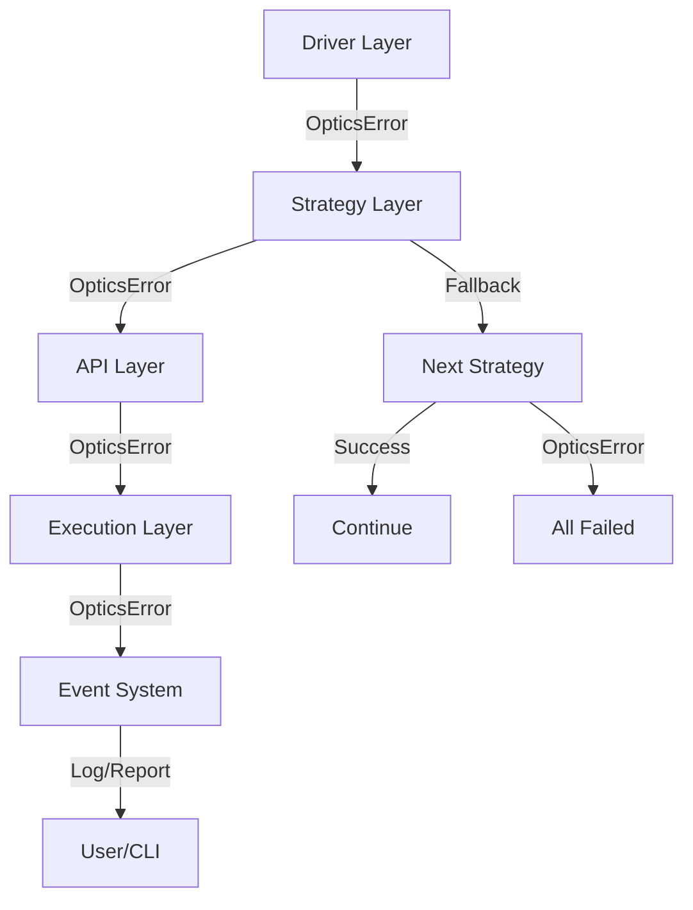

# Handle errors in Optics code

> How Optics names, raises, carries and reports errors, from a driver call up to the CLI and the HTTP API.

Optics uses one structured error type in all layers. Each error has a code, a category and an HTTP status. This page explains the design for contributors. For what each code means to a user and what to do about it, see [Error codes](https://optics-framework.org/docs/reference/errors).

## Overview

The error handling system has five parts:

1. **Error codes**: structured error identifiers with categories.
2. **OpticsError**: the exception class that carries the code and its metadata.
3. **Error registry**: the one place that defines every code.
4. **Error propagation**: how an error moves through the layers.
5. **Error recovery**: the fallback and retry mechanisms.

All of it is in [`optics_framework/common/error.py`](https://github.com/mozarkai/optics-framework/blob/main/optics_framework/common/error.py).

## Error code structure

**Location:** `optics_framework/common/error.py`

### Error code format

Each code has this format:

```text
[Severity][Category][Number]
```

### Severity prefixes

- **E**: Error (the default severity).
- **W**: Warning (not fatal).
- **X**: Exception (critical or not handled).

`ErrorSpec` does not store the severity. Optics reads it from the first character of the code.

### Categories

The two digits after the prefix give the category. Each one is a value of the `Category` enum.

| Digits | Category | `Category` value |
|---|---|---|
| **01** | Driver issues | `driver` |
| **02** | Element location issues | `element` |
| **03** | Screenshot issues | `screenshot` |
| **04** | Keyword execution issues | `keyword` |
| **05** | Config/File issues | `config` |
| **06** | Module/Factory issues | `module` |
| **07** | Test case issues | `test` |
| **08** | General issues | `general` |
| **09** | Live (interactive session) issues | `live` |

### Examples

```text
E0101 - Driver not initialized (Error, Driver category)
W0104 - Driver config incomplete (Warning, Driver category)
X0201 - Element not found after all fallbacks (Exception, Element category)
E0402 - Keyword not found (Error, Keyword category)
```

## Error registry

The error registry (`ERROR_REGISTRY`) holds the specification of each code:

```python
ERROR_REGISTRY = {
    "E0101": ErrorSpec(
        code=Code.E0101,
        default_message="Driver not initialized",
        category=Category.DRIVER,
        default_status=500,
    ),
    "E0201": ErrorSpec(
        code=Code.E0201,
        default_message="Element not found",
        category=Category.ELEMENT,
        default_status=404,
    ),
    # ... more error codes
}
```

### ErrorSpec structure

`ErrorSpec` is a frozen pydantic model. Each specification has these fields:

- **code**: the `Code` enum value.
- **default_message**: the message when the caller gives none.
- **category**: the error category (`Category.DRIVER`, `Category.ELEMENT` and so on).
- **default_status**: the HTTP status code for API responses. The default is `500`.
- **meta**: optional metadata.

## OpticsError exception

`OpticsError` is the primary exception type in the framework. Its constructor is:

```python
OpticsError(code: str | Code, message: str | None = None, details: Any = None, cause: BaseException | None = None, meta: dict | None = None)
```

### Creating OpticsError

```python
from optics_framework.common.error import OpticsError, Code

# Using error code
raise OpticsError(Code.E0101, message="Custom message", details={"driver": "appium"})

# Using string code
raise OpticsError("E0101", message="Driver initialization failed")

# With details
raise OpticsError(
    Code.E0201,
    message="Element not found",
    details={"element": "submit_button", "strategies_tried": ["xpath", "ocr"]},
    cause=original_exception
)
```

The module also has two helpers. `from_code(code, message=None, details=None)` returns an `OpticsError`, and `raise_code(code, message=None, details=None)` raises one.

### OpticsError attributes

- **code**: the `Code` enum value. A string code becomes its `Code` member.
- **category**: the error category.
- **status_code**: the HTTP status code.
- **message**: the human-readable message. It is the `default_message` of the code when you do not give one.
- **details**: additional error context. It is `None` when you do not give it.
- **meta**: optional metadata. It is the `meta` of the spec when you do not give it.
- **cause**: the original exception, if there is one. `OpticsError` keeps it as `__cause__`, not as a `cause` attribute.

`cause_text` gives the root of the cause chain as one line of at most 300 characters. It is `None` when the message already contains that text. `str(error)` is `E0101: <message>`, with ` (cause: <cause_text>)` at the end when there is a cause.

### Log an error

`OpticsError` can log itself:

```python
error = OpticsError(Code.E0101, message="Driver failed")
error.log()  # Prints formatted error with rich formatting
error.log(use_rich=False)  # Uses standard logging
```

With `use_rich=True` (the default), `log()` prints a Rich panel to the console. With `use_rich=False`, it writes one line to a logger. The default logger is `internal_logger`. See [Error logging](#error-logging) for the format.

## Error categories

The tables give the `default_message` and `default_status` of each code in `ERROR_REGISTRY`.

### Driver errors (01xx)

Driver-related errors:

| Code | Default message | Status |
|---|---|---|
| **E0101** | Driver not initialized | 500 |
| **E0102** | Failed to start session | 500 |
| **E0103** | Failed to end session | 500 |
| **E0104** | Driver config incomplete | 400 |
| **E0105** | Keyword not supported on this device platform | 400 |
| **E0106** | Driver session is no longer active | 500 |
| **W0104** | Driver config incomplete (warning) | 200 |

**Example:**

```python
if not self.driver:
    raise OpticsError(Code.E0101, message="Appium driver not initialized")
```

### Element errors (02xx)

Element location errors:

| Code | Default message | Status |
|---|---|---|
| **E0201** | Element not found | 404 |
| **X0201** | Element not found after all fallbacks | 500 |
| **E0202** | Unsupported operation for element source | 400 |
| **W0203** | Element format mismatch | 200 |
| **E0204** | Timeout locating element | 504 |
| **E0205** | Invalid element type | 400 |

**Example:**

```python
if not element:
    raise OpticsError(
        Code.E0201,
        message=f"Element '{element_id}' not found",
        details={"strategies": ["xpath", "ocr", "image"]}
    )
```

### Screenshot errors (03xx)

Screenshot-related errors:

| Code | Default message | Status |
|---|---|---|
| **E0301** | Screenshot disabled | 400 |
| **W0302** | Fallback to next camera supported driver | 200 |
| **E0303** | Screenshot empty/black | 500 |
| **E0304** | Image too large to decode or not a valid image | 422 |
| **E0305** | The camera does not see the device screen | 503 |

`E0305` means that the camera moved, the screen is out of view, or the screen is off.

**Example:**

```python
if screenshot is None or is_black_screen(screenshot):
    raise OpticsError(Code.E0303, message="Screenshot is empty or black")
```

### Keyword errors (04xx)

Keyword execution errors:

| Code | Default message | Status |
|---|---|---|
| **E0401** | Action failed | 500 |
| **X0401** | Action failed with exception | 500 |
| **E0402** | Keyword not found | 404 |
| **E0403** | Invalid keyword parameters | 400 |
| **W0404** | Keyword deprecated | 200 |
| **E0405** | Action ran, but the screen does not show its result | 500 |
| **E0406** | Expression or filter refused: unsafe or too costly | 400 |

No fallback retries an action that fails with `E0405`.

Optics refuses an expression or a filter with `E0406` when it uses something other than literals, names, indexing, arithmetic, comparisons, `and`/`or`/`not` and `if`/`else`, or when it costs too much. Conditions also allow `len`, `str`, `int`, `float` and `bool` calls.

**Example:**

```python
if keyword not in registry:
    raise OpticsError(
        Code.E0402,
        message=f"Keyword '{keyword}' not found",
        details={"available_keywords": list(registry.keys())}
    )
```

### Config errors (05xx)

Configuration and file errors:

| Code | Default message | Status |
|---|---|---|
| **E0501** | Missing required files | 400 |
| **X0502** | File read exception | 500 |
| **E0503** | Config parser error (important param) | 400 |
| **W0503** | Config parser warning (can be ignored) | 200 |

**Example:**

```python
if not os.path.exists(config_path):
    raise OpticsError(
        Code.E0501,
        message=f"Configuration file not found: {config_path}",
        details={"path": config_path}
    )
```

### Module/Factory errors (06xx)

Module and factory errors:

| Code | Default message | Status |
|---|---|---|
| **E0601** | Module not found | 404 |
| **W0602** | No valid instances, ignoring it | 200 |
| **E0603** | Factory init failed | 500 |
| **X0604** | Import related problem | 500 |

**Example:**

```python
try:
    module = importlib.import_module(module_name)
except ImportError as e:
    raise OpticsError(
        Code.X0604,
        message=f"Failed to import module: {module_name}",
        cause=e
    )
```

### Test case errors (07xx)

Test case execution errors:

| Code | Default message | Status |
|---|---|---|
| **E0701** | Execution failed | 500 |
| **E0702** | Test case not found | 404 |
| **E0703** | Parameter resolution failed | 400 |
| **E0704** | Test case timeout | 504 |
| **W0705** | Test case skipped | 200 |
| **E0706** | Run stopped before the test case finished | 500 |

Optics raises `E0706` when Ctrl-C or SIGTERM stops the run.

**Example:**

```python
if test_case_id not in session.test_cases:
    raise OpticsError(
        Code.E0702,
        message=f"Test case '{test_case_id}' not found",
        details={"session_id": session.session_id}
    )
```

### General errors (08xx)

General framework errors:

| Code | Default message | Status |
|---|---|---|
| **E0801** | Unexpected error | 500 |
| **E0802** | Unhandled exception | 500 |

**Example:**

```python
except Exception as e:
    raise OpticsError(
        Code.E0802,
        message="Unhandled exception occurred",
        cause=e,
        details={"context": "keyword_execution"}
    )
```

### Live errors (09xx)

Errors from an `optics live` session:

| Code | Default message | Status |
|---|---|---|
| **E0901** | Named element not defined in this project | 404 |

Some codes are in the registry, but no current code raises them. [Reserved codes](https://optics-framework.org/docs/reference/errors#reserved-codes) lists them.

## Error propagation flow

Errors move up through the framework layers:

`How an OpticsError moves from a driver to the user`:



### Propagation rules

1. **Driver layer**: raises `OpticsError` for driver-specific issues.
2. **Strategy layer**: catches errors and tries the fallback strategies.
3. **API layer**: wraps errors with context and sends them to the execution layer.
4. **Execution layer**: handles errors, publishes events, and then continues or stops.
5. **Event system**: logs errors and publishes error events.

### Error context preservation

Errors keep their context as they move up:

```python
try:
    element = strategy.locate(element_id)
except OpticsError as e:
    # Add context
    raise OpticsError(
        e.code,
        message=f"Failed to locate element in {strategy.__class__.__name__}",
        details={**(e.details or {}), "strategy": strategy.__class__.__name__},
        cause=e
    )
```

`details` is `None` when the first error has no details. A line such as `details={**e.details, "strategy": strategy.__class__.__name__},` then fails with `TypeError`. Use `e.details or {}` before you unpack it.

## Error recovery mechanisms

### 1. Strategy fallback

When a strategy fails to locate an element, `StrategyManager.locate` tries the next strategy. It continues after any exception, not only after `E0201`. Two errors change this:

- A dead session (`E0106`, or a driver error that shows the session is gone) stops the loop at once. `raise_if_session_dead` in `session_liveness.py` raises it.
- `E0305` (the camera does not see the screen) is kept. When no strategy finds the element, Optics raises the `E0305` error, because no other strategy can see the screen either.

When no strategy finds the element, `locate` raises `E0201` with the last error as its cause.

This is the shape of the loop:

```python
for strategy in strategies:
    try:
        result = strategy.locate(element)
        return result
    except Exception as e:
        raise_if_session_dead(e)
        last_error = e
        continue  # Try next strategy
raise OpticsError(Code.E0201, message=f"Element '{element}' not found.", cause=last_error)
```

Earlier versions of these docs showed this loop continuing only on `if e.code == Code.E0201:  # Element not found` and had `raise  # Re-raise other errors` for all other errors. Current code does not do that.

### 2. Driver fallback

When you configure more than one driver, `InstanceFallback` (in `base_factory.py`) calls each instance in turn. It moves to the next instance after any exception, not only after driver errors. It logs each failure with `internal_logger.error`. When all instances fail, it raises the last exception.

```python
for driver in driver_fallback.instances:
    try:
        driver.press_element(element, repeat)
        return
    except Exception as e:
        last_exception = e
        continue  # Try next driver
raise last_exception
```

Earlier versions of these docs showed it continuing only on `if e.code in [Code.E0101, Code.E0102]:  # Driver errors`. Current code does not filter on the code. Their call `driver.press_element(element)` also left out `repeat`, which the driver method requires.

### 3. Retry logic

Optics has no general retry helper. Some operations have their own retry loop:

- `EventSDK.send_all_events()` tries 3 times, with a delay of 2 and then 4 seconds. See [Events](https://optics-framework.org/docs/contribute/events#response-handling).
- `capture_base64_screenshot_bytes` in `utils.py` tries a screenshot 2 times, with a 0.5 second delay.

If you add a retry to an operation, use this pattern:

```python
max_retries = 3
for attempt in range(max_retries):
    try:
        return operation()
    except OpticsError as e:
        if attempt < max_retries - 1:
            time.sleep(2 ** attempt)  # Exponential backoff
            continue
        raise
```

### 4. Graceful degradation

Some errors are warnings that let execution continue. This pattern catches a warning code and uses a fallback source:

```python
try:
    screenshot = element_source.capture()
except OpticsError as e:
    if e.code == Code.W0302:  # Warning
        # Try fallback screenshot source
        screenshot = fallback_source.capture()
    else:
        raise
```

**Note:**
`W0302` is in the registry, but no current code raises it. The pattern shows how to handle a warning code. It does not describe a current code path.

### 5. Keyword fallback

When a step gives more than one value for a parameter, `optics_framework/common/fallback.py` runs the keyword once for each combination of values. It tries at most 20 combinations (`MAX_ATTEMPTS`). It moves to the next combination only for element-not-found errors: an `E02` code or `X0201` (`advances()`). Any other error stops the keyword at once. When every combination fails, Optics raises `FallbackExhausted`, an `OpticsError` with the code of the last failure. Its message lists the last five failures (`KEPT_FAILURES`).

## Error handling in API layer

The REST API (`optics_framework/common/expose_api.py`) changes an `OpticsError` into a FastAPI `HTTPException`. The status comes from the code, and the payload goes in `detail`:

```python
from fastapi import HTTPException
from optics_framework.common.error import OpticsError

try:
    result = execute_keyword(keyword, params)
except OpticsError as e:
    raise HTTPException(
        status_code=e.status_code,
        detail=e.to_payload(include_status=True)
    ) from e
```

`to_payload(include_status=False, meta=None)` returns a plain dict. It includes `status` only when `include_status` is true.

### API error response format

FastAPI puts the payload under `detail`:

```json
{
  "detail": {
    "type": "optics:driver",
    "code": "E0101",
    "status": 500,
    "message": "Driver not initialized",
    "details": {
      "driver": "appium",
      "session_id": "abc123"
    },
    "meta": null,
    "cause": null
  }
}
```

`type` is `optics:<category>`. `cause` is the `cause_text` of the error, or `null`. For every status the API can return, see [HTTP API errors](https://optics-framework.org/docs/reference/http-api#errors).

## Error handling best practices

### 1. Use appropriate error codes

Use a code from the category of the error:

```python
# Good
raise OpticsError(Code.E0201, message="Element not found")

# Bad - wrong category
raise OpticsError(Code.E0101, message="Element not found")  # Should be E0201
```

The code also controls recovery. Keyword fallback moves to the next value only for `E02` codes and `X0201`.

### 2. Include context in details

Give information that helps to find the cause:

```python
raise OpticsError(
    Code.E0201,
    message="Element not found",
    details={
        "element": element_id,
        "strategies_tried": ["xpath", "ocr"],
        "screenshot_path": "/path/to/screenshot.png"
    }
)
```

### 3. Preserve original exceptions

Use the `cause` parameter to keep the exception chain:

```python
try:
    driver.connect()
except ConnectionError as e:
    raise OpticsError(
        Code.E0102,
        message="Failed to connect to driver",
        cause=e
    )
```

### 4. Use warnings for non-critical issues

Use a warning code for an issue that does not stop execution:

```python
if config.get("optional_setting") is None:
    raise OpticsError(
        Code.W0503,
        message="Optional setting not configured, using default"
    )
```

A raised warning is still an exception. A caller must catch it to continue.

### 5. Handle errors at appropriate levels

Handle an error where recovery is possible:

```python
# Strategy level - try fallback
try:
    return xpath_strategy.locate(element)
except OpticsError:
    return ocr_strategy.locate(element)  # Fallback

# Execution level - stop execution
try:
    execute_test_case(test_case)
except OpticsError as e:
    publish_error_event(e)
    raise  # Stop execution
```

## Error logging

### Structured logging

`OpticsError.log(logger=None, level=None, extra=None, use_rich=True)` connects to the logging system:

```python
error = OpticsError(Code.E0101, message="Driver failed")
error.log()  # Logs with rich formatting
error.log(level=logging.WARNING, use_rich=False)  # Custom log level
error.log(extra={"session_id": session_id}, use_rich=False)  # Additional context
```

`logger`, `level` and `extra` have an effect only with `use_rich=False`. Calls such as `error.log(level=logging.WARNING)` and `error.log(extra={"session_id": session_id})` print the Rich panel and ignore those arguments.

With `use_rich=False`:

- The default level is `logging.ERROR` for an `E` or `X` code and `logging.WARNING` for a `W` code.
- The line is `[E0101] <message> (category: <category>, status: <status>)`, with ` caused by: <cause_text>` at the end when there is a cause.
- The record `extra` holds `code`, `category`, `status`, `details` and `meta`, plus the keys you give in `extra`.

### Error log format

With `use_rich=True`, `log()` prints a Rich panel. The border is red for an `E` or `X` code and yellow for a `W` code. The title is the code and the payload `type`:

```text
──────────── ❌ E0101 (optics:driver) ────────────
Driver not initialized
Caused by: <cause_text>
[dim]Details:[/dim] {'driver': 'appium', 'session_id': 'abc123'}
```

The panel shows the `Caused by:`, `Details:` and `Meta:` lines only when they have a value. The `[dim]` tags print as text, because the panel body is a Rich `Text`, which does not read markup.

## Debugging errors

### 1. Enable debug logging

The Optics loggers are `optics.internal` and `optics.execution`. Set `log_level: DEBUG` in `config.yaml`, or set the level in code:

```python
from optics_framework.common.logging_config import LoggingConfig, reconfigure_logging

reconfigure_logging(LoggingConfig(log_level="DEBUG"))
```

`reconfigure_logging` sets the level on both loggers and their console handlers. This snippet from earlier versions of these docs has no effect, because no Optics logger is named `optics_framework`:

```python
import logging
logging.getLogger("optics_framework").setLevel(logging.DEBUG)
```

See [Logging](https://optics-framework.org/docs/contribute/logging).

### 2. Check error details

```python
try:
    operation()
except OpticsError as e:
    print(f"Code: {e.code}")
    print(f"Category: {e.category}")
    print(f"Details: {e.details}")
    print(f"Cause: {e.__cause__}")
```

### 3. Error code lookup

Read the specification of a code from the error registry:

```python
from optics_framework.common.error import ERROR_REGISTRY

spec = ERROR_REGISTRY.get("E0101")
print(f"Message: {spec.default_message}")
print(f"Category: {spec.category}")
print(f"Status: {spec.default_status}")
```

## Extending error handling

### Registering custom error codes

`Code` is a closed enum, and `ErrorSpec.code` has the type `Code`. Thus `Code("E0950")` raises `ValueError`, and so does `OpticsError("E0950")`. `register_error(spec)` can only replace the spec of a code that already exists.

To add a new code:

1. Add a member to `Code` in `optics_framework/common/error.py`.
2. Add its `ErrorSpec` to `ERROR_REGISTRY`.
3. Add the code to [Error codes](https://optics-framework.org/docs/reference/errors).

To change the default message or status of an existing code at runtime, use `register_error`:

```python
from optics_framework.common.error import ErrorSpec, Category, Code, register_error

spec = ErrorSpec(
    code=Code.E0801,
    default_message="Custom error",
    category=Category.GENERAL,
    default_status=500
)
register_error(spec)
```

Do not use `custom_code = Code("E0901")  # Custom code` as earlier versions of these docs did. `E0901` is now a real code ("Named element not defined in this project"), and the call replaces its spec.

### Custom error classes

```python
class CustomOpticsError(OpticsError):
    def __init__(self, custom_field, **kwargs):
        super().__init__(**kwargs)
        self.custom_field = custom_field
```

Give the code as a keyword argument, for example `CustomOpticsError("value", code=Code.E0401)`. `FallbackExhausted` in `fallback.py` is a subclass of this kind.

## Related documentation

- [Components](https://optics-framework.org/docs/contribute/components): component error handling.
- [Strategies](https://optics-framework.org/docs/contribute/strategies): strategy fallback mechanisms.
- [Execution](https://optics-framework.org/docs/contribute/execution): execution error handling.
- [API layer](https://optics-framework.org/docs/contribute/api-layer): API error handling.
- [Logging](https://optics-framework.org/docs/contribute/logging): error logging patterns.
- [Architecture decisions](https://optics-framework.org/docs/contribute/decisions): error handling design decisions.
- [HTTP API](https://optics-framework.org/docs/reference/http-api#errors): REST API error responses.
- [Python SDK](https://optics-framework.org/docs/create/python): the Python API.
- [Error codes](https://optics-framework.org/docs/reference/errors): what each code means to a user and what to do.
