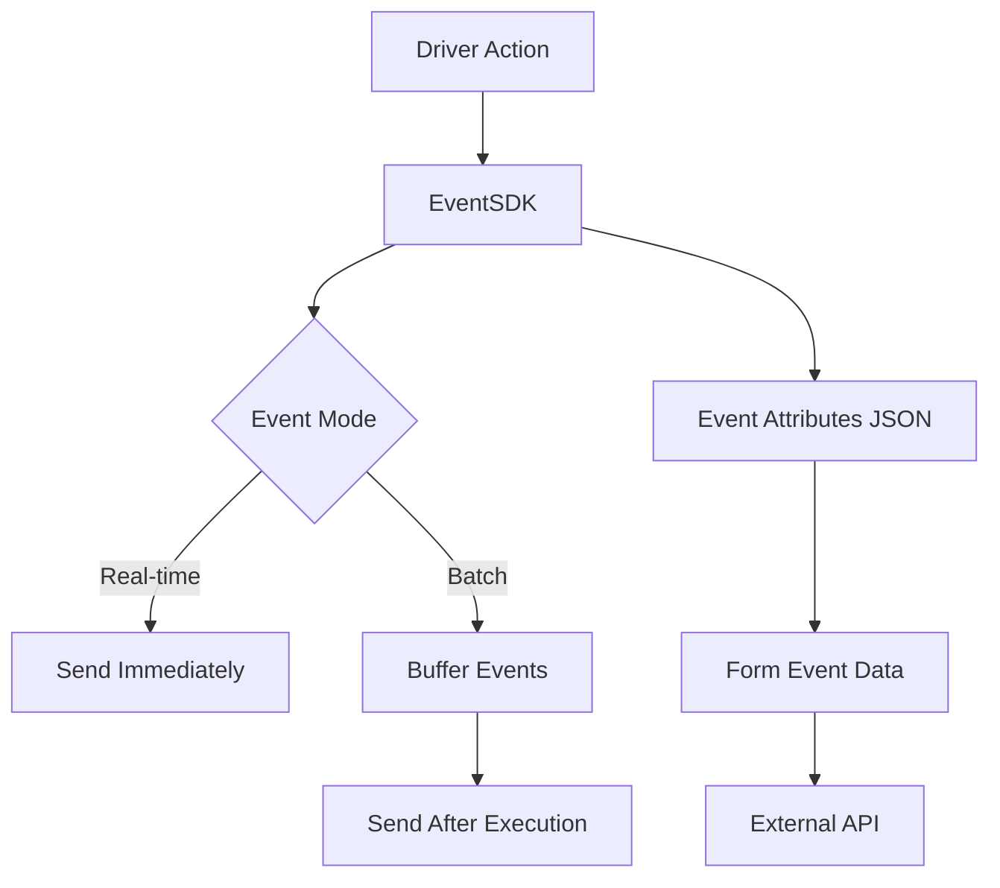

Optics can record the actions of a test as events and send them to an external service for monitoring and analytics. This page explains the event system: the `EventSDK` class, the event attributes file and the submission modes.

## Overview

The event system has two main components:

1. **EventManager**: the internal event system for execution tracking. See [Execution](/docs/contribute/execution).
2. **EventSDK**: the external event tracking SDK for analytics and monitoring.

This page is about `EventSDK`. `EventSDK` records labelled user actions and sends them to an external service.

## EventSDK architecture



## EventSDK component

**Location:** `optics_framework/common/eventSDK.py`

The `EventSDK` class records events for the monitoring of test execution and user actions. Source: [`eventSDK.py`](https://github.com/mozarkai/optics-framework/blob/main/optics_framework/common/eventSDK.py).

### Initialization

You initialize `EventSDK` with a `ConfigHandler` instance:

```python
from optics_framework.common.config_handler import ConfigHandler
from optics_framework.common.eventSDK import EventSDK

config_handler = ConfigHandler(config)
event_sdk = EventSDK(config_handler)
```

Each session makes one `EventSDK` in `Session.__init__` (`session_manager.py`). `OpticsBuilder` gives it to each driver through `DeviceFactory.get_driver(..., event_sdk=...)`.

### Key responsibilities

- Event capture and formatting.
- Event attribute management.
- Real-time and batch event submission.
- Connection to the test context.
- Event buffering and retry logic.

## Event attributes file

`EventSDK` reads a JSON file that gives the event attributes, the metadata and the delivery settings.

### Configuration structure

The event attributes JSON file contains:

```json
{
  "eventUrl": "https://api.example.com",
  "testParameters_bearer": "your-bearer-token",
  "applicationName": "MyApp",
  "appVersion": "1.0.0"
}
```

### Configuration fields

| Key | What `EventSDK` does with it |
|---|---|
| **eventUrl** | The base URL for the event submission API. `EventSDK` posts to `{eventUrl}/v1/event/batchevent`. |
| **testParameters_bearer** | The bearer token for API authentication. It goes in the `Authorization` header. |
| **applicationName** | The name of the application under test. It goes in `eventAttributes.applicationName` and `mozarkEventAttributes.applicationName`. |
| **appVersion** | The version of the application under test. It goes in `eventAttributes.applicationVersion`. |

These four key names are fixed in the code (`_EVENT_URL`, `_BEARER`, `get_application_name()` and `get_app_version()`). You can add other keys. `EventSDK` sends each one in `mozarkEventAttributes` with every event. It does not send `eventUrl` or a key with a secret name, such as `testParameters_bearer`.

The file must contain a JSON object. When the path is not set, `EventSDK` logs `Event attributes JSON file path is not set`. When the file is missing, is not valid JSON or is not an object, `EventSDK` logs an error. In each of these cases, it continues with no attributes.

### Loading event attributes

`EventSDK` loads the event attributes JSON file one time, in `__init__`:

```python
def __init__(self, config_handler: ConfigHandler):
    self.config_handler = config_handler
    self.event_attributes_json_path = self.config_handler.config.event_attributes_json
    data = self._load_event_attributes_json()
    self.event_url = data.get(_EVENT_URL)
    self.bearer = data.get(_BEARER)
    if isinstance(self.bearer, str):
        register_config_secret(_BEARER, self.bearer)
    self.event_attributes_data = {
        key: value for key, value in data.items() if key != _EVENT_URL and not is_secret_name(key)
    }
    self.all_events = []
    self.real_time = False
```

Earlier versions kept the whole file as `self.event_attributes_data = self._load_event_attributes_json()`. Now `__init__` keeps `eventUrl` and the bearer token apart, and registers the token as a secret. Optics then writes `****` in place of the token in all logs and reports.

You give the file path in the main configuration:

```yaml
event_attributes_json: "/path/to/event_attributes.json"
```

See [`event_attributes_json`](/docs/reference/config#top-level-keys) in the configuration reference.

## Event capture

### Basic event capture

Use the `capture_event()` method to capture an event:

```python
event_sdk.capture_event(
    event_name="button_clicked",
    button_id="submit",
    screen="login",
    timestamp="2024-01-01T12:00:00"
)
```

`capture_event(event_name, **args)` adds the event to the buffer (`all_events`) and prints it. It does not send it. `send_all_events()` sends the buffer. `timestamp` is not an attribute: when you give it, `EventSDK` uses its value for `dateTime`. `capture_event_with_time_input(event_name, current_time, **event_attributes)` does the same with a timestamp you give.

When `event_attributes_json` is not set, `capture_event()` logs `Unable to capture events` and drops the event.

### Event structure

Each captured event contains:

1. **Event name**: the identifier for the event type.
2. **Event attributes**: key-value pairs with the event data.
3. **Mozark event attributes**: the additional metadata from the attributes file.
4. **DateTime**: a timestamp that `EventSDK` adds.

### Automatic attributes

`EventSDK` adds these attributes to each captured event:

- `dateTime`: the current timestamp in ISO format.
- `testCaseName`: the current test case name, from the test context.
- `applicationName`: from the event attributes JSON.
- `applicationVersion`: the `appVersion` value from the event attributes JSON.

### Event format

The final event has this structure:

```json
{
  "eventName": "button_clicked",
  "eventAttributes": {
    "dateTime": "2024-01-01T12:00:00+05:30",
    "testCaseName": "test_login",
    "applicationName": "MyApp",
    "applicationVersion": "1.0.0",
    "button_id": "submit",
    "screen": "login"
  },
  "mozarkEventAttributes": {
    "applicationName": "MyApp",
    "appVersion": "1.0.0"
  }
}
```

`mozarkEventAttributes` holds every key of the attributes file except `eventUrl` and the secret-named keys. In this example, that is `applicationName` and `appVersion`.

## Event submission modes

`submit_single_event(event_name, event_attributes, real_time=False, time_interval=0)` has two submission modes. Unlike `capture_event()`, it adds only `dateTime`, not `testCaseName` or the application attributes. No code in Optics calls it now. Drivers use `capture_event()` and `send_all_events()`.

### 1. Real-time submission

The event goes to a timer as soon as you submit it:

```python
event_sdk.submit_single_event(
    event_name="action_completed",
    event_attributes={"action": "press_element"},
    real_time=True,
    time_interval=1.0  # Send after 1 second
)
```

**Characteristics:**

- Each event is sent as soon as it is submitted, after a delay of `time_interval` seconds (the default is `0`).
- Uses `threading.Timer` for the delayed submission. `time_interval` is a delay, not a repeat interval.
- Suitable for live monitoring.
- Higher network overhead.

:::mistake[Real-time mode sends the wrong body]
`send_real_time_events()` calls `threading.Timer(interval, self.send_batch_events, args=(self.all_events[:]))`. `(self.all_events[:])` is a list, not a tuple, so the timer unpacks it. With one event, the body is the event object, not an array. With more than one event, the call fails with a `TypeError` in the timer thread. Until this is fixed, use `capture_event()` and `send_all_events()`.
:::

### 2. Batch submission

```python
event_sdk.submit_single_event(
    event_name="action_completed",
    event_attributes={"action": "press_element"},
    real_time=False
)
```

**Characteristics:**

- `submit_single_event(real_time=False)` sends the buffer at once, in requests of 5 events (`send_events_after_execution()`). It does not wait for the end of execution.
- Lower network overhead than one request for each event.
- No retry.

The buffer that waits for the end of the session is the one that `capture_event()` fills. `send_all_events()` sends it.

### Batch submission flow

This is the flow that drivers use. `send_all_events()` sends the whole buffer in one request:

```mermaid title="How captured events are buffered and sent at the end of a session"
sequenceDiagram
    participant Driver
    participant EventSDK
    participant Buffer
    participant API

    Driver->>EventSDK: capture_event()
    EventSDK->>Buffer: append event
    Note over Buffer: Buffer events
    Driver->>EventSDK: send_all_events()
    EventSDK->>Buffer: get all buffered events
    Buffer->>API: POST /v1/event/batchevent
    API-->>EventSDK: success
    EventSDK->>Buffer: clear sent events
```

Earlier versions of these docs showed `send_all_events()` getting a `get batch (5 events)`. Only `submit_single_event(real_time=False)` sends in groups of 5.

## Integration with drivers

Drivers get the `EventSDK` instance in their constructor. A keyword that takes `event_name`, such as `press_element`, gives it to the driver. The driver captures the event when `event_name` is set:

```python
class Appium(DriverInterface):
    def __init__(self, config: Optional[Dict[str, Any]] = None, event_sdk: Optional[EventSDK] = None) -> None:
        if event_sdk is None:
            raise OpticsError(Code.E0101, message="Appium driver requires an EventSDK instance.")
        self.event_sdk: EventSDK = event_sdk

    def press_element(self, element: Any, repeat: int, event_name: Optional[str] = None) -> None:
        timestamp = None
        for _ in range(repeat):
            timestamp = self.event_sdk.get_current_time_for_events()
            self._press_target(element).click()
        if event_name and timestamp is not None:
            self.event_sdk.capture_event_with_time_input(event_name, timestamp)

    def terminate(self, event_name: Optional[str] = None) -> None:
        # ... quit the session
        self.event_sdk.send_all_events()
```

Earlier versions of these docs used a class named `AppiumDriver` and a method `self.event_sdk.track_action("press_element", event_name)`. The class is now `Appium`, and `track_action()` does not exist. Drivers call `capture_event(event_name)` directly. Some actions, such as `press_element`, read the time before the action and call `capture_event_with_time_input()`, so the event has the time of the action.

Each driver calls `send_all_events()` when it ends the session. The drivers do not all treat a missing `EventSDK` the same way:

| Driver | Without an `EventSDK` |
|---|---|
| `Appium` | Raises `OpticsError` `E0101` |
| `BLEDriver` | Raises `OpticsError` `E0101` |
| `SeleniumDriver` | Raises `ValueError` |
| `Playwright` | Accepts `None`. It checks `if self.event_sdk:` before each call and records no events. |

### Track action method

`EventSDK` has no `track_action()` method now. If you want a convenience wrapper like that, add it in a subclass:

```python
class TrackingEventSDK(EventSDK):
    def track_action(self, action_type: str, event_name: Optional[str] = None):
        event_name = event_name or action_type
        self.capture_event(
            event_name=event_name,
            action_type=action_type,
            timestamp=self.get_current_time_for_events()
        )
```

`timestamp` sets `dateTime`. To use the subclass in a run, see [Extension points](#extension-points).

## Test context integration

`EventSDK` reads the current test case name from the test context:

```python
def get_test_case_name(self):
    return test_context.current_test_case.get()
```

This connects each event to the test case that caused it.

## Event submission API

### API endpoint

`EventSDK` sends events to:

```text
POST {eventUrl}/v1/event/batchevent
```

The path `/v1/event/batchevent` is fixed in `send_batch_events()`. Only the base URL comes from the file.

### Request format

The body is a JSON array of events:

```json
[
  {
    "eventName": "button_clicked",
    "eventAttributes": {...},
    "mozarkEventAttributes": {...}
  },
  ...
]
```

### Authentication

Each request has a bearer token in the `Authorization` header and `Content-Type: application/json`:

```text
Authorization: Bearer {testParameters_bearer}
```

The request timeout is 10 seconds.

### Response handling

`send_all_events()` retries a failed submission:

```python
def send_all_events(self):
    if not self.all_events:
        execution_logger.info("No events to send.")
        return
    events_to_send = self.all_events.copy()
    max_retries = 3
    retry_delay = 2  # seconds
    for attempt in range(max_retries):
        if attempt > 0:
            time.sleep(retry_delay * attempt)
        success = self.send_batch_events(events_to_send)
        if success:
            self.all_events.clear()
            return True

    # All retries failed
    self.all_events.clear()
    return False
```

The delays are 2 and then 4 seconds, between the three attempts. `send_batch_events()` returns `True` on a 2xx response and `False` on a request error or an HTTP error. It returns `None` when `eventUrl` or `testParameters_bearer` is missing. That also counts as a failure, so a missing setting costs three attempts and 6 seconds of delay before `EventSDK` clears the buffer.

## Time management

`EventSDK` uses a fixed timezone, IST (UTC+5:30), for timestamps:

```python
def get_current_time_for_events(self):
    current_utc_time = datetime.now(timezone.utc)
    desired_timezone = timezone(timedelta(hours=5, minutes=30))
    current_time_in_desired_timezone = current_utc_time.astimezone(desired_timezone)
    formatted_time = current_time_in_desired_timezone.strftime("%Y-%m-%dT%H:%M:%S.%f%z")
    return formatted_time[:-2] + ":" + formatted_time[-2:]
```

This gives the same timestamp format for all events, for example `2024-01-01T12:00:00.000000+05:30`. The offset does not change with the timezone of the computer.

## Event printing

`capture_event()` prints each event with the `TreeResultPrinter`:

```python
def print_event(self, event_data):
    printer = TreeResultPrinter.get_instance()
    printer.print_event_log(event_data)
```

The printer masks secrets in the event. During a live run display, it shows the event as an *Event Captured* panel. Otherwise, it prints the event as a dict. When no printer exists, for example in a library run, `print_event()` writes `Event data: ...` to the execution logger. This is useful for debugging and local development.

## Best practices

### 1. Event naming

Use consistent, descriptive event names:

```python
# Good
event_sdk.capture_event(event_name="login_button_clicked", ...)
event_sdk.capture_event(event_name="form_submission_completed", ...)

# Bad
event_sdk.capture_event(event_name="click", ...)
event_sdk.capture_event(event_name="done", ...)
```

### 2. Event attributes

Put the related context in the event attributes:

```python
event_sdk.capture_event(
    event_name="element_pressed",
    element_id="submit_button",
    element_type="button",
    screen="login",
    test_case="test_user_login"
)
```

### 3. Submission mode selection

- Use **real-time** for live monitoring and debugging, after the bug in the real-time mode is fixed.
- Use **batch** for production runs to decrease the network overhead.

### 4. Error handling

`EventSDK` does not stop execution when it fails:

- It logs a failed event submission, and execution continues.
- Retry logic in `send_all_events()` gives each batch three attempts.
- It clears the events after a successful submission or after the last retry. Events that fail three times are lost.

### 5. Configuration management

- Keep the event attributes JSON file in a safe location, because it holds the bearer token.
- `EventSDK` does not replace environment variables in this file. To keep the token out of the project, write the file at run time, or give its path from an environment variable.
- `EventSDK` checks only that the file is a JSON object. It checks `eventUrl` and `testParameters_bearer` when it sends.

## Troubleshooting

### Events not being sent

**Problem**: Events are captured but not submitted.

**Solutions**:

1. Make sure that `eventUrl` is set in the event attributes JSON. Otherwise the log shows `eventUrl not found in configuration`.
2. Make sure that `testParameters_bearer` is valid. Otherwise the log shows `testParameters_bearer not found in configuration` or an HTTP error.
3. Check the network connection to the event API.
4. Read the execution logs for error messages.

### Missing test case name

**Problem**: `testCaseName` is None in events.

**Solutions**:

1. Make sure that the test context is set before you capture events.
2. Make sure that the test case runs through the session management.
3. Make sure that `test_context.current_test_case` is set.

### Timestamp issues

**Problem**: Timestamps are incorrect or missing.

**Solutions**:

1. Make sure that the system time is correct.
2. Remember that `EventSDK` always writes UTC+5:30. It does not use the timezone setting of the computer.
3. Make sure that `get_current_time_for_events()` is called correctly. It returns `None` and logs `Unable to get current time` when it fails.

## Extension points

### Custom event handlers

You can extend `EventSDK` to add custom event processing:

```python
class CustomEventSDK(EventSDK):
    def capture_event(self, event_name, **args):
        # Custom processing
        processed_args = self._process_attributes(args)
        super().capture_event(event_name, **processed_args)

    def _process_attributes(self, args):
        # Add custom attributes
        args['custom_field'] = 'custom_value'
        return args
```

### Custom submission logic

Override the submission methods for custom behavior:

```python
class CustomEventSDK(EventSDK):
    def send_batch_events(self, event_data):
        # Custom submission logic
        # e.g., send to multiple endpoints
        result1 = self._send_to_endpoint1(event_data)
        result2 = self._send_to_endpoint2(event_data)
        return result1 and result2
```

`Session` makes a plain `EventSDK`, so a subclass needs a change in `session_manager.py` to take effect in a run.

## Related documentation

- [Execution architecture](/docs/contribute/execution): the internal event system (EventManager) and the test context.
- [Components](/docs/contribute/components): driver integration.
- [Logging](/docs/contribute/logging): the logging system.
- [Configuration](/docs/reference/config): configuration setup.
- [Architecture decisions](/docs/contribute/decisions): event system design decisions.
- [Extending](/docs/contribute/extending): custom extensions.
