This page explains how test execution works inside Optics: the execution engine, the executors, the test runners, the keyword registry, the data models, events, results, test context and the execution tracer. Read it before you change how a run behaves.

## Execution overview

The execution system runs test cases, sends events and collects results. It has three execution modes and three runner types.

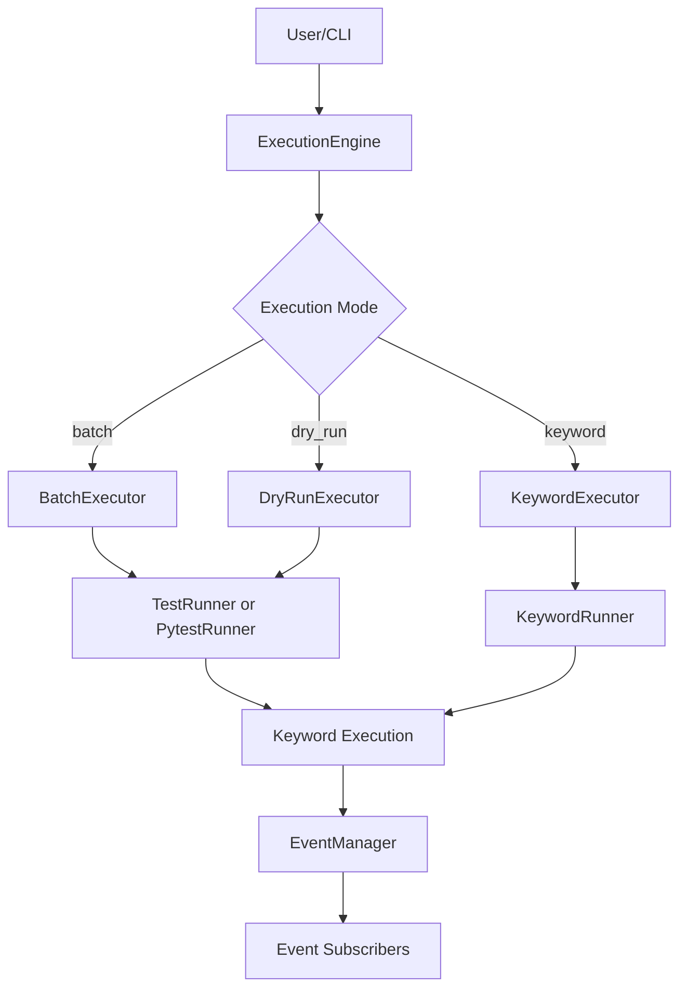

## ExecutionEngine

**Location:** `optics_framework/common/execution.py`

The `ExecutionEngine` is the main orchestrator for test execution. You create it with a `SessionManager`, and you start a run with `await engine.execute(params)`.

### Key responsibilities

- Execution mode selection
- Runner instantiation
- Event management coordination
- Result collection
- Error handling

### ExecutionParams

`ExecutionParams` is a Pydantic model with these fields:

| Field | Type | Default |
|---|---|---|
| `session_id` | `str` | A new UUID |
| `mode` | `str` | Required: `batch`, `dry_run` or `keyword` |
| `keyword` | `Optional[str]` | `None` |
| `params` | `List[str]` | `[]` |
| `runner_type` | `str` | `"test_runner"` (also `"pytest"`; keyword mode always uses `"keyword_runner"`) |
| `use_printer` | `bool` | `True` |

The test cases, modules, elements and APIs are not in `ExecutionParams`. They are part of the `Session`.

### Execution modes

#### Batch mode

Executes all test cases in sequence.

```python
execution_params = ExecutionParams(
    session_id=session_id,
    mode="batch",
    runner_type="test_runner"
)
```

#### Dry run mode

Validates test cases without executing actions.

```python
execution_params = ExecutionParams(
    session_id=session_id,
    mode="dry_run",
    runner_type="test_runner"
)
```

#### Keyword mode

Executes a single keyword with parameters.

```python
execution_params = ExecutionParams(
    session_id=session_id,
    mode="keyword",
    keyword="Press Element",
    params=["submit_button"]
)
```

### Execution flow

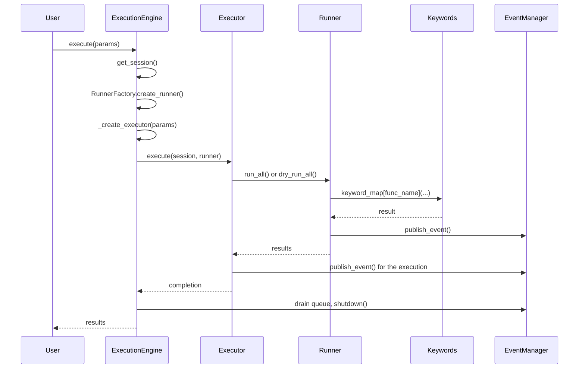

`ExecutionEngine.execute()` does these steps in this order:

1. Gets the session's `EventManager` with `get_event_manager(session_id)` and the session with `session_manager.get_session(session_id)`.
2. Validates the request in `_validate_execution_params()`. A missing session or a `batch` or `dry_run` run without test cases publishes an `ERROR` event and raises `E0702`.
3. Starts the `EventManager`.
4. Inside `LoggerContext(session_id)`, creates the runner with `RunnerFactory.create_runner()`. In keyword mode the runner type is always `keyword_runner`. When the printer is on, it starts the live result display.
5. Publishes a `RUNNING` execution event, creates the executor with `_create_executor()` and runs it with `_run_executor()`.
6. On an error, publishes a `FAIL` execution event. An `OpticsError` is raised again as it is; any other exception is wrapped in `OpticsError` `E0701`.
7. In `finally`, waits for the event queue to drain, then calls `event_manager.shutdown()`. The wait stops after `OPTICS_EVENT_DRAIN_TIMEOUT_S` seconds (default `2.0`).

`_create_executor()` raises `E0702` for an unknown mode. Keyword mode without a keyword raises `E0403`. `RunnerFactory.create_runner()` raises `E0601` for an unknown runner type.

## Executors

Executors handle the different execution modes and coordinate with runners. Each one extends the abstract `Executor` class and implements `async def execute(self, session: Session, runner: Runner)`.

### BatchExecutor

**Location:** `optics_framework/common/execution.py`

Executes all test cases in a session.

#### Batch flow

1. Validates test cases exist. Without them it publishes an `ERROR` event and raises `E0702`.
2. Calls runner's `run_all()` method
3. Collects results from all test cases in `runner.result_printer.test_state`
4. Publishes execution completion event: `PASS` when every test case passed, else `FAIL`
5. Returns aggregated results (the `test_state` dictionary)

If `run_all()` raises, it publishes a `FAIL` execution event and raises again.

### DryRunExecutor

**Location:** `optics_framework/common/execution.py`

Validates test cases without executing actions.

#### Dry run flow

1. Validates test cases exist
2. Calls runner's `dry_run_all()` method
3. Validates keyword existence and parameters: each step's `${name}` values must resolve, and its parameters must bind to the keyword's signature (`E0403` if not)
4. Does not execute actual actions
5. Returns validation results

A dry run does not check locators, the app or the device. `optics execute` does.

### KeywordExecutor

**Location:** `optics_framework/common/execution.py`

Executes a single keyword with parameters.

#### Keyword flow

1. Looks the keyword up in `runner.keyword_map` by its slug (`"_".join(keyword.split()).lower()`). If it is missing, it publishes a `FAIL` event and raises `E0402`.
2. Deserializes the parameters with `_deserialize_params()`: a parameter whose type in the method signature is a list and whose value is a JSON list becomes a Python list.
3. Executes keyword with parameters, in a thread (`asyncio.to_thread`) while it holds `session.keyword_lock`, so keywords in one session do not overlap.
4. On an exception, publishes a `FAIL` event. An `OpticsError` is raised again; any other exception becomes `E0401`.
5. Publishes a `PASS` event and returns keyword result.

`KeywordExecutor` does not try fallback values. If the keyword used AI self-heal, the return value is a dictionary with `result`, `healed`, `heal_summary` and `suggested_steps`, and the event's `extra` carries `healed` and `heal_summary`.

### RunnerFactory

**Location:** `optics_framework/common/execution.py`

`RunnerFactory.create_runner(session, runner_type, use_printer, event_manager)` builds the keyword registry and the runner:

| `runner_type` | Runner | Result printer |
|---|---|---|
| `test_runner` | `TestRunner` | `TreeResultPrinter` when `use_printer` is on, else `NullResultPrinter` |
| `pytest` | `PytestRunner` | `NullResultPrinter` |
| `keyword_runner` | `KeywordRunner` | None |

## Test runners

Runners execute test cases and manage keyword execution. They all extend `Runner` in `optics_framework/common/runner/test_runnner.py` (the file name has three n's). `Runner` declares `test_case`, `result_printer`, `keyword_map`, `apis` and `elements`, gives no-op `execute_test_case()`, `run_all()`, `dry_run_test_case()` and `dry_run_all()`, and shares `_resolve_candidate_params()`.

### TestRunner

**Location:** `optics_framework/common/runner/test_runnner.py`

The main test runner for batch execution.

#### TestRunner features

- Test case execution, including suite setup, test setup, test teardown and suite teardown cases
- Module execution
- Keyword execution
- Element values with fallback, `${name}` variables and `store_as`
- Result collection and reporting
- Commands from the event manager: `Retry` a failed keyword, or `Add` a keyword after the current one

#### TestRunner execution flow

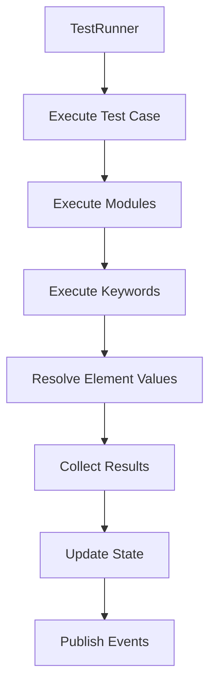

`run_all()` walks the `TestCaseNode` list from `session.test_cases`. A `SetupGuard` skips cases after a failure: after a failed suite setup, only the suite teardown runs; after a failed test setup, its test does not run. A skipped case gets the `SKIPPED` state and a `NOT_RUN` event. Before the suite teardown, or at the end of the run, the runner captures the end-of-run screen.

#### Test case execution

`async def execute_test_case(self, test_case: str)` returns `await self._process_test_case(test_case, dry_run=False)`, and `dry_run_test_case()` passes `dry_run=True`. This is a shortened form of `TestRunner._process_test_case()`:

```python
async def _process_test_case(self, test_case: str, dry_run: bool = False) -> TestCaseResult:
    # 1. Set the test context and get the result entry
    test_case_result = self._init_test_case(test_case)

    # 2. Find the test case node
    current = self.test_cases
    while current and current.name != test_case:
        current = current.next
    if not current:
        await self._send_event("test_case", ..., EventStatus.FAIL, code=Code.E0702)
        return test_case_result

    # 3. Initialize test case state
    current.state = State.RUNNING
    await self._send_event("test_case", current, EventStatus.RUNNING)

    # 4. Execute modules in sequence; the first failed module ends the test case
    module_current = current.modules_head
    while module_current:
        if not await self._process_module(module_current, test_case_result, extra):
            current.state = State.COMPLETED_FAILED
            self._capture_failure_artifacts(current.name)
            await self._send_event("test_case", current, self._last_failure_status)
            return test_case_result
        module_current = module_current.next

    # 5. Collect and return results
    current.state = State.COMPLETED_PASSED
    await self._send_event("test_case", current, EventStatus.PASS)
    return test_case_result
```

**Example execution flow:**

```python
# Test case structure:
# TestCaseNode: "Login Test"
#   ├── ModuleNode: "Launch Application"
#   │   └── KeywordNode: "Launch App"
#   ├── ModuleNode: "Enter Credentials"
#   │   ├── KeywordNode: "Press Element"
#   │   ├── KeywordNode: "Enter Text"
#   │   └── KeywordNode: "Press Element"
#   └── ModuleNode: "Verify Login"
#       └── KeywordNode: "Validate Element"

# Execution order:
# 1. Execute "Launch Application" module
# 2. Execute "Enter Credentials" module
# 3. Execute "Verify Login" module
```

#### Module execution

This is a shortened form of `TestRunner._process_module()`:

```python
async def _process_module(self, module_node: ModuleNode, test_case_result: TestCaseResult, extra: Dict[str, str]) -> bool:
    # 1. Initialize module state
    module_node.state = State.RUNNING
    await self._send_event("module", module_node, EventStatus.RUNNING, parent_id=test_case_result.id)

    # 2. Check that the step names a module or a keyword
    if not self._step_resolves(module_node.name):
        module_node.state = State.COMPLETED_FAILED
        await self._send_event("module", module_node, EventStatus.FAIL, code=Code.E0402)
        return False

    # 3. Execute keywords in sequence; the first failed keyword ends the module
    current = module_node.keywords_head
    while current:
        if not await self._execute_keyword(current, module_node, test_case_result, extra):
            module_node.state = State.COMPLETED_FAILED
            return False
        current = current.next

    # 4. Return module result
    module_node.state = State.COMPLETED_PASSED
    return True
```

Flow control keywords (`Run Loop`, `Condition`, `Execute Module`) run other modules from inside a keyword call. They do not change the linked list.

**Example module execution:**

```python
# Module: "Enter Credentials"
# Keywords:
#   1. Press Element ${username_field}
#   2. Enter Text ${username_field} testuser
#   3. Press Element ${password_field}
#   4. Enter Text ${password_field} testpass
#   5. Press Element ${login_button}

# Execution:
# - Each keyword executed in sequence
# - Element references resolved from elements.csv
# - State tracked per keyword
# - Module state updated on completion
# - The first failed keyword stops the module
```

#### Keyword execution

This is a shortened form of `TestRunner._execute_keyword()`:

```python
async def _execute_keyword(
    self,
    keyword_node: KeywordNode,
    module_node: ModuleNode,
    test_case_result: TestCaseResult,
    extra: Dict[str, str],
) -> bool:
    keyword_node.state = State.RUNNING
    await self._send_event("keyword", keyword_node, EventStatus.RUNNING, parent_id=module_node.id)

    # 1. Look up keyword in the keyword map
    func_name = "_".join(keyword_node.name.split()).lower()
    method = self.keyword_map.get(func_name)
    if not method:
        await self._handle_keyword_not_found(...)  # FAIL event with E0402
        return False

    # 2. Split off store_as and build the values to try for each parameter
    params, store_as = utils.split_store_as(keyword_node.params)
    param_candidates = await self._build_param_candidates(...)
    # Variables: ${element_name} -> every value of that element
    # Plain parameters: one value

    # 3. Execute keyword with fallback support
    result = await self._try_execute_with_fallback(
        method, param_candidates, keyword_node, module_node, ..., store_as=store_as
    )
    if result is not None:
        return result  # True on success, False on a failure that is not element-not-found

    # 4. After the fallback ran out, wait halt_duration and check for a Retry command
    await asyncio.sleep(self.config.halt_duration)
    should_retry = await self._process_commands(keyword_node, module_node)
    ...
```

An exception that is not an `OpticsError` gets the code `X0401` in the event.

**Example keyword execution:**

```python
# Keyword: "Press Element ${submit_button}"
# Args: ["${submit_button}"]

# 1. Lookup: "press_element" in keyword_map
# 2. Resolve: "${submit_button}" -> element values from elements.csv
#    - If element has multiple values: try each as fallback
# 3. Execute: ActionKeyword.press_element(<one value>)
#    - StrategyManager tries the locator strategies in turn
#    - XPath -> Text -> OCR -> Image, then AI self-heal if it is on
# 4. Publish: Keyword execution event
# 5. Return: True on success, False on failure
```

**Parameter resolution example:**

```python
# Test case: "Press Element ${button_name}"
# Elements.csv: button_name = "submit_button"
# Resolved: "Press Element submit_button"

# With fallback in elements:
# Elements.csv: button_name = ["submit_btn", "submit_button", "//button[@id='submit']"]
# Tries each value until one succeeds
```

When several parameters have several values, `fallback.run()` tries their combinations in order, at most `MAX_ATTEMPTS` (20). Only an element-not-found error (`E02xx` or `X0201`) moves on to the next combination. Any other error stops the keyword at once. When all combinations fail, the error is `FallbackExhausted`, which keeps the code of the last failure.

### PytestRunner

**Location:** `optics_framework/common/runner/test_runnner.py`

Integrates with pytest for test execution. Select it with `runner_type="pytest"`, or with `--runner pytest` on the [CLI](/docs/reference/cli).

#### PytestRunner features

- Pytest integration: one generated pytest test per test case
- Fixture support: a generated `conftest.py` gives each test a `runner` fixture that returns `PytestRunner.instance`
- Test discovery: pytest collects the generated file from a temporary folder
- Pytest reporting: JUnit XML at `<execution_output_path>/junit_output.xml`

#### PytestRunner usage

`_run_pytest()` writes a test file in which each test calls `runner.execute_test_case_sync(name, dry_run=...)` and asserts the status is `PASS`, then runs:

```python
pytest.main([temp_dir, "-q", "--disable-warnings", f"--junitxml={junit_path}", "--no-cov"])
```

Events from the pytest runner go to the subscribers at once through `queue_event_sync()`, not through the event queue. A test case that `SetupGuard` blocks calls `pytest.skip()`.

### KeywordRunner

**Location:** `optics_framework/common/runner/test_runnner.py`

Minimal runner for single keyword execution. It holds only the `keyword_map`.

#### KeywordRunner features

- Single keyword execution
- Parameter handling
- Result return
- No test case management

## Event system

The event system provides real-time execution tracking and extensibility. See [Events](/docs/contribute/events) for the full design.

### EventManager

**Location:** `optics_framework/common/events.py`

Centralized event management and distribution. There is one `EventManager` per session, from `get_event_manager(session_id)`.

#### EventManager features

- Event queuing in an `asyncio.Queue`
- Subscriber management: `subscribe()` and `unsubscribe()`
- Async event processing in a background task that `start()` creates
- Command handling: `publish_command()` and `get_command()`. `CommandType` defines `Retry`, `Add`, `Skip`, `Pause` and `Resume`; `TestRunner` acts on `Retry` and `Add` only

#### Event types

```python
class EventStatus(str, Enum):
    NOT_RUN = "NOT_RUN"
    RUNNING = "RUNNING"
    PASS = "PASS"
    FAIL = "FAIL"
    ERROR = "ERROR"
    SKIPPED = "SKIPPED"
    RETRYING = "RETRYING"
```

#### Event structure

```python
class Event(BaseModel):
    entity_type: str  # "test_case", "module", "keyword"
    entity_id: str    # Unique identifier
    name: str         # Human-readable name
    status: EventStatus
    message: str
    code: Optional[str]
    parent_id: Optional[str]
    extra: Dict[str, str]
    timestamp: float
    args: Optional[Union[List[Any], Dict[str, Any]]]
    start_time: Optional[float]
    end_time: Optional[float]
    elapsed: Optional[float]
    logs: Optional[List[str]]
```

`entity_type` is also `"execution"` or `"session"` for events about the whole run. `code` is the error code of a failure, for example `E0201`. `publish_event()` masks secrets in `message`, `extra`, `args` and `logs` before it queues the event.

### Event flow

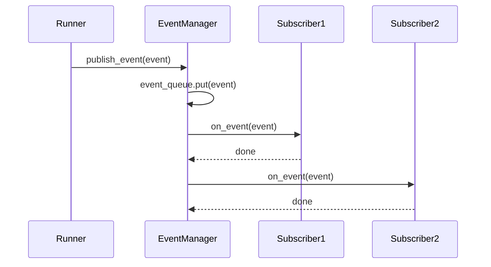

The background task calls the subscribers one after another. An exception in one subscriber is logged, and the next subscriber still gets the event.

### Event subscribers

Subscribers receive and process events.

#### JUnitEventHandler

**Location:** `optics_framework/common/Junit_eventhandler.py`

Generates JUnit XML reports from events. See [Results](/docs/run/results).

#### Custom subscribers

Implement `EventSubscriber` interface:

```python
class CustomSubscriber(EventSubscriber):
    async def on_event(self, event: Event) -> None:
        # Process event
        pass
```

If your subscriber has a `close()` method, `EventManager.shutdown()` calls it.

### Event registration

```python
event_manager = get_event_manager(session_id)
event_manager.subscribe("custom_subscriber", CustomSubscriber())
```

## Keyword registry

**Location:** `optics_framework/common/runner/keyword_register.py`

The `KeywordRegistry` manages keyword registration, discovery, and lookup. It maps keyword names to their implementation methods in one place.

### Registry architecture

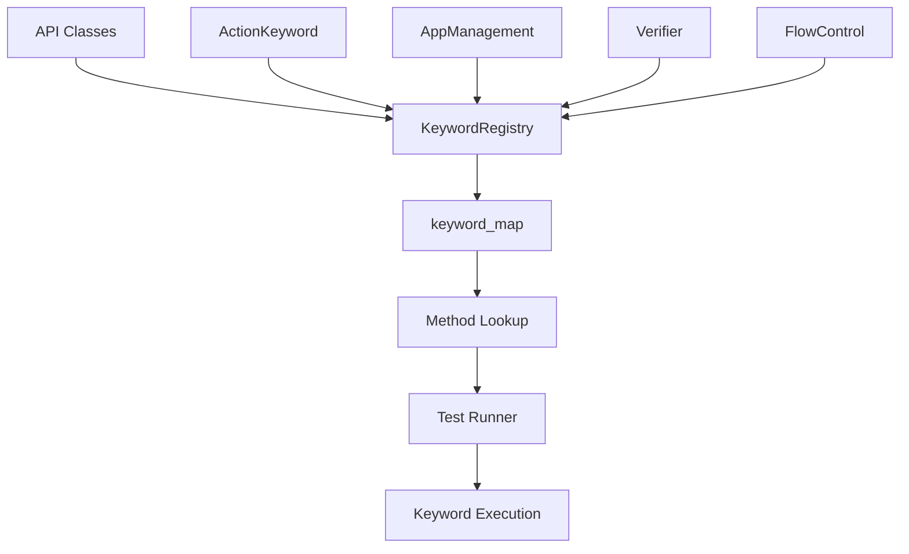

### Registration process

Keywords are registered by passing API class instances to the registry. `RunnerFactory.create_runner()` does this for each run:

```python
from optics_framework.common.runner.keyword_register import KeywordRegistry
from optics_framework.api.action_keyword import ActionKeyword
from optics_framework.api.app_management import AppManagement
from optics_framework.api.verifier import Verifier
from optics_framework.api.flow_control import FlowControl

registry = KeywordRegistry()

# Register API classes
action_keyword = ActionKeyword(builder)
app_management = AppManagement(builder)
verifier = Verifier(builder)
flow_control = FlowControl(session=session, keyword_map=registry.keyword_map)

registry.register(action_keyword)
registry.register(app_management)
registry.register(verifier)
registry.register(flow_control)
```

`builder` is the session's `OpticsBuilder` (`session.optics`). `RunnerFactory` calls `session.optics.build(api_class)`, which returns `api_class(builder)`, and it registers `ActionKeyword`, `AppManagement` and `Verifier` only when `session.driver` is set. `FlowControl` gets the keyword map itself, so `Run Loop` and `Condition` can call other keywords. The runner receives `registry.keyword_map`, not the registry.

### Automatic discovery

The registry automatically discovers public methods from registered instances:

```python
def register(self, instance: object) -> None:
    """
    Register all public callable methods of an instance.

    - Iterates over all attributes
    - Registers callable methods (not starting with _)
    - Warns on duplicate method names
    """
    for method_name in dir(instance):
        if not method_name.startswith("_"):
            method = getattr(instance, method_name)
            if callable(method):
                if method_name in self.keyword_map:
                    internal_logger.warning(
                        f"Warning: Duplicate method name '{method_name}'"
                    )
                self.keyword_map[method_name] = method
```

**Registration rules:**

- Only public methods (not starting with `_`)
- Must be callable
- Method name becomes the keyword identifier
- Duplicate names generate warnings

### Keyword lookup

Keywords are looked up by converting human-readable names to method names:

```python
def get_method(self, func_name: str) -> Optional[Callable[..., object]]:
    """Retrieve a method by its function name."""
    return self.keyword_map.get(func_name)
```

**Name conversion:**

```python
# Human-readable name -> Method name
"Press Element" -> "press_element"
"Enter Text" -> "enter_text"
"Validate Element" -> "validate_element"

# Conversion logic
keyword_slug = "_".join(keyword_name.split()).lower()
method = registry.keyword_map.get(keyword_slug)
```

**Lookup flow:**

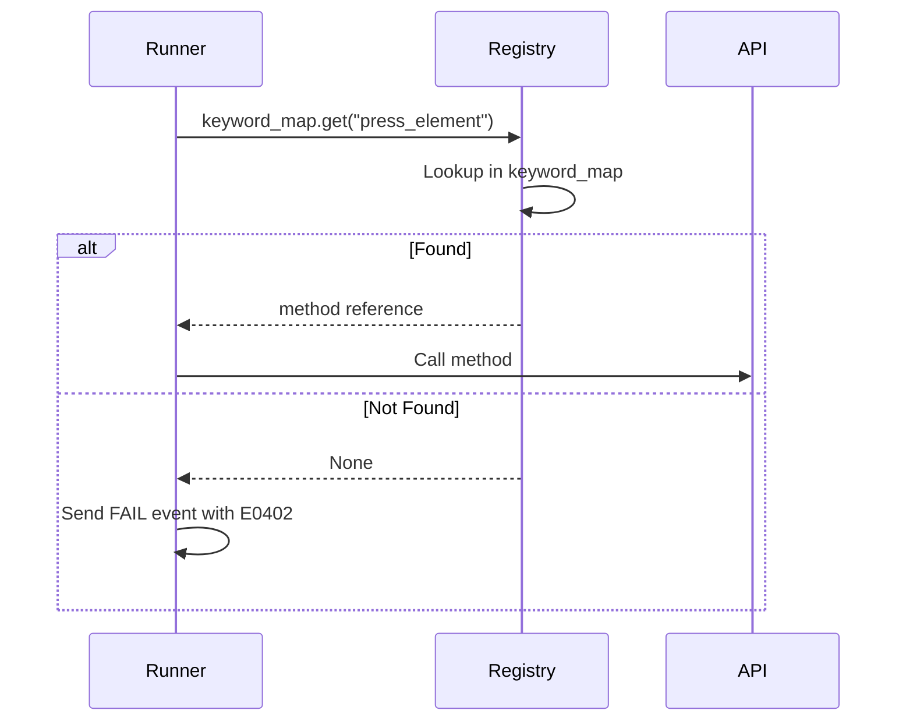

### Keyword map structure

The registry maintains a dictionary mapping method names to callable methods:

```python
class KeywordRegistry:
    def __init__(self):
        self.keyword_map: Dict[str, Callable[..., object]] = {}
```

**Example map:**

```python
{
    "press_element": <bound method ActionKeyword.press_element>,
    "enter_text": <bound method ActionKeyword.enter_text>,
    "launch_app": <bound method AppManagement.launch_app>,
    "validate_element": <bound method Verifier.validate_element>,
    "condition": <bound method FlowControl.condition>,
    # ... more keywords
}
```

### Integration with test runner

The test runner uses the keyword map to execute keywords:

```python
# In TestRunner._execute_keyword
# 1. Convert keyword name to method name
func_name = "_".join(keyword_node.name.split()).lower()

# 2. Lookup method in the keyword map
method = self.keyword_map.get(func_name)
if not method:
    await self._handle_keyword_not_found(...)
    return False

# 3. Resolve parameters
params, store_as = utils.split_store_as(keyword_node.params)
param_candidates = await self._build_param_candidates(...)

# 4. Execute keyword
result = await self._try_execute_with_fallback(method, param_candidates, ...)
```

### Parameter resolution

The keyword map works with the test runner to resolve parameters:

**1. Variable substitution:**

```python
# Test case: "Press Element ${button_name}"
# Resolved: "Press Element submit_button"
# Where ${button_name} is replaced with actual value
```

A parameter that is exactly one `${name}` expands to every value of that element. A whole-parameter `${name}` with no element fails the step with `E0201`. A `${name}` inside a longer parameter is replaced in place by `utils.substitute_inline()` with the element's first value; an unknown name there fails with `E0403`. `$${name}` keeps the literal text `${name}`.

**2. Fallback parameters:**

```python
# Elements: btn = ["btn1", "btn2", "btn3"]
# Test case: "Press Element ${btn}"
# The keyword map provides the method, the runner handles fallback logic
```

In the Python library, a keyword such as `press_element` also takes a list (`fallback_str = Union[str, List[str]]`). Its `@fallback_params` decorator passes the values to `fallback.run()`, which tries them in order.

**3. Type conversion and named parameters:**

```python
# A key=value parameter becomes a keyword argument when key names a parameter
# of the method (DataReader.split_params_by_signature); otherwise it stays positional
# store_as=${name} keeps the keyword's return value in that variable
# KeywordExecutor turns a JSON list into a Python list for a list-typed parameter
```

### Robot Framework integration

When Robot Framework is available, the `Optics` library class exposes keywords through the `@keyword` decorator from `robot.api.deco`. Without Robot Framework, `optics_framework.optics` defines a `keyword` decorator that does nothing.

```python
from optics_framework.optics import keyword

@keyword("Press Element")
def press_element(self, element: str):
    """Press an element."""
    pass
```

The registry works independently of Robot Framework, but both systems can coexist. The `Optics` class also builds a `KeywordRegistry` of its own in `Setup`.

- **Registry**: For internal test execution
- **Robot Framework**: For Robot Framework test files

### Dynamic keyword loading

Keywords can be registered dynamically:

```python
# Register custom keywords
class CustomKeywords:
    def custom_action(self, param: str):
        pass

custom = CustomKeywords()
registry.register(custom)

# Now available as keyword
method = registry.get_method("custom_action")
```

### Registry errors

**Keyword not found:**

```python
method = registry.get_method("nonexistent_keyword")
if method is None:
    raise keyword_not_found("nonexistent_keyword", registry.keyword_map)
    # OpticsError(Code.E0402, message="Keyword not found: nonexistent_keyword. Did you mean '...'? ...")
```

`keyword_not_found()` and `suggest_keyword()` are in the same module. The hint names the closest keyword (by `difflib`, cutoff 0.6) and tells the user to run `optics list`.

**Duplicate registration:**

```python
# Warning logged, but registration continues
# Last registered method wins
internal_logger.warning(
    f"Warning: Duplicate method name '{method_name}'"
)
```

### Registry best practices

1. **Consistent naming**: Use consistent method naming conventions
2. **Public methods only**: Only expose methods intended as keywords
3. **Documentation**: Document keyword behavior in docstrings
4. **Error handling**: Handle errors gracefully in keyword methods
5. **Type hints**: Use type hints for better parameter resolution

### Registry lifecycle

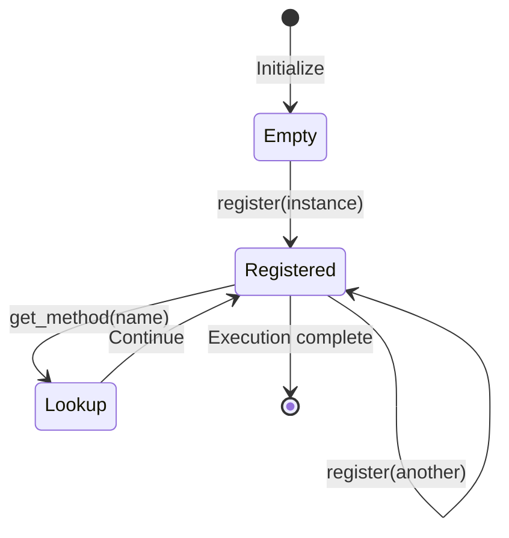

### Registry performance

- **O(1) lookup**: Dictionary-based lookup is fast
- **Single registration**: Methods registered once per runner, that is once per `ExecutionEngine.execute()` call
- **No re-scanning**: Methods cached after registration
- **Memory efficient**: Only stores method references, not copies

### Related components

- **Test runner**: Uses the keyword map for keyword execution
- **API classes**: Provide keyword implementations
- **Execution engine**: Coordinates registry usage through `RunnerFactory`
- **Parameter resolution**: Works with the keyword map for parameter handling

## Data models

**Location:** `optics_framework/common/models.py`

Optics uses a linked list structure to represent the test execution hierarchy, and other data structures to manage test artifacts. This design gives sequential execution, dynamic structure changes and per-node state tracking.

### Why linked lists?

Optics uses linked lists for the execution hierarchy because:

1. **Sequential execution**: Natural order for test execution flow
2. **Memory efficiency**: No array overhead, only stores necessary links
3. **Dynamic structure**: Easy to add/remove nodes during execution
4. **State tracking**: Each node tracks its own execution state
5. **Flexible traversal**: Can traverse forward through execution flow

### Node hierarchy

The execution structure is organized as a linked list:

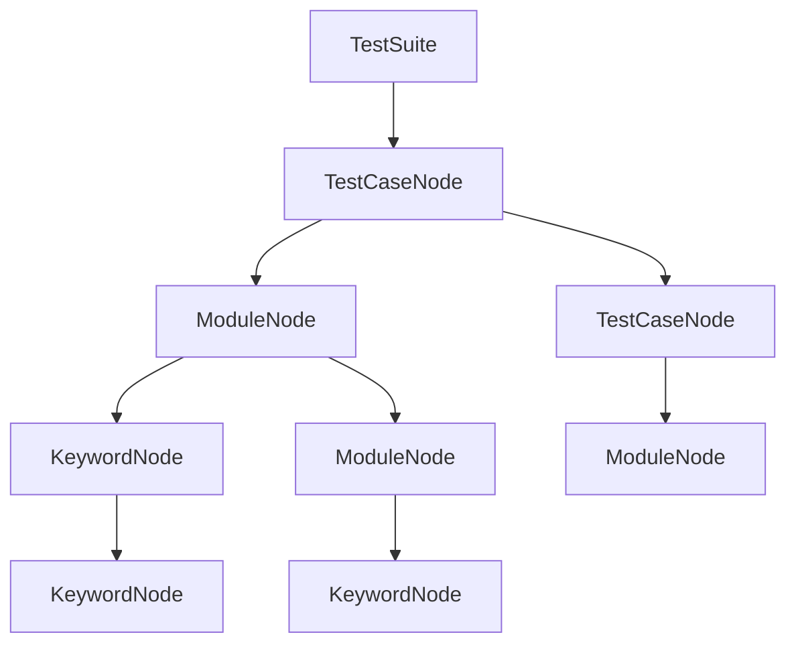

**Structure:**

- **TestSuite**: Container for test cases (head pointer)
- **TestCaseNode**: Individual test case with modules (linked list)
- **ModuleNode**: Reusable module with keywords (linked list)
- **KeywordNode**: Individual keyword execution (linked list)

`build_linked_list()` in `optics_framework/helper/execute.py` builds this structure before the session starts. It uses a `TestSuite` to link the test cases, then gives the session only the head `TestCaseNode` (`session.test_cases`). The order is: suite setup, then each test wrapped in its test setup and test teardown, then suite teardown.

### Base node

All nodes extend the `Node` base class:

```python
class Node(BaseModel):
    id: str = Field(default_factory=lambda: str(uuid4()))  # Unique identifier (UUID)
    name: str  # Human-readable name
    state: State = State.NOT_RUN  # Execution state
    attempt_count: int = 0  # Number of execution attempts
    max_attempts: int = 3  # Maximum retry attempts
    last_failure_reason: Optional[str] = None  # Last failure message
```

**Node properties:**

- **id**: Unique UUID for each node
- **name**: Human-readable identifier
- **state**: Current execution state (see the State enum)
- **attempt_count**: Tracks retry attempts; a `Retry` command adds one
- **max_attempts**: Maximum retries before giving up. The runners do not check it yet.
- **last_failure_reason**: Stores error message for debugging

### State enum

Execution states track the lifecycle of each node:

```python
class State(str, Enum):
    NOT_RUN = "NOT_RUN"              # Initial state, not yet executed
    RUNNING = "RUNNING"              # Currently executing
    COMPLETED_PASSED = "COMPLETED_PASSED"  # Execution succeeded
    COMPLETED_FAILED = "COMPLETED_FAILED"  # Execution failed
    RETRYING = "RETRYING"            # Retrying after failure
    SKIPPED = "SKIPPED"              # Skipped execution
    ERROR = "ERROR"                  # Error occurred
```

**State transitions:**

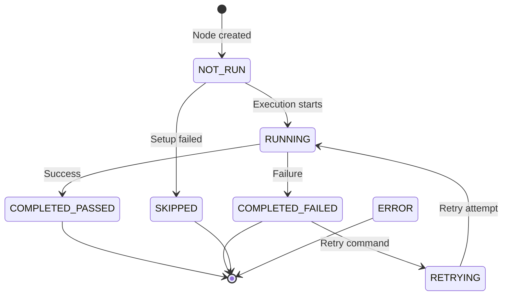

A keyword goes to `RETRYING` only when a `Retry` command for its id is waiting after its fallback values ran out. `SKIPPED` is set on a test case that `SetupGuard` skips. The `ERROR` state exists in the enum, but no runner sets it today; a dead session is reported with the `ERROR` event status instead.

### TestCaseNode

Represents a test case with linked modules:

```python
class TestCaseNode(Node):
    modules_head: Optional[ModuleNode] = None
    kind: CaseKind = CaseKind.TEST
    next: Optional['TestCaseNode'] = None
```

`kind` is one of `CaseKind.SUITE_SETUP`, `SETUP`, `TEST`, `TEARDOWN` or `SUITE_TEARDOWN`. Optics sets it from the end of the test case name, for example a name that ends with "Suite Setup".

**Methods:**

- `add_module(module)`: Add module to test case
- `remove_module(module_name)`: Remove module by name
- `get_module(module_name)`: Get module by name

**Structure:**

```text
TestCaseNode
├── ModuleNode (modules_head)
│   ├── KeywordNode
│   └── KeywordNode (next)
└── ModuleNode (next)
    └── KeywordNode
```

### ModuleNode

Represents a module (reusable keyword sequence) with linked keywords:

```python
class ModuleNode(Node):
    keywords_head: Optional[KeywordNode] = None
    next: Optional['ModuleNode'] = None
```

**Methods:**

- `add_keyword(keyword)`: Add keyword to module
- `remove_keyword(keyword_name)`: Remove keyword by name
- `get_keyword(keyword_name)`: Get keyword by name

**Structure:**

```text
ModuleNode
├── KeywordNode (keywords_head)
│   └── KeywordNode (next)
└── KeywordNode (next)
```

### KeywordNode

Represents a keyword execution with parameters:

```python
class KeywordNode(Node):
    params: List[str] = Field(default_factory=list)  # Keyword parameters
    method_ref: Optional[Callable] = None  # Reference to keyword method
    next: Optional['KeywordNode'] = None
```

When a `KeywordNode` is created, each parameter marked as a secret is registered, so the logs mask it.

**Structure:**

```text
KeywordNode
├── name: "Press Element"
├── params: ["submit_button", "30"]
├── method_ref: <function press_element>
└── next: KeywordNode
```

The runners look the method up in the keyword map by name, so `method_ref` stays `None` in a normal run.

### TestSuite

Container for test cases:

```python
class TestSuite(BaseModel):
    test_cases_head: Optional[TestCaseNode] = None
```

**Methods:**

- `add_test_case(test_case)`: Add test case to suite
- `remove_test_case(test_case_name)`: Remove test case by name
- `get_test_case(test_case_name)`: Get test case by name

### Linked list operations

**Traversal:**

```python
# Traverse test cases
current = test_suite.test_cases_head
while current:
    execute_test_case(current)
    current = current.next

# Traverse modules in test case
current = test_case.modules_head
while current:
    execute_module(current)
    current = current.next

# Traverse keywords in module
current = module.keywords_head
while current:
    execute_keyword(current)
    current = current.next
```

**Adding nodes:**

```python
# Add module to test case
test_case.add_module(module_node)

# Add keyword to module
module.add_keyword(keyword_node)
```

**Removing nodes:**

```python
# Remove module by name
test_case.remove_module("module_name")

# Remove keyword by name
module.remove_keyword("keyword_name")
```

**Searching:**

```python
# Get module by name
module = test_case.get_module("module_name")

# Get keyword by name
keyword = module.get_keyword("keyword_name")
```

### Linked list benefits

1. **Sequential execution**: Natural order for execution flow
2. **Memory efficiency**: No array overhead, only stores necessary links
3. **Dynamic structure**: Easy to add/remove nodes during execution
4. **State tracking**: Each node tracks its own execution state independently
5. **Flexible modification**: Can modify structure without reallocation
6. **Insertion during a run**: an `Add` command links a new `KeywordNode` after the current one while the run continues

### ElementData

Manages element definitions with fallback support:

```python
class ElementData(BaseModel):
    elements: Dict[str, List[str]]  # name -> [value1, value2, ...]
    secrets: set[str]
```

`secrets` holds values to mask in logs; it is not serialized.

**Key features:**

- Multiple values per element (fallback support)
- Automatic fallback resolution
- Priority-based value selection

**Methods:**

- `add_element(name, value)`: Add value to element
- `store(name, value)`: Replace all values of an element with one value (used by `store_as`)
- `remove_element(name)`: Remove element
- `get_element(name)`: Get all values for element
- `get_first(name)`: Get first (highest priority) value
- `resolve_with_fallback(name, resolver)`: Try values until one succeeds

**Example:**

```python
element_data = ElementData()
element_data.add_element("submit_button", "//button[@id='submit']")
element_data.add_element("submit_button", "Submit")  # Fallback
element_data.add_element("submit_button", "submit_template.png")  # Another fallback

# Try each value until one succeeds
element = element_data.resolve_with_fallback(
    "submit_button",
    resolver=lambda v: locate_element(v)
)
```

### ModuleData

Manages reusable module definitions:

```python
class ModuleData(BaseModel):
    modules: Dict[str, List[tuple[str, List[str]]]]  # name -> [(keyword, params), ...]
```

**Structure:**

```python
{
    "login_module": [
        ("Press Element", ["username_field"]),
        ("Enter Text", ["username", "testuser"]),
        ("Press Element", ["password_field"]),
        ("Enter Text", ["password", "testpass"]),
        ("Press Element", ["login_button"])
    ]
}
```

**Methods:**

- `add_module_definition(name, definition)`: Add module definition
- `remove_module_definition(name)`: Remove module
- `get_module_definition(name)`: Get module definition

### ApiData and ApiCollection

Manages API endpoint definitions:

```python
class ApiData(BaseModel):
    global_defaults: Dict[str, Any]
    collections: Dict[str, ApiCollection]

class ApiCollection(BaseModel):
    name: str
    base_url: str
    global_headers: Dict[str, str]
    apis: Dict[str, ApiDefinition]

class ApiDefinition(BaseModel):
    name: str
    description: Optional[str]
    endpoint: str
    request: RequestDefinition
    expected_result: Optional[ExpectedResultDefinition]
```

`RequestDefinition` has `method`, `headers`, `body` and `timeout`. `ExpectedResultDefinition` has `expected_status`, `json_schema`, `jsonpath_assertions` and `extract`. `ApiData` has `add_collection()`, `remove_collection()` and `get_collection()`; `ApiCollection` has `add_api()`, `remove_api()` and `get_api()`.

**Structure:**

```python
api_collection = ApiCollection(
    name="user_api",
    base_url="https://api.example.com",
    global_headers={"Authorization": "Bearer token"},
    apis={
        "get_user": ApiDefinition(
            name="get_user",
            endpoint="/users/{id}",
            request=RequestDefinition(method="GET"),
            expected_result=ExpectedResultDefinition(expected_status=200)
        )
    }
)
```

### TemplateData

Manages image template mappings:

```python
class TemplateData(BaseModel):
    templates: Dict[str, str]  # name -> file_path
```

**Methods:**

- `add_template(name, path)`: Add template mapping
- `remove_template(name)`: Remove template
- `get_template_path(name)`: Get template file path

**Example:**

```python
template_data = TemplateData()
template_data.add_template("submit_button", "/path/to/submit.png")
template_data.add_template("login_form", "/path/to/login.png")
```

## Data-driven testing

### DataReader

**Location:** `optics_framework/common/runner/data_reader.py`

Handles data reading from the project files. `DataReader` is an abstract class with two implementations:

- `CSVDataReader`: test cases, modules, elements and error definitions in CSV files
- `YAMLDataReader`: test cases, modules, elements and API definitions in YAML files

`DataReader.split_params_by_signature()` also lives here; the runners use it to split `key=value` parameters.

#### Supported sources at run time

The flow keywords bring data into the session's elements while a test runs:

- CSV files: `Read Data` (also JSON files)
- API endpoints: `Invoke API`
- Lists/arrays: `Read Data` with a 2D list (Python API only), and `Run Loop` with `a|b|c` values
- Variables: `Read Data` with `ENV:VAR_NAME`, and `store_as` on any keyword

See [flow keywords](/docs/reference/keywords/flow) for their parameters.

### Data flow

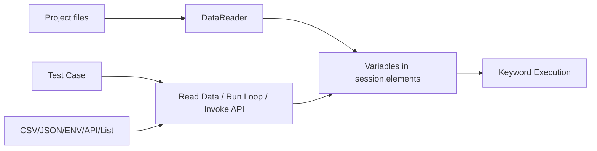

### Execution with data sets

There is no data set loop at test case level. To run the same module once per row, use `Run Loop` with variable and value pairs. `FlowControl._loop_with_variables()` does this:

```python
# For each value
for i in range(min_length):
    # Set variables
    for var_name, iterable_values in zip(var_names, parsed_iterables):
        runner_elements.remove_element(var_name)
        runner_elements.add_element(var_name, iterable_values[i])
    # Execute the module
    result = self.execute_module(target)
```

### Element fallback resolution

The `ElementData.resolve_with_fallback()` method provides automatic fallback:

```python
def resolve_with_fallback(
    self,
    name: str,
    resolver: Callable[[str], Any],
    on_error: Optional[Callable[[Exception, str], None]] = None,
    max_attempts: Optional[int] = None,
) -> Any:
    """Try each value until one succeeds."""
    values = self.get_element(name)
    if not values:
        raise OpticsError(Code.E0201, f"Element not found: {name}")
    attempts = 0
    cap = max_attempts if (max_attempts is not None) else len(values)
    for v in values:
        if attempts >= cap:
            break
        attempts += 1
        try:
            return resolver(v)
        except Exception as e:
            if on_error:
                on_error(e, v)
            continue
    raise OpticsError(Code.X0201, f"Element '{name}' not found after attempting {attempts} value(s); last error: ...")
```

An exception in `on_error` is logged at debug level and does not stop the loop.

**Usage:**

```python
element = session.elements.resolve_with_fallback(
    "submit_button",
    resolver=lambda v: strategy_manager.locate(v),
    on_error=lambda e, v: logger.warning(f"Failed {v}: {e}"),
    max_attempts=3
)
```

## Result collection

### Result printers

**Location:** `optics_framework/common/runner/printers.py`

Collect and format execution results. Each printer implements `IResultPrinter`: the `test_state` property, `print_tree_log()`, `print_event_log()`, `start_live()`, `stop_live()` and `start_run()`.

#### TreeResultPrinter

Hierarchical result display in the terminal (with Rich), with a progress bar and the failure details:

- Test case results
- Module results
- Keyword results
- Nested structure

`TreeResultPrinter.get_instance()` returns one shared instance.

#### NullResultPrinter

No-op printer for programmatic use. It still keeps `test_state`.

### Result structure

```python
class TestCaseResult(BaseModel):
    id: str
    name: str
    elapsed: str
    status: str
    modules: list

class ModuleResult(BaseModel):
    name: str
    elapsed: str
    status: str
    reason: str
    keywords: List[KeywordResult]

class KeywordResult(BaseModel):
    id: str
    name: str
    resolved_name: str
    elapsed: str
    status: str
    reason: str
    stored: dict[str, str]
```

`elapsed` is a string such as `"1.25s"`. `status` is `"NOT_RUN"`, `"RUNNING"`, `"PASS"`, `"FAIL"` or `"SKIPPED"`. `resolved_name` is the keyword with its resolved parameters, and `stored` is what `store_as` kept; both have secrets masked.

## Session lifecycle during execution

### Session creation

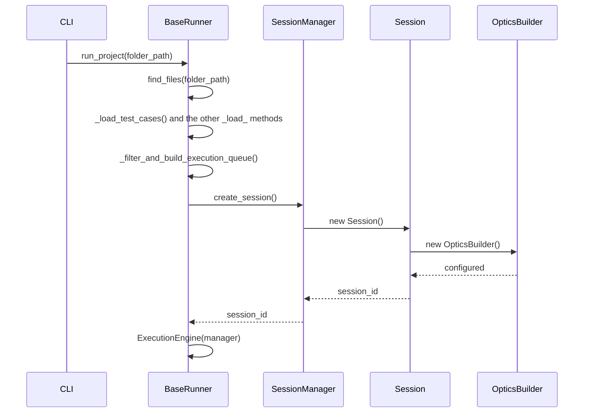

`BaseRunner` is in `optics_framework/helper/execute.py`. `ExecuteRunner` runs mode `batch` and `DryRunRunner` runs mode `dry_run`.

### Execution phase

1. **Initialization**: Load test cases, modules, elements, API definitions, error definitions, config and templates
2. **Setup**: Create session; the session's `OpticsBuilder` sets up the drivers, element sources, text and image detection
3. **Execution**: Run test cases
4. **Cleanup**: `BaseRunner.cleanup()` terminates drivers and closes the session, in a `finally` block

### Session termination

```python
def terminate_session(self, session_id: str) -> None:
    session = self.sessions.pop(session_id, None)
    if session:
        for driver in getattr(session.driver, "instances", [session.driver] if session.driver else []):
            try:
                driver.terminate()
            except Exception as e:
                internal_logger.warning("Failed to terminate driver %s: %s", driver, e)
        session.inline_templates.clear()
    cleanup_junit(session_id)
    base_dir = getattr(session, "_session_dir", None)
    if base_dir:
        try:
            shutil.rmtree(base_dir)
        except OSError as e:
            internal_logger.warning("Failed to remove session directory %s: %s", base_dir, e)
    get_event_manager_registry().remove_session(session_id)
```

It terminates every fallback driver, not only the first, and removes the session's temporary folder.

## Error handling during execution

See [Errors](/docs/contribute/errors) for the error codes.

### Error types

- **OpticsError**: Framework-specific errors with error codes
- **Exception**: General Python exceptions. `TestRunner` reports them with code `X0401`, `KeywordExecutor` wraps them in `E0401`, and `ExecutionEngine` wraps them in `E0701`
- **AssertionError**: Test assertion failures

### Error flow

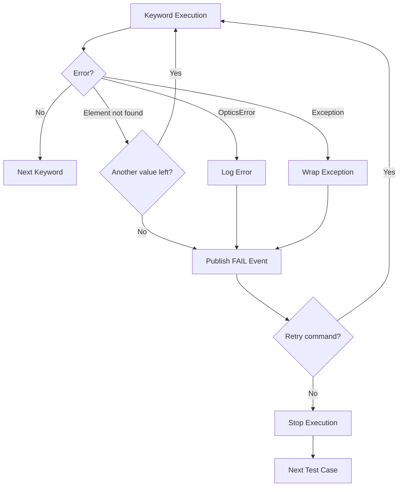

The runner checks for a `Retry` command only after the fallback values ran out. When the driver session is dead, the event status is `ERROR` instead of `FAIL`.

### Error recovery

- **Keyword level**: Try fallback values for element-not-found errors
- **Module level**: The first failed keyword stops the module
- **Test case level**: The first failed module stops the test case; the runner continues with the next test case
- **Setup level**: A failed suite setup skips everything except the suite teardown; a failed test setup skips its test
- **Session level**: Terminate and cleanup

When captures are on, a failed test case saves the screenshot and page source it ended on, and a failed keyword adds the screen's element list to `failed_steps_elements.json`.

## Performance considerations

### Async execution

- Event processing is async
- Non-blocking event publishing: `publish_event()` only puts the event on the queue
- One background task delivers each event to the subscribers, one after another
- `ExecutionEngine` waits at most `OPTICS_EVENT_DRAIN_TIMEOUT_S` (default 2.0 s) for the queue to drain

### Resource management

- One driver per session, used by every test case in that session
- `OpticsBuilder` keeps each component it creates, and creates some (for example the LLM) only on first use
- Lazy component instantiation

### Optimization tips

1. **Batch operations**: Execute multiple test cases in one session
2. **Connection reuse**: Reuse driver connections; the session keeps its driver until it terminates
3. **Parallel execution**: Test cases in one session run in sequence; run independent suites in separate sessions in parallel

## Test context

**Location:** `optics_framework/common/test_context.py`

Test context gives thread-safe and async-safe storage for execution context, through Python's `contextvars` module. Components can read the current test case name without explicit parameter passing.

### Context variables

Optics uses Python's `contextvars` module for context management:

```python
from contextvars import ContextVar

current_test_case: ContextVar[str] = ContextVar("current_test_case", default=None)
element_names: ContextVar[dict[str, str]] = ContextVar("element_names")
```

`element_names` maps each locator value of the keyword about to run to the element name it came from. `name_locators(params, locators)` sets it before each keyword; the first name wins. AI self-heal uses it to tell the model the element's name.

**Why context variables?**

- **Thread-safe**: Each thread/async task has its own context
- **Async-safe**: Automatically propagated to async tasks
- **No parameter passing**: Access context without explicit parameters
- **Isolation**: Context isolated per execution context

### Setting test context

Test context is set during test case execution:

```python
from optics_framework.common import test_context

# Set current test case
test_context.current_test_case.set("test_login")

# Access current test case
test_case_name = test_context.current_test_case.get()
# Returns: "test_login" or None if not set
```

**When context is set:**

- At the start of test case execution, in `TestRunner._init_test_case()`
- Before each test case in a suite
- Automatically by test runner

`PytestRunner` does not set it.

**When context is cleared:**

The runner does not clear it. It sets a new value at the start of each test case, so after a run it still holds the last test case name.

### Usage in components

Components can read test context without explicit parameters:

```python
from optics_framework.common import test_context

class EventSDK:
    def get_test_case_name(self):
        """Get current test case name from context."""
        return test_context.current_test_case.get()

    def user_event_attributes(self, event_name, timestamp=None, **event_attributes):
        test_case_name = self.get_test_case_name()
        event_attributes['testCaseName'] = test_case_name
        ...
```

**Benefits:**

- No need to pass test case name through call stack
- Automatic context propagation
- Cleaner API signatures
- Consistent context access

### Context propagation

Context variables are propagated to:

- **Async tasks**: Context copied to a new async task when it is created
- **Thread workers**: `asyncio.to_thread()` copies the context, so `KeywordExecutor`'s keyword thread sees it; a plain thread pool does not, so `_run_to_completion()` passes `contextvars.copy_context().run`
- **Nested function calls**: Context available in all nested calls
- **Event handlers**: Only when they run in the same context. `PytestRunner` calls subscribers inline, so they see it. The `EventManager` task copies the context when `start()` creates it, before any test case is set, so queued subscribers do not see later values. Use the event's `entity_id` and `parent_id` to find the test case instead.

**Example:**

```python
# Context set in the current task
test_context.current_test_case.set("test_login")

# Context automatically available in an async task created after this point
async def async_operation():
    test_case = test_context.current_test_case.get()
    # Returns: "test_login"
```

### Context isolation

Each execution context has its own context variables:

```python
# Context 1
test_context.current_test_case.set("test_1")
# ... execution ...

# Context 2 (different thread/async task)
test_context.current_test_case.set("test_2")
# ... execution ...

# Each context maintains its own value
```

**Use cases:**

- Parallel sessions
- Async operations
- Event handling
- Logging and tracking

### Integration with EventSDK

`EventSDK` uses test context to include the test case name in every event it captures:

```python
class EventSDK:
    def get_test_case_name(self):
        return test_context.current_test_case.get()

    def capture_event(self, event_name, **args):
        user_event_attrb = self.user_event_attributes(event_name=event_name, **args)
        # ... capture event
```

`user_event_attributes()` sets `testCaseName` from the context.

**Event structure:**

```json
{
  "eventName": "button_clicked",
  "eventAttributes": {
    "testCaseName": "test_login",  // From context
    "button_id": "submit"
  }
}
```

`eventAttributes` also gets `dateTime`, `applicationName` and `applicationVersion`. `testCaseName` is `null` outside a test case.

### Test context best practices

1. **Set context early**: Set context at the start of test case execution
2. **Do not rely on clearing**: The value stays until the next test case sets it
3. **Handle None**: Always check if context is None before using
4. **Don't modify**: Don't modify context from multiple threads simultaneously
5. **Use for metadata**: Use context for metadata, not for control flow

## Execution tracer

**Location:** `optics_framework/common/execution_tracer.py`

The execution tracer writes one structured log line for each strategy attempt during element location. It helps you debug self-healing behavior and see why a strategy succeeds or fails.

### Purpose

The execution tracer logs these facts about each strategy attempt:

- **Strategy class**: Which strategy is being tried
- **Element**: Element being located
- **Status**: Success or failure status
- **Duration**: How long the attempt took, when the caller gives it
- **Error messages**: Error details (if any)

### Tracer architecture

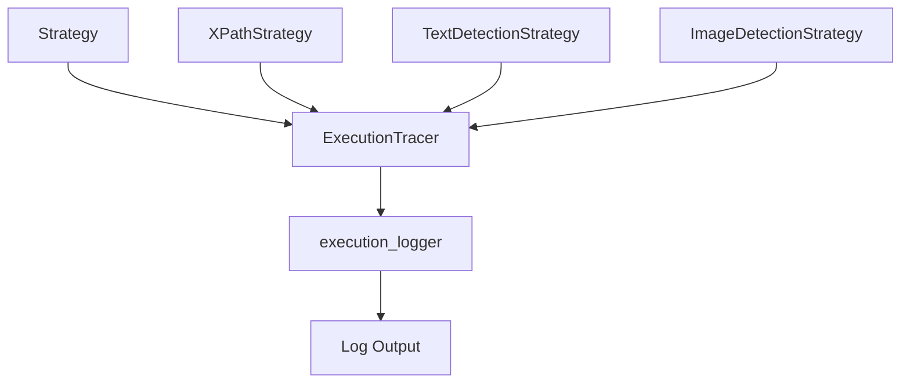

### Tracer implementation

**ExecutionTracer class:**

```python
class ExecutionTracer:
    @staticmethod
    def log_attempt(
        strategy,
        element: str,
        status: str,
        duration: Optional[float] = None,
        error: Optional[str] = None
    ):
```

| Argument | Meaning |
|---|---|
| `strategy` | The strategy instance; the log shows its class name |
| `element` | Element being located |
| `status` | `"success"` or `"fail"`; logged in upper case |
| `duration` | Duration in seconds; left out of the line when `None` |
| `error` | Error message if failed |

The module creates one shared instance, `execution_tracer`. Each call also tells `keyword_outcome` which strategy found the element, so the keyword result can name it.

### Tracer usage

`StrategyManager` in `optics_framework/common/strategies.py` makes the calls. You do not call the tracer from a strategy.

**Logging successful attempt:**

```python
from optics_framework.common.execution_tracer import execution_tracer

execution_tracer.log_attempt(strategy, element, "success")
```

**Logging failed attempt:**

```python
execution_tracer.log_attempt(strategy, element, "fail", error=str(e))
```

### Log format

Tracer logs are formatted as structured messages:

**Success:**

```text
Trying XPathStrategy on 'submit_button' ... SUCCESS, duration: 0.15s
```

**Failure:**

```text
Trying TextDetectionStrategy on 'submit_button' ... FAIL (error: Element not found), duration: 2.50s
```

`StrategyManager` passes no duration today, so its lines end after the status or the error.

**Format components:**

- Strategy class name
- Element identifier
- Status (SUCCESS/FAIL)
- Duration (if provided)
- Error message (if failed)

### Integration with strategies

`StrategyManager` logs each strategy attempt around the strategy's `locate()` call:

```python
try:
    result = _run_locate(strategy, element, index, aoi)
    if result is None:
        return None
    value, annotated_frame = _value_and_frame(result)
    if use_aoi and locate_with_aoi is None and not self._within_aoi(strategy, value, ...):
        execution_tracer.log_attempt(strategy, element, "fail", error="match outside AOI")
        return None
    execution_tracer.log_attempt(strategy, element, "success")
    return LocateResult(value, strategy, annotated_frame=annotated_frame)
except Exception as e:
    execution_tracer.log_attempt(strategy, element, "fail", error=str(e))
    raise
```

It also logs the attempts of `assert_presence()` checks and of the screenshot strategies (with the element `"screenshot"` or `"screenshot_bytes"`).

**Automatic logging:**

- Strategy attempts are logged automatically
- Errors captured and logged
- No manual logging required in a strategy

### Element name handling

The tracer handles different element formats:

```python
element_str = str(element)
if isinstance(element, list) and len(element) == 1:
    element_str = str(element[0])
```

**Examples:**

- Single string: `"submit_button"` → `"submit_button"`
- List with one item: `["submit_button"]` → `"submit_button"`
- List with multiple: `["btn1", "btn2"]` → `"['btn1', 'btn2']"`

### Integration with logging system

The tracer uses the execution logger:

```python
from optics_framework.common.logging_config import execution_logger

execution_logger.info(log_line)
```

**Logger configuration:**

- Uses `optics.execution` logger
- Logs at INFO level
- Formatted for user visibility
- Integrated with execution output

See [Logging](/docs/contribute/logging).

### Tracer benefits

**1. Debugging:**

- See which strategies are tried
- Understand why strategies fail
- Track strategy selection order
- Identify strategy conflicts

**2. Performance analysis:**

- Identify slow strategies
- Compare strategy performance
- Optimize strategy ordering
- Measure location time

**3. Observability:**

- Track self-healing behavior
- Monitor strategy success rates
- Understand fallback patterns
- Analyze element location patterns

**4. Troubleshooting:**

- Understand element location failures
- Debug strategy selection issues
- Identify configuration problems
- Track down performance issues

### Example output

**Complete execution trace:**

```text
Trying XPathStrategy on 'submit_button' ... FAIL (error: Element not found)
Trying TextElementStrategy on 'submit_button' ... FAIL (error: Element not found)
Trying TextDetectionStrategy on 'submit_button' ... SUCCESS
```

**Analysis:**

- XPath failed - element not in DOM
- TextElement failed - element not accessible
- TextDetection succeeded - found via OCR

The log line times show how long each attempt took.

### Tracer best practices

1. **Always log**: Log both success and failure
2. **Include duration**: Measure and log execution time when you can
3. **Capture errors**: Include error messages for failures
4. **Use consistently**: Route every strategy attempt through the tracer
5. **Review logs**: Regularly review tracer logs for insights

### Components related to the tracer

- **Strategies**: Their attempts are logged through `StrategyManager`
- **Execution logger**: Receives tracer logs
- **Self-healing**: Tracer helps understand self-healing behavior
- **Debugging**: Tracer essential for debugging location issues

See [Strategies](/docs/contribute/strategies).

## Extension points

See [Extend Optics](/docs/contribute/extending) for complete recipes.

### Custom runners

Extend `Runner` base class:

```python
class CustomRunner(Runner):
    async def run_all(self):
        # Custom execution logic
        pass
```

`RunnerFactory.create_runner()` knows only `test_runner`, `pytest` and `keyword_runner`. Add a branch there for your runner type.

### Custom executors

Implement `Executor` interface:

```python
class CustomExecutor(Executor):
    async def execute(self, session: Session, runner: Runner):
        # Custom execution logic
        pass
```

`ExecutionEngine._create_executor()` knows only the modes `batch`, `dry_run` and `keyword`. Add a branch there for your mode.

### Custom event handlers

Implement `EventSubscriber`:

```python
class CustomEventHandler(EventSubscriber):
    async def on_event(self, event: Event):
        # Custom event handling
        pass
```

## Debugging execution

### Enable debug logging

Set `log_level: DEBUG` in `config.yaml` (see [config](/docs/reference/config)). It sets the level of both loggers, `optics.internal` and `optics.execution`, and of their handlers. The engine and the runners log to `optics.internal`.

```python
import logging
logging.getLogger("optics.internal").setLevel(logging.DEBUG)
```

This changes only the logger. After `initialize_handlers()` the console and file handlers keep their own level, so debug lines may still not show.

### Event monitoring

```python
# Subscribe to all events; DebugSubscriber is your own EventSubscriber
event_manager.subscribe("debug", DebugSubscriber())
```

### Result inspection

```python
# Access results from runner
results = runner.result_printer.test_state
for test_case_id, result in results.items():
    print(f"{test_case_id}: {result.status}")
```

The keys of `test_state` are test case names. In batch and dry run modes, `ExecutionEngine.execute()` also returns this dictionary.

### Execution tracer logging

Execution tracer logs are automatically written to `execution_logger`:

```python
import logging
logging.getLogger("optics.execution").setLevel(logging.INFO)
# Tracer logs will appear in execution logs
```

## Related documentation

- [Components](/docs/contribute/components): component architecture
- [Strategies](/docs/contribute/strategies): strategy pattern and self-healing
- [Errors](/docs/contribute/errors): error handling
- [Events](/docs/contribute/events): event system
- [Logging](/docs/contribute/logging): logging system and execution tracer
- [Architecture decisions](/docs/contribute/decisions): design decisions for execution architecture
- [Keyword registry](#keyword-registry): keyword registration and lookup
- [Data models](#data-models): linked list structure and data models
- [Test context](#test-context): context variable system
- [Execution tracer](#execution-tracer): strategy attempt logging
- [CLI layer](/docs/contribute/cli-layer): CLI execution
