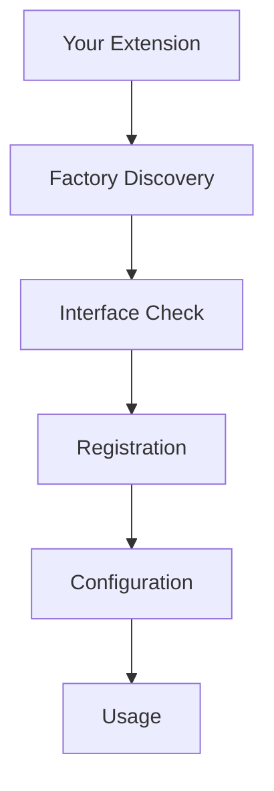

This page tells you how to extend Optics. It covers custom drivers, element sources, vision models, LLM engines, event subscribers, keywords, executors, result printers and locator strategies. It also lists the smaller extension points: CLI subcommands, error codes, config fields and sample projects.

## Introduction

You can extend Optics at these levels:

- **Engines**: drivers, element sources, vision models and LLM engines
- **API layer**: custom keywords and actions
- **Execution layer**: custom executors and result printers
- **Event system**: custom event subscribers
- **Strategies**: custom element location strategies

### When to extend

Extend Optics when:

- You need support for a new automation tool or protocol.
- You want to connect a custom OCR or image recognition service.
- You need keywords for your domain.
- You want custom reports or event handling.
- You need a special execution mode.

### Extension architecture

The factories in `optics_framework/common/factories.py` find engines by name. You put the module in the correct package, and you enable it in `config.yaml` with the module filename as its key. You do not register an engine anywhere else.



The parts of the diagram work like this:

- **Configuration.** `Session.__init__` (`common/session_manager.py`) keeps only the `config.yaml` entries with `enabled: true`. It gives them to `OpticsBuilder` (`common/optics_builder.py`). The builder makes the driver when the session starts, and each other engine when Optics first needs it.
- **Factory discovery.** `GenericFactory.create_instance_dynamic` (`common/base_factory.py`) imports `optics_framework.engines.<package>.<name>`, where `<name>` is the key in `config.yaml`. An unknown name raises `E0601`.
- **Interface check.** The factory takes the first concrete class in the module that subclasses the interface (`DriverInterface`, `ElementSourceInterface`, `TextInterface`, `ImageInterface` or `LLMInterface`). If there is none, it raises `E0603`. The class name does not matter, so keep one implementation in each module.
- **Registration.** The factory reads the parameters of your `__init__`. It passes `config` (the entry's settings) only when `__init__` has a `config` parameter. It passes `event_sdk` to a driver and the matched `driver` to an element source in the same way.
- **Usage.** When you enable more than one entry of a kind, the factory wraps them in an `InstanceFallback` (`common/instance_fallback.py`). Call sites then try each instance in `config.yaml` order.

| Extension | Where it goes | Base class | Selected by |
|---|---|---|---|
| Driver | `engines/drivers/<name>.py` | `DriverInterface` (`common/driver_interface.py`) | `driver_sources` key = module filename |
| Element source | `engines/elementsources/<name>.py` | `ElementSourceInterface` (`common/elementsource_interface.py`) | `elements_sources` key = module filename |
| OCR model | `engines/vision_models/ocr_models/<name>.py` | `TextInterface` (`common/text_interface.py`) | `text_detection` key = module filename |
| Image model | `engines/vision_models/image_models/<name>.py` | `ImageInterface` (`common/image_interface.py`) | `image_detection` key = module filename |
| LLM engine | `engines/llm_models/<name>.py` | `LLMInterface` (`common/llm_interface.py`) | `llm_models` key = module filename |
| Keyword | a method on a class in `optics_framework/api/` | none | the registries listed in [Adding a keyword](#adding-a-keyword) |
| Event subscriber | any module | `EventSubscriber` (`common/events.py`) | `EventManager.subscribe` |
| Executor | `common/execution.py` | `Executor` (`common/execution.py`) | `ExecutionEngine._create_executor` |
| Result printer | `common/runner/` | `IResultPrinter` (`common/runner/printers.py`) | `RunnerFactory.create_runner` |
| Locator strategy | `common/strategies.py` | `LocatorStrategy` (`common/strategies.py`) | `StrategyFactory._registry` |

All paths in this page are relative to the `optics_framework/` package of the [optics-framework repository](https://github.com/mozarkai/optics-framework), unless they start with `tests/`.

## Recipes

These are short walkthroughs for frequent contributions. For tools such as pre-commit hooks, docs previews and local static analysis, see [Set up a development environment](/docs/contribute/setup).

### Adding a keyword

A method on an API class is *not* enough. Keywords reach users through eight entry points. Do these steps:

1. **Add the method** to `ActionKeyword`, `AppManagement`, `Verifier`, or `FlowControl` (`optics_framework/api/`). The CSV/YAML runner, `optics live`, `optics serve`, `optics mcp`, and `optics list` register it automatically.
2. **If it locates an element**, build an `act(located)` callback and return `self._locate_and_act(element, "<name>", act, intent_args, index=index, aoi=(...))` (`api/action_keyword.py`). The keyword then goes through the locator ladder (XPath → text → OCR → image) and gets the AOI, screenshot and AI self-heal support. `press_element` is the example. The `act` callback gets the `located` value: an `(x, y)` tuple or an element handle, so it must accept both. To let AI self-heal call the keyword, add it to `ActionKeyword._heal_dispatch`. Older docs named a `@with_self_healing` decorator. That decorator no longer exists.
3. **Expose it on the SDK facade**: add a wrapper in `optics.py:Optics` with `@keyword("Pretty Name")`, and `@fallback_params` for element arguments. Without this wrapper, Robot Framework and the public SDK cannot see the keyword.
4. **Teach the code generator**: add `"Pretty Name": "method_name"` to `TestFrameworkGenerator.keyword_registry` (`helper/generate.py`). Also add `"Pretty Name"` to the `keyword_registry` set inside `YAMLDataReader.read_modules`, so that YAML step parsing knows multi-word names. Without the first entry, `optics generate` makes the method name from the display name, which is wrong when the two differ. Without the second, a YAML step splits a multi-word name at the first word. Issue [#484](https://github.com/mozarkai/optics-framework/issues/484) tracks a simpler registration.
5. **Write tests for it**: add new test cases under `tests/units/` or `tests/integration/` for your keyword. The existing suite alone is not enough, because no other test runs the new code path. Document the keyword too.
6. **Verify**: run `optics list` and make sure that reflection finds it.

The display name (`"Pretty Name"`) does not depend on the Python method name. If you change either one, change every point above and the docs.

The eight entry points are:

| Entry point | How it finds keywords |
|---|---|
| CSV/YAML runner | `RunnerFactory.create_runner` (`common/execution.py`) calls `KeywordRegistry.register` on each API class, so new public methods register automatically. The runner turns `Title Case Words` into `title_case_words`. |
| Python SDK | `optics.py:Optics` is a `@library(scope="GLOBAL")` class with one explicit `@keyword("Pretty Name")` method for each keyword. There is no automatic registration. |
| HTTP server (`optics serve`) | `discover_keywords()` (`common/expose_api.py`) reflects over `optics_framework.api.*` and skips `_*` and `test*` methods. Types and docstrings go into the OpenAPI document, so keep them correct. |
| Code generation (`optics generate`) | `TestFrameworkGenerator.keyword_registry` and the `keyword_registry` set in `YAMLDataReader.read_modules` (`helper/generate.py`). |
| `optics list` | Prints `discover_keywords()`, the same list that `GET /v1/keywords` returns. `Optics`-only keywords do not show. |
| Robot `Library    optics_framework.optics.Optics` | Only the `@keyword` methods on `Optics`. |
| `optics live` | `LiveController._build_registry` (`helper/live.py`) registers the API classes like the runner, so new API methods work with no extra wiring. |
| MCP server (`optics mcp`) | The `core` toolset reaches each agent-visible keyword through `run_keyword` (`agent_core.keyword_catalog`). `--toolset full` registers each public API method as a tool. A dedicated core verb needs a case in `agent_core.prepare` and a tool in `build_server` (`helper/mcp_server.py`). |

:::warning[Keep helper methods private]
`KeywordRegistry.register` makes every public callable a keyword. Two API classes can then have the same keyword name, and Optics only logs a warning. Start the name of each helper method with `_`.
:::

### Adding an engine backend

- **Driver**: subclass `DriverInterface` in `engines/drivers/<name>.py`. The factory finds it when the module filename matches the `config.yaml` key. See [Creating new drivers](#creating-new-drivers).
- **Element source**: implement `ElementSourceInterface` in `engines/elementsources/<name>.py`. Set `REQUIRED_DRIVER_TYPE` so that the factory injects the matching driver. See [Creating new element sources](#creating-new-element-sources).
- **OCR / image detector**: implement `TextInterface` / `ImageInterface` under `engines/vision_models/`. See [Creating new text detection models](#creating-new-text-detection-models) and [Creating new image detection models](#creating-new-image-detection-models).
- **LLM backend**: subclass `LLMInterface` in `engines/llm_models/<name>.py`. The factory selects it when the module filename matches the `llm_models:` config key. See [Creating new LLM engines](#creating-new-llm-engines).

For the wiring details, see [Engines](/docs/contribute/engines).

## Creating new drivers

Drivers do user actions on target applications or devices.

### Step 1: Create driver file

Create a new file in `optics_framework/engines/drivers/your_driver.py`:

```python title="optics_framework/engines/drivers/your_driver.py"
from typing import Any, Dict, Optional
from optics_framework.common.driver_interface import DriverInterface
from optics_framework.common.logging_config import internal_logger
from optics_framework.common.eventSDK import EventSDK
from optics_framework.common.error import OpticsError, Code

class YourDriver(DriverInterface):
    """
    Your custom driver implementation.
    """

    DEPENDENCY_TYPE = "driver_sources"
    NAME = "your_driver"

    def __init__(self, config: Optional[Dict[str, Any]] = None, event_sdk: Optional[EventSDK] = None):
        """
        Initialize your driver.

        Args:
            config: Configuration dictionary
            event_sdk: Optional EventSDK for tracking actions
        """
        self.config = config or {}
        self.event_sdk = event_sdk
        self.driver = None  # Your driver instance

        # Initialize your driver here
        self._initialize_driver()

    def _initialize_driver(self):
        """Initialize the underlying driver."""
        # Your initialization logic
        pass

    def launch_app(
        self,
        app_identifier: str | None = None,
        app_activity: str | None = None,
        event_name: str | None = None,
    ) -> Optional[str]:
        """Launch an application."""
        if self.event_sdk and event_name:
            self.event_sdk.capture_event(event_name)

        # Your launch logic
        session_id = "your_session_id"
        return session_id

    def press_coordinates(
        self,
        coor_x: int,
        coor_y: int,
        event_name: Optional[str] = None
    ) -> None:
        """Press at absolute coordinates."""
        if self.event_sdk and event_name:
            self.event_sdk.capture_event(event_name)

        # Your press logic
        pass

    def press_element(
        self,
        element: str,
        repeat: int,
        event_name: Optional[str] = None
    ) -> None:
        """Press a UI element."""
        if self.event_sdk and event_name:
            self.event_sdk.capture_event(event_name)

        # Your element press logic
        pass

    def press_percentage_coordinates(
        self,
        percentage_x: float,
        percentage_y: float,
        repeat: int,
        event_name: Optional[str] = None
    ) -> None:
        """Press at percentage coordinates."""
        if self.event_sdk and event_name:
            self.event_sdk.capture_event(event_name)

        # Your percentage press logic
        pass

    def enter_text(
        self,
        text: str,
        event_name: Optional[str] = None
    ) -> None:
        """Enter text."""
        if self.event_sdk and event_name:
            self.event_sdk.capture_event(event_name)

        # Your text entry logic
        pass

    def press_keycode(
        self,
        keycode: str,
        event_name: Optional[str] = None
    ) -> None:
        """Press a key code."""
        if self.event_sdk and event_name:
            self.event_sdk.capture_event(event_name)

        # Your keycode logic
        pass

    def enter_text_element(
        self,
        element: str,
        text: str,
        event_name: Optional[str] = None
    ) -> None:
        """Enter text into an element."""
        if self.event_sdk and event_name:
            self.event_sdk.capture_event(event_name)

        # Your text entry logic
        pass

    def enter_text_using_keyboard(
        self,
        text: str,
        event_name: Optional[str] = None
    ) -> None:
        """Enter text using keyboard."""
        if self.event_sdk and event_name:
            self.event_sdk.capture_event(event_name)

        # Your keyboard input logic
        pass

    def clear_text(self, event_name: Optional[str] = None) -> None:
        """Clear text."""
        if self.event_sdk and event_name:
            self.event_sdk.capture_event(event_name)

        # Your clear text logic
        pass

    def clear_text_element(
        self,
        element: str,
        event_name: Optional[str] = None
    ) -> None:
        """Clear text from an element."""
        if self.event_sdk and event_name:
            self.event_sdk.capture_event(event_name)

        # Your clear text logic
        pass

    def swipe(
        self,
        x_coor: int,
        y_coor: int,
        direction: str,
        swipe_length: int,
        event_name: Optional[str] = None
    ) -> None:
        """Swipe gesture."""
        if self.event_sdk and event_name:
            self.event_sdk.capture_event(event_name)

        # Your swipe logic
        pass

    def swipe_percentage(
        self,
        x_percentage: int,
        y_percentage: int,
        direction: str,
        swipe_length_percentage: int,
        event_name: Optional[str] = None
    ) -> None:
        """Swipe by percentage (x_percentage, y_percentage, swipe_length_percentage are integers 0-100)."""
        if self.event_sdk and event_name:
            self.event_sdk.capture_event(event_name)

        # Your swipe logic
        pass

    def swipe_element(
        self,
        element: str,
        direction: str,
        swipe_length: int,
        event_name: Optional[str] = None
    ) -> None:
        """Swipe an element."""
        if self.event_sdk and event_name:
            self.event_sdk.capture_event(event_name)

        # Your swipe logic
        pass

    def scroll(
        self,
        direction: str,
        duration: int,
        event_name: Optional[str] = None
    ) -> None:
        """Scroll gesture."""
        if self.event_sdk and event_name:
            self.event_sdk.capture_event(event_name)

        # Your scroll logic
        pass

    def get_text_element(self, element: str) -> str:
        """Get text from an element."""
        # Your text extraction logic
        return "extracted_text"

    def force_terminate_app(
        self,
        app_name: str,
        event_name: Optional[str] = None
    ) -> None:
        """Force terminate an application."""
        if self.event_sdk and event_name:
            self.event_sdk.capture_event(event_name)

        # Your termination logic
        pass

    def terminate(self) -> None:
        """Clean up and terminate the driver."""
        # Your cleanup logic
        if self.driver:
            # Close connections, release resources
            pass

    def get_app_version(self) -> str:
        """Get application version."""
        # Your version retrieval logic
        return "1.0.0"

    def launch_other_app(
        self,
        app_name: str,
        event_name: str | None
    ) -> None:
        """Launch another application."""
        if self.event_sdk and event_name:
            self.event_sdk.capture_event(event_name)

        # Your launch logic
        pass

    def get_driver_session_id(self) -> Optional[str]:
        """Get driver session ID if supported."""
        return getattr(self.driver, 'session_id', None)

    def execute_script(
        self,
        script: str,
        *args,
        event_name: Optional[str] = None
    ) -> Any:
        """Execute a script."""
        if self.event_sdk and event_name:
            self.event_sdk.capture_event(event_name)

        # Your script execution logic
        return None
```

The methods above are all the abstract methods of `DriverInterface`. `EventSDK` (`common/eventSDK.py`) records an event only when the keyword has an `event_name`. The built-in drivers call `capture_event(event_name)` in the same way.

### Step 2: Configuration

The factory finds your driver when its module filename (`your_driver`) is the key in `config.yaml`:

```yaml title="config.yaml"
driver_sources:
  - your_driver:
      enabled: true
      url: "your_driver_url"
      capabilities:
        key1: "value1"
        key2: "value2"
```

Each entry accepts only `enabled`, `url` and `capabilities` (`DependencyConfig` in `common/config_handler.py`). Optics drops other keys silently. Your driver gets the entry as its `config` dictionary, so read `config.get("url")` and `config.get("capabilities", {})`.

### Optional driver capabilities

Some actions exist only on some platforms. For such an action, add a non-abstract method to `DriverInterface` that calls `self._unsupported("<name>")`. That call raises `E0105`. Override the method in the drivers that support it. `go_back` is the example.

- `DriverInterface.supports(method)` is false for a method whose full body refuses (`raise NotImplementedError` or `self._unsupported(...)`). `agent_core.runs_on` uses it to remove, for each MCP session, a keyword when the driver supports none of the driver methods that the keyword calls.
- `E0105` is fatal. It is not in the `E02*` family, so no fallback level tries again.
- If your backend can lose its remote session, override `DriverInterface.is_dead_session_error(exc)`. `session_liveness` then fails fast with `E0106`, not with element-not-found.
- `AppManagement` gives each driver a screen reader through `DriverInterface.attach_screen`. Override it if your driver must read the screen, as the `ble` driver does to check that an app opened.

### Appium device families

To add a device family to Appium, add a `PlatformProfile` in `engines/drivers/appium_platforms.py`. The current profiles are Android, iOS, Tizen, webOS, Mac, Linux and Windows. `@supported_on(*platforms)` raises `Code.E0105` for a method that the session's family does not support. In `config.yaml`, a new family changes `platformName`. A desktop family (`app_at_start`: Mac, Linux, Windows) also needs `app` to launch the app, or `appName` to attach to a running one.

### Key points

- Set `NAME = "your_driver"`. The factory reads `NAME` only to match element sources through their `REQUIRED_DRIVER_TYPE` (for example, `Appium.NAME = "appium"`). The built-in drivers also set `DEPENDENCY_TYPE = "driver_sources"`, but only for their error messages. The factory does not read it.
- Implement all abstract methods from `DriverInterface`.
- Use `EventSDK` for action events (optional but recommended).
- Handle errors with `OpticsError`.
- Do the cleanup in `terminate()`.

## Creating new element sources

Element sources find and locate UI elements.

### Step 1: Create element source file

Create a new file in `optics_framework/engines/elementsources/your_element_source.py`:

```python title="optics_framework/engines/elementsources/your_element_source.py"
from typing import Optional, Any, List
import numpy as np
from optics_framework.common.elementsource_interface import ElementSourceInterface
from optics_framework.common.logging_config import internal_logger

class YourElementSource(ElementSourceInterface):
    """
    Your custom element source implementation.
    """

    # If your element source requires a specific driver, set this:
    REQUIRED_DRIVER_TYPE = "your_driver"  # or None if driver-independent

    def __init__(self, driver: Optional[Any] = None, config: Optional[dict] = None):
        """
        Initialize element source.

        Args:
            driver: Optional driver instance (if REQUIRED_DRIVER_TYPE is set)
            config: Optional configuration dictionary
        """
        self.driver = driver
        self.config = config or {}

    def capture(self) -> np.ndarray:
        """
        Capture the current screen state.

        Returns:
            Screenshot as NumPy array
        """
        # Your screenshot capture logic
        # Return as numpy.ndarray with shape (height, width, channels)
        pass

    def locate(self, element: Any, index: int | None = None) -> tuple:
        """
        Locate an element within the current screen state.

        Args:
            element: Element identifier (XPath, text, etc.)
            index: Index if multiple matches

        Returns:
            Tuple (x, y) representing element center, or element object
        """
        # Your element location logic
        # Return coordinates (x, y) or element object
        pass

    def assert_elements(
        self,
        elements: Any,
        timeout: int = 30,
        rule: str = 'any'
    ) -> None:
        """
        Assert the presence of elements on the screen.

        Args:
            elements: List of elements to check
            timeout: Time to wait
            rule: 'any' or 'all'

        Raises:
            AssertionError if assertion fails
        """
        # Your assertion logic
        pass

    def get_interactive_elements(
        self,
        filter_config: Optional[List[str]] = None,
        compact: bool = False
    ) -> list:
        """
        Retrieve interactive elements on the current screen.

        Args:
            filter_config: Optional filter types (e.g., ["buttons", "inputs"])
            compact: Return only actionable elements and standalone visible text

        Returns:
            List of interactive elements
        """
        # Your interactive element detection logic
        return []
```

`locate` returns `(x, y)` in the driver's window space (`get_window_size`), because AOI filters compare against it. It can also return a `ScreenPoint` (`common/elementsource_interface.py`): an `(x, y)` tuple that also carries the text, `covered`, `enabled` and `checked` state that `Verifier.is_element` reads.

### Step 2: Driver dependency

If your element source requires a specific driver:

```python
REQUIRED_DRIVER_TYPE = "appium"  # Must match driver NAME
```

`ElementSourceFactory._find_matching_driver` (`common/factories.py`) matches it against the `NAME` of each enabled driver and injects that driver as `driver=`.

A capture-only source that works with any driver sets `ACCEPTS_ANY_DRIVER = True`, as `camera_screenshot` does. The factory then injects the first enabled driver. `utils.is_appium_source` makes `_pixel_scale_for_source` (`common/utils.py`) map its OCR and image matches into an Appium driver's window.

### Step 3: Configuration

```yaml title="config.yaml"
elements_sources:
  - your_element_source:
      enabled: true
      capabilities:
        # Additional configuration
        key1: "value1"
```

As for drivers, put your settings under `capabilities`. Optics drops keys other than `enabled`, `url` and `capabilities`.

### Optional methods

Implement what your strategies need: `locate` (XPath and text), `capture` (OCR, image and screenshots) and `get_page_source`. The interface also has these optional methods:

| Method or attribute | Default | Override it when |
|---|---|---|
| `check_elements(elements, visible)` | Calls `assert_elements()` once for each element with a 1 s timeout | You can do one fast, non-waiting look. This keeps assertion rounds fast. |
| `can_locate(element)` | `True` | Your source handles only some locators. Strategies then skip the other elements, so a `css=` assert never queries native sources. |
| `get_page_source()` | Raises `NotImplementedError` | Your source can return `(page_source, timestamp)`. |
| `assert_elements_visible(...)` | Raises `NotImplementedError` | Your source can tell visible elements from elements that are only in the page source. |
| `capture_screenshot_bytes()` | Encodes `capture()` as PNG | Your backend returns encoded bytes. Subclass `EncodedScreenshotSource` and implement only `capture_screenshot_bytes`. The base class decodes it for `capture()`. |
| `count(element)` | `None` | Your source can count the nodes that a locator matches. |
| `get_element_bboxes(elements)` | A list of `None`, one for each element | Your source knows element bounds, for annotated screenshots. |
| `get_bbox_for_element(element)` | `None` | Your source knows the bounds of an element that it already located. |
| `SUPPLEMENTS_SCREEN_ELEMENTS` | `False` | Your elements sit inside another source's screen (a web page in an app). `StrategyManager.get_interactive_elements` then merges them into the native list. |

:::mistake[A stub hides your source]
`LocatorStrategy._is_method_implemented` (`common/strategies.py`) treats a method whose body only raises `NotImplementedError` as missing. Strategies that need that method then skip your source silently. Use such a stub only for a method that you do not support.
:::

If your plain-text lookups match more loosely than exact text (fuzzy, `contains()` or loose-match flags), gate the loose path behind `Config.strict_element_match`. Use a `_strict_element_match()` helper that reads `self.driver.event_sdk.config_handler.config.strict_element_match` and returns `False` on `AttributeError`. Apply it to both `locate` and `assert_elements`, as `AppiumPageSource`, `SeleniumPageSource` and `PlaywrightPageSource` do. With the `False` default, a near-miss can satisfy a presence check. Suites that must tell near-miss labels apart set `strict_element_match: true`.

### Key points

- Set `REQUIRED_DRIVER_TYPE` if driver-dependent
- Implement all abstract methods from `ElementSourceInterface`
- Return NumPy arrays for screenshots
- Optionally override `check_elements(elements, visible=False)` with one non-waiting look per element; the default calls `assert_elements()` once per element with a 1 s timeout
- Assertions own timing and retries: they call each source's `check_elements()` once per round until the timeout, so `assert_elements()` need not loop

## Creating new text detection models

Text detection models give OCR capabilities.

### Step 1: Create OCR model file

Create a new file in `optics_framework/engines/vision_models/ocr_models/your_ocr.py`:

```python title="optics_framework/engines/vision_models/ocr_models/your_ocr.py"
from typing import Optional, Tuple, Any, List
import numpy as np
from optics_framework.common.text_interface import TextInterface
from optics_framework.common.logging_config import internal_logger

class YourOCR(TextInterface):
    """
    Your custom OCR implementation.
    """

    def __init__(self, config: Optional[dict] = None):
        """
        Initialize OCR model.

        Args:
            config: Configuration dictionary
        """
        self.config = config or {}
        # Initialize your OCR engine here
        self._initialize_ocr()

    def _initialize_ocr(self):
        """Initialize the OCR engine."""
        # Your initialization logic
        pass

    def detect_text(
        self,
        input_data
    ) -> Optional[Tuple[str, List[Tuple[List[Tuple[int, int]], str, float]]]]:
        """
        Detect all text in input data.

        Args:
            input_data: Screenshot/image as NumPy array

        Returns:
            Tuple (detected_text_str, results) where each result is:
            (bbox, text, confidence) where bbox is list of (x,y) tuples
        """
        # Your full text detection logic
        # Return (full_text_string, [(bbox, text, confidence), ...])
        pass
```

`TextFactory` (`common/factories.py`) loads the model. `TextInterface` wraps your `detect_text` so that it reads each frame once: a second call with the same pixels returns the earlier result. `OpticsBuilder.add_text_detection` adds `execution_output_path` to your `config`.

### Step 2: Configuration

```yaml title="config.yaml"
text_detection:
  - your_ocr:
      enabled: true
      capabilities:
        api_key: "your_api_key"
        language: "en"
```

### Key points

- Implement only `detect_text`: `TextInterface.find_element` matches the text the same way for every engine
- Never match text in the engine. `find_text` (`common/text_match.py`) is the one rule for every engine, for both locate and assert. It also applies `strict` (`Config.strict_element_match`).
- Handle NumPy array inputs (screenshots)
- Return bounding boxes with confidence scores
- Support multiple language detection

## Creating new image detection models

Image detection models give template matching capabilities.

### Step 1: Create image model file

Create a new file in `optics_framework/engines/vision_models/image_models/your_image_matcher.py`:

```python title="optics_framework/engines/vision_models/image_models/your_image_matcher.py"
from typing import Literal, Optional, Tuple, Any
import numpy as np
import cv2
from optics_framework.common.image_interface import ImageInterface
from optics_framework.common.logging_config import internal_logger
from optics_framework.engines.vision_models.base_methods import load_template

class YourImageMatcher(ImageInterface):
    """
    Your custom image matching implementation.
    """

    def __init__(self, config: Optional[dict] = None):
        """
        Initialize image matcher.

        Args:
            config: Configuration dictionary with project_path and templates
        """
        self.config = config or {}
        self.project_path = self.config.get("project_path", "")
        self.templates = self.config.get("templates", None)
        self.execution_output_dir = self.config.get("execution_output_path", "")

    def element_exist(
        self,
        input_data: Any,
        reference_data: Any
    ) -> (
        tuple[Literal[False], tuple[None, None], None]
        | tuple[Literal[True], tuple[int, int], list[tuple[int, int]]]
    ):
        """
        Check if image exists in input data.

        Args:
            input_data: Screenshot/image as NumPy array
            reference_data: Template image path or name

        Returns:
            (False, (None, None), None) if not found
            (True, (x, y), [corners]) if found
        """
        # Load template
        try:
            template = load_template(reference_data, self.templates)
        except ValueError:
            return (False, (None, None), None)

        # Your image matching logic
        # Return (True, (x, y), [corners]) or (False, (None, None), None)
        pass

    def find_element(
        self,
        input_data,
        image,
        index=None
    ) -> Optional[Tuple[bool, Tuple[int, int], Tuple[Tuple[int, int], Tuple[int, int]]]]:
        """
        Locate image in input data.

        Args:
            input_data: Screenshot/image as NumPy array
            image: Template image path or name
            index: Index if multiple matches

        Returns:
            Tuple (found, center, bounds) where:
            - found: bool
            - center: (x, y) coordinates
            - bounds: ((x1, y1), (x2, y2)) bounding box
            Returns None if not found
        """
        # Load template
        try:
            template = load_template(image, self.templates)
        except ValueError:
            return None

        # Your image matching logic
        # Return (True, (x, y), ((x1, y1), (x2, y2))) or None
        pass

    def assert_elements(
        self,
        input_data,
        elements,
        rule="any"
    ) -> Optional[Tuple[bool, Any]]:
        """
        Assert that elements are present.

        Args:
            input_data: Screenshot/image as NumPy array
            elements: List of template images
            rule: "any" or "all"

        Returns:
            Tuple (result, annotated_image) or None
        """
        # Your assertion logic
        # Check if elements exist based on rule
        # Return (True, annotated_image) or (False, None)
        pass
```

`load_template` (`engines/vision_models/base_methods.py`) raises `ValueError` when the template is not in the template data or cannot be read. It raises `OpticsError` `E0304` when the template is too large or is not a valid image. `ImageFactory` (`common/factories.py`) loads the model.

### Step 2: Configuration

```yaml title="config.yaml"
image_detection:
  - your_image_matcher:
      enabled: true
      capabilities:
        confidence_threshold: 0.85
```

You do not set `project_path` or `execution_output_path`. `OpticsBuilder.add_image_detection` (`common/optics_builder.py`) adds `project_path`, `execution_output_path` and `templates` to your `config` from the session.

### Key points

- Use `load_template()` helper to load template images
- Support template discovery from project directory
- Return proper coordinate formats
- Support multiple match detection (index parameter)

## Creating new LLM engines

LLM engines power AI self-heal and the natural-language mode of `optics live`.

1. Create `engines/llm_models/<name>.py` with a subclass of `LLMInterface` (`common/llm_interface.py`). Implement the abstract `generate(prompt, images=None, system=None, response_schema=None, *, temperature=None) -> str`. The base class gives you `generate_json`. The module also has `missing_extra_error` and `image_mime_type`.
2. `LLMFactory` (`common/factories.py`) selects the engine when the module filename matches the `llm_models` config key. The examples are `GeminiLLM` (`engines/llm_models/gemini.py`), `OpenAILLM` (`openai.py`) and `AnthropicLLM` (`anthropic.py`).
3. Name the pyproject extra after the key. Register it in `LLM_ENGINES` (`helper/setup.py`) and in the `llm` bundle.
4. Add a disabled default entry in `Config.__init__` (`common/config_handler.py`).
5. Read a key with `api_key(caps, default_env)` (`common/llm_interface.py`). It reads `capabilities.api_key` first, then the variable that `capabilities.api_key_env` names. `service_account_credentials` (`common/google_credentials.py`) loads a Google key file from `capabilities.credentials_path`.
6. Pass `request_timeout_s(caps)` to the SDK timeout, so that a request that hangs raises an error (wrapped as `E0801`).

The response schemas (`ACTION_SCHEMA`, `HEAL_ACTION_SCHEMA`, `CURATION_SCHEMA`) are plain JSON Schema. Each engine adapts them to its provider.

## Creating new event subscribers

Event subscribers process execution events for custom handling.

### Step 1: Create event subscriber

Create a new file in `optics_framework/common/your_event_handler.py`:

```python title="optics_framework/common/your_event_handler.py"
from optics_framework.common.events import EventSubscriber, Event, EventStatus
from optics_framework.common.logging_config import internal_logger
from typing import Optional

class YourEventHandler(EventSubscriber):
    """
    Your custom event handler.
    """

    def __init__(self, config: Optional[dict] = None):
        """
        Initialize event handler.

        Args:
            config: Optional configuration dictionary
        """
        self.config = config or {}
        self.events = []  # Store events if needed

    async def on_event(self, event: Event) -> None:
        """
        Process an event.

        Args:
            event: Event object to process
        """
        # Your event processing logic
        internal_logger.debug(f"Processing event: {event.name} - {event.status}")

        # Example: Filter by entity type
        if event.entity_type == "keyword":
            self._handle_keyword_event(event)
        elif event.entity_type == "test_case":
            self._handle_test_case_event(event)
        elif event.entity_type == "module":
            self._handle_module_event(event)

    def _handle_keyword_event(self, event: Event):
        """Handle keyword-level events."""
        # Your keyword event logic
        pass

    def _handle_test_case_event(self, event: Event):
        """Handle test case-level events."""
        # Your test case event logic
        pass

    def _handle_module_event(self, event: Event):
        """Handle module-level events."""
        # Your module event logic
        pass

    def close(self):
        """Cleanup resources."""
        # Your cleanup logic
        pass
```

`Event.entity_type` is one of `"execution"`, `"test_case"`, `"module"`, `"keyword"` or `"session"`. Each subscriber gets an event after `EventManager.publish_event` masks the secrets in it.

### Step 2: Register event subscriber

Register your subscriber in session setup:

```python
from optics_framework.common.events import get_event_manager
from optics_framework.common.your_event_handler import YourEventHandler

# Get event manager for session
event_manager = get_event_manager(session_id)

# Create and register your handler
handler = YourEventHandler(config={})
event_manager.subscribe("your_handler", handler)
```

### Step 3: Integration in session

Optics has no initialization hook for subscribers. Subscribe after the session exists, as above. To subscribe in every session, add the call to `Session.__init__` (`common/session_manager.py`), next to `_maybe_setup_junit`. That is where `setup_junit` subscribes `JUnitEventHandler` with `event_manager.subscribe("junit", handler)`.

### Key points

- Implement `EventSubscriber` interface
- Make `on_event()` async. The `EventManager` awaits it for each event and logs a subscriber error without a stop.
- Filter events by entity type or status
- Implement `close()` for cleanup if you hold files. `EventManager.shutdown` calls it.
- Reference `JUnitEventHandler` for a complete example

## Creating new keywords

Keywords are the user-facing API for test automation. The fast path is in [Adding a keyword](#adding-a-keyword). This section shows the code.

### Step 1: Add method to API class

Add your keyword to an existing API class (`ActionKeyword`, `AppManagement`, `Verifier` or `FlowControl`). You can also create a new class in `optics_framework/api/your_keywords.py`:

```python title="optics_framework/api/your_keywords.py"
from typing import Optional
from optics_framework.common.optics_builder import OpticsBuilder
from optics_framework.common.logging_config import internal_logger

class YourKeywords:
    """
    Your custom keywords.
    """

    def __init__(self, builder: OpticsBuilder):
        self.builder = builder
        self.driver = builder.get_driver()
        self.element_source = builder.get_element_source()

    def your_custom_keyword(
        self,
        param1: str,
        param2: Optional[str] = None,
        event_name: Optional[str] = None
    ) -> Optional[str]:
        """
        Your custom keyword description.

        Args:
            param1: First parameter (supports fallback)
            param2: Optional second parameter
            event_name: Optional event name for tracking

        Returns:
            Optional result value
        """
        # Your keyword logic
        internal_logger.info(f"Executing your_custom_keyword with {param1}")

        # Access driver, element source, etc.
        # self.driver.press_coordinates(x, y)

        return "result"
```

API classes do not use `@keyword` or `@fallback_params`. Those decorators belong on the `Optics` wrapper in step 3, and `optics.py` imports the API classes. The runner gives API methods their parameter fallback (`fallback.run`), and every parameter arrives as a string.

### Step 2: Register keywords

A method on an existing API class needs no registration. A new class is different: `discover_keywords()` shows it in `optics list` and `GET /v1/keywords`, but no runner can call it until you register it. Each registry lists the API classes explicitly. Add your class to each one:

- `RunnerFactory.create_runner` (`common/execution.py`), for `optics execute` and `optics dry_run`
- the keyword registry in `common/expose_api.py`, for `optics serve` and `optics mcp`
- `LiveController._build_registry` (`helper/live.py`), for `optics live`
- `Optics.setup` (`optics.py`), for the Python SDK

```python
# In optics_framework/common/execution.py
from optics_framework.api.your_keywords import YourKeywords

# Build your keywords
your_keywords = session.optics.build(YourKeywords)

# Register with keyword registry
registry = KeywordRegistry()
registry.register(your_keywords)
```

Each of these places already makes `registry = KeywordRegistry()`. Register your instance on that same registry, before `FlowControl`, so that `FlowControl` gets the full `keyword_map`. `RunnerFactory.create_runner` builds the API classes only when `session.driver` is set. If your class needs a driver, as `YourKeywords.__init__` does, put it inside that check. `KeywordRegistry` is in `common/runner/keyword_register.py`. `OpticsBuilder.build(cls)` calls `cls(builder)`.

### Step 3: Add to Optics class (optional)

If you want to expose keywords through the main Optics class, add wrapper methods in `optics_framework/optics.py`:

```python title="optics_framework/optics.py"
@keyword("Your Custom Keyword")
@fallback_params
def your_custom_keyword(
    self,
    param1: fallback_str,
    param2: Optional[fallback_str] = None,
    event_name: Optional[fallback_str] = None
) -> Optional[str]:
    """Your custom keyword."""
    if not hasattr(self, 'your_keywords'):
        self.your_keywords = self.session_manager.sessions[self.session_id].optics.build(YourKeywords)
    return self.your_keywords.your_custom_keyword(
        param1=cast(str, param1),
        param2=cast(Optional[str], param2),
        event_name=cast(Optional[str], event_name)
    )
```

Without `robotframework`, `keyword` and `library` in `optics.py` are no-op decorators. Do not import `robot.api` directly. Copy the `try/except` in `optics.py`.

### Key points

- Use `@keyword("Display Name")` decorator on the `Optics` wrapper
- Use `@fallback_params` for fallback parameter support
- Use `fallback_str` type hint for fallback parameters
- Access builder components (driver, element_source, etc.)
- Handle errors gracefully
- Prefix helper methods with `_`, because `KeywordRegistry.register` makes every public callable a keyword

## Creating new test executors

Executors handle different execution modes.

### Step 1: Create executor

Create a new file or add to `optics_framework/common/execution.py`:

```python title="optics_framework/common/execution.py"
from typing import Optional
from optics_framework.common.execution import Executor
from optics_framework.common.session_manager import Session
from optics_framework.common.runner.test_runnner import Runner
from optics_framework.common.events import EventManager, Event, EventStatus
from optics_framework.common.error import OpticsError, Code
from optics_framework.common.models import TestCaseNode

class YourExecutor(Executor):
    """
    Your custom executor implementation.
    """

    def __init__(self, test_case: Optional[TestCaseNode], event_manager: EventManager):
        """
        Initialize executor.

        Args:
            test_case: Optional test case node
            event_manager: Event manager for publishing events
        """
        self.test_case = test_case
        self.event_manager = event_manager

    async def execute(self, session: Session, runner: Runner) -> None:
        """
        Execute with custom logic.

        Args:
            session: Session instance
            runner: Runner instance
        """
        # Your custom execution logic
        try:
            # Publish start event
            await self.event_manager.publish_event(Event(
                entity_type="execution",
                entity_id=session.session_id,
                name="Your Execution",
                status=EventStatus.RUNNING,
                message="Starting custom execution"
            ))

            # Your execution logic
            # For example, run with custom filtering
            if self.test_case:
                # Custom execution
                await runner.run_all()

            # Publish completion event
            await self.event_manager.publish_event(Event(
                entity_type="execution",
                entity_id=session.session_id,
                name="Your Execution",
                status=EventStatus.PASS,
                message="Execution completed"
            ))
        except Exception as e:
            await self.event_manager.publish_event(Event(
                entity_type="execution",
                entity_id=session.session_id,
                name="Your Execution",
                status=EventStatus.FAIL,
                message=f"Execution failed: {str(e)}"
            ))
            raise
```

### Step 2: Integrate with ExecutionEngine

`ExecutionEngine.execute` calls `_create_executor`, which picks the executor from `ExecutionParams.mode`. Add your mode there:

```python
# In optics_framework/common/execution.py
class ExecutionEngine:
    async def execute(self, params: ExecutionParams) -> Any:
        # ... existing code ...
        executor = await self._create_executor(params, session, event_manager)

    async def _create_executor(self, params: ExecutionParams, session: Session, event_manager: EventManager) -> Executor:
        # Add your executor
        if params.mode == "your_mode":
            return YourExecutor(test_case=session.test_cases, event_manager=event_manager)
        if params.mode == "batch":
            return BatchExecutor(test_case=session.test_cases, event_manager=event_manager)
        # ... etc ...
```

An unknown mode raises `E0702`. `ExecutionEngine._validate_execution_params` requires test cases only for the `batch` and `dry_run` modes. If your mode also needs them, add it there.

### Key points

- Implement `Executor` interface
- Handle async execution
- Publish events for tracking
- Handle errors gracefully
- Integrate with ExecutionEngine through `_create_executor`

## Creating new result printers

Result printers format and show test execution results.

### Step 1: Create result printer

Create a new file in `optics_framework/common/runner/your_printer.py`:

```python title="optics_framework/common/runner/your_printer.py"
from typing import Dict, Optional
from optics_framework.common.runner.printers import (
    IResultPrinter,
    TestCaseResult,
    KeywordResult,
    ModuleResult
)
from optics_framework.common.logging_config import internal_logger

class YourResultPrinter(IResultPrinter):
    """
    Your custom result printer.
    """

    def __init__(self, config: Optional[dict] = None):
        """
        Initialize result printer.

        Args:
            config: Optional configuration dictionary
        """
        self.config = config or {}
        self._test_state: Dict[str, TestCaseResult] = {}

    @property
    def test_state(self) -> Dict[str, TestCaseResult]:
        """Get test state."""
        return self._test_state

    @test_state.setter
    def test_state(self, value: Dict[str, TestCaseResult]) -> None:
        """Set test state."""
        self._test_state = value

    def print_tree_log(self, test_case_result: TestCaseResult) -> None:
        """
        Print test case result in tree format.

        Args:
            test_case_result: Test case result to print
        """
        # Your tree printing logic
        internal_logger.info(f"Test Case: {test_case_result.name} - {test_case_result.status}")

        for module in test_case_result.modules:
            internal_logger.info(f"  Module: {module.name} - {module.status}")
            for keyword in module.keywords:
                internal_logger.info(f"    Keyword: {keyword.name} - {keyword.status}")

    def print_event_log(self, event_data: dict) -> None:
        """
        Print event log.

        Args:
            event_data: Event data dictionary
        """
        # Your event printing logic
        internal_logger.debug(f"Event: {event_data}")

    def start_live(self) -> None:
        """Start live updates."""
        # Your live update initialization
        pass

    def stop_live(self) -> None:
        """Stop live updates."""
        # Your live update cleanup
        pass

    def start_run(self, total_test_cases: int) -> None:
        """
        Start a test run.

        Args:
            total_test_cases: Total number of test cases
        """
        # Your run initialization
        internal_logger.info(f"Starting run with {total_test_cases} test cases")
```

`TestRunner` writes each `TestCaseResult` into `result_printer.test_state`. After the run, `BatchExecutor` reads `runner.result_printer.test_state` to decide PASS or FAIL, so the setter must keep the value that it gets.

### Step 2: Integrate with RunnerFactory

Modify `RunnerFactory` to use your printer:

```python
# In optics_framework/common/execution.py
from optics_framework.common.runner.your_printer import YourResultPrinter

class RunnerFactory:
    @staticmethod
    def create_runner(session, runner_type, use_printer, event_manager):
        # ... existing code ...

        if runner_type == "test_runner":
            result_printer = YourResultPrinter(config={}) if use_printer else NullResultPrinter()

        # ... rest of code ...
```

The default is `TreeResultPrinter.get_instance(TerminalWidthProvider())`, a single shared instance.

### Key points

- Implement all methods from `IResultPrinter`
- Maintain test state dictionary
- Support live updates if needed
- Format output as needed
- Reference `TreeResultPrinter` for Rich library usage

## Creating new strategies

Strategies give element location methods. `StrategyManager.locate` tries them in priority order. This is fallback level 2. See [Strategies](/docs/contribute/strategies).

### Step 1: Create strategy

Add to `optics_framework/common/strategies.py`:

```python title="optics_framework/common/strategies.py"
from optics_framework.common.strategies import LocatorStrategy
from optics_framework.common.elementsource_interface import ElementSourceInterface
from typing import Union, Tuple, Optional
import numpy as np

class YourStrategy(LocatorStrategy):
    """
    Your custom location strategy.
    """

    def __init__(self, element_source: ElementSourceInterface):
        self._element_source = element_source

    @property
    def element_source(self) -> ElementSourceInterface:
        return self._element_source

    def locate(
        self,
        element: str,
        index: int = 0
    ) -> Union[object, Tuple[int, int]]:
        """
        Locate element using your custom method.

        Args:
            element: Element identifier
            index: Index if multiple matches

        Returns:
            Coordinates (x, y) or element object
        """
        # Your location logic
        pass

    def check_elements(
        self,
        elements: list[str],
        visible: bool,
        frame: np.ndarray | None
    ) -> tuple[list[bool], np.ndarray | None]:
        """
        One look per element, no waiting.

        Args:
            elements: List of elements
            visible: Check visibility, not only presence
            frame: Shared screenshot of this round, if any

        Returns:
            Tuple (hits, annotated_frame)
        """
        # Your assertion logic
        pass

    @staticmethod
    def supports(
        element_type: str,
        element_source: ElementSourceInterface
    ) -> bool:
        """
        Check if strategy supports element type and source.

        Args:
            element_type: Type of element (e.g., "Custom")
            element_source: Element source to check

        Returns:
            True if supported
        """
        return (
            element_type == "Custom" and
            LocatorStrategy._is_method_implemented(element_source, "your_method")
        )
```

`locate`, `check_elements` and the static `supports` are abstract. `StrategyManager._assert` owns the deadline and the polling. It gives each strategy one `check_elements` call for each round, so `check_elements` must not wait. Override `can_assert(element)` only when the strategy must skip some locators. Vision strategies also give `locate_with_aoi(element, aoi_x, aoi_y, aoi_width, aoi_height, index=0)`, so that an area of interest crops the screenshot.

### Step 2: Register strategy

Register in `StrategyFactory`:

```python
# In optics_framework/common/strategies.py
class StrategyFactory:
    def __init__(self, text_detection, image_detection, strategy_manager):
        # ... existing code ...
        self._registry = [
            # ... existing strategies ...
            (YourStrategy, "Custom", {}, 5),  # Priority 5
        ]
```

Each entry is `(cls, element_type, kwargs, priority)`. `create_strategies` builds `cls(element_source, **kwargs)` for each element source that `supports` accepts, and sorts by priority: XPath (1), TextElement (2), TextDetection (3), ImageDetection (4).

### Step 3: Teach the element type

At locate time, Optics calls `supports` with the type that `utils.determine_element_type` (`common/utils.py`) gives the element. That function returns only `"Text"`, `"Image"`, `"CSS"`, `"XPath"`, `"ID"` or `"Class"`. For a new type such as `"Custom"`, add a rule there.

:::warning
A change to `determine_element_type` changes which strategy runs for existing locators. Check the blast radius before you change it.
:::

### Key points

- Extend `LocatorStrategy` base class
- Implement `supports()` static method
- Register in `StrategyFactory`
- Set appropriate priority
- Handle element source capabilities

## Other extension points

| To add | Do this |
|---|---|
| A CLI subcommand | Subclass `Command` in `helper/cli.py` and append it to the `commands` list in `main()`. Put the args model next to it (for example `ExecuteArgs`). Print through `safe_console()` (`helper/console.py`): a piped Windows stdout is cp1252 and crashes on emoji. See [CLI layer](/docs/contribute/cli-layer). |
| An error code | Extend `Code` (`common/error.py`) and add an `ErrorSpec` to `ERROR_REGISTRY`. Use the `E02xx` prefix only for element-not-found errors that must drive fallback level 1. `fallback.advances` (`common/fallback.py`) matches that prefix. See [Error handling](/docs/contribute/errors). |
| A config field | Extend `Config` (`common/config_handler.py`), with its default in `Config.__init__`. Partial updates go through `deep_merge` in `ConfigHandler.update_config`. If the field matters for API sessions, also add it to `SessionConfig` (`common/expose_api.py`) and forward it in `create_session`. `SessionConfig` is a closed allowlist, so Optics drops a missing field silently. |
| A sample project | Add a directory under `optics_framework/samples/` with `config.yaml`, `test_cases/*.csv`, `modules/*.csv` and `test_data/`. `optics init --template <dirname>` copies it. Add an entry to `samples/metadata.json` to show it in the interactive picker. |
| Package installs at run time | Go through `helper/environment.py` (`detect()`, `plan_install(env, specs)`). Do not hardcode `[sys.executable, "-m", "pip", ...]`: uv and pipx environments have no pip, and managed environments discard unmanaged installs. Keep the module stdlib-only, because `abort.py` imports it while the package can fail to load. |

Values from a remote caller need extra care for a config field. `_refuse_server_side_reads` (`common/expose_api.py`) refuses caller values that could make the server read its own files or environment. Add new refusals there. Values that a keyword gets at run time go through `common/caller_policy.py`. Do not add CLI-only fields (`console`, `halt_duration`, `include`, `exclude`), fields hard-coded for each session (`save_captures`, `log_level`), paths that the server computes, or `event_attributes_json` to `SessionConfig`.

## Best practices

### Code organization

1. **Follow the directory structure**: put extensions in the correct directories.
2. **Naming conventions**: use descriptive names that match the patterns of the framework. For engines, the module filename is the config key.
3. **Module structure**: one class per file, clear imports. The factory takes the first matching class in a module.
4. **Documentation**: add docstrings to all public methods. For keywords, docstrings and type hints go into `optics list` and the OpenAPI document.

### Error handling

```python
from optics_framework.common.error import OpticsError, Code

try:
    # Your code
    pass
except SpecificError as e:
    raise OpticsError(
        Code.EXXXX,  # Use appropriate error code
        message="What went wrong, in plain words",
        details={"context": "additional_info"},
        cause=e,
    )
```

Give the original exception as `cause=`, and keep its text out of `message`: the summary adds it. `hint=` gives the next step for this case. See [Errors](/docs/contribute/errors#write-the-message-of-a-layer), and [Error codes](/docs/reference/errors) for the codes.

### Logging

```python
from optics_framework.common.logging_config import internal_logger, execution_logger

# Use internal_logger for debug/info
internal_logger.debug("Debug message")
internal_logger.info("Info message")

# Use execution_logger for execution events
execution_logger.info("Execution event")
```

### Testing extensions

1. **Unit tests**: test individual methods.
2. **Integration tests**: test with framework components.
3. **Configuration tests**: test with different configurations.
4. **Error cases**: test error handling.

Put the tests under `tests/units/` or `tests/integration/`. One `pytest` run covers both trees.

### Performance considerations

1. **Lazy loading**: start heavy resources on demand.
2. **Caching**: cache expensive operations.
3. **Connection pooling**: use connections again when possible.
4. **Async operations**: use async for I/O operations.

## Troubleshooting

### Factory discovery issues

**Problem**: Extension not discovered by factory

**Solutions**:

- Make sure that the file is in the correct package directory.
- Make sure that the module filename is the same as the key in `config.yaml`. The class name does not matter.
- Make sure that the module holds one concrete class that implements the correct interface. `E0603` means that the factory found no such class. A class that misses one abstract method is abstract, so the factory skips it.
- Do not import another concrete engine class into your module (for example `from ...appium import Appium`). The factory looks at imported classes too, in name order, and can take the wrong one.
- `E0601` means that the import failed. Look for an unknown name or an import error in your module.
- Make sure that the entry has `enabled: true`.

### Driver matching issues

**Problem**: Element source not matching with driver

**Solutions**:

- Make sure that `REQUIRED_DRIVER_TYPE` is the same as the driver `NAME`.
- Make sure that the driver is enabled in the configuration.
- Make sure that the driver is instantiated before the element source. `ElementSourceFactory.get_driver` gets the driver instances.
- For a source that works with any driver, set `ACCEPTS_ANY_DRIVER = True`.
- Make sure that `__init__` has a `driver` parameter. The factory passes only the parameters that `__init__` names.

### Configuration issues

**Problem**: Configuration not passed correctly

**Solutions**:

- Make sure that the configuration structure matches the expected format.
- Put your settings under `capabilities`. Optics drops keys other than `enabled`, `url` and `capabilities`.
- Make sure that `__init__` has a `config` parameter.
- Use `config.get()` with defaults for optional values.
- Validate the configuration in `__init__`.

### Event handling issues

**Problem**: Events not received by subscriber

**Solutions**:

- Make sure that you registered the subscriber with the correct session ID.
- Make sure that the event manager is started. `ExecutionEngine.execute` starts it. `optics live` has no `EventManager`.
- Make sure that `on_event()` is async.
- Check your event filter logic.

### Strategy selection issues

**Problem**: Strategy not being used

**Solutions**:

- Make sure that `supports()` returns True.
- Make sure that the element type matches the strategy registration, and that `utils.determine_element_type` gives that type.
- Make sure that the element source implements the required methods. A method that only raises `NotImplementedError` counts as missing.
- Check the strategy priority order.

## Next steps

- [Architecture](/docs/contribute/architecture) for system design
- [Components](/docs/contribute/components) for component details
- [Engines](/docs/contribute/engines) for implementation examples
- [Strategies](/docs/contribute/strategies) for strategy patterns
- [Execution](/docs/contribute/execution) for execution flow
- [Error handling](/docs/contribute/errors) for error handling patterns
- [Event system](/docs/contribute/events) for event tracking
- [Architecture decisions](/docs/contribute/decisions) for design decisions and extension rationale
- [HTTP API](/docs/reference/http-api) for REST API endpoints
- [Keywords](/docs/reference/keywords/) and [Python](/docs/create/python) for the Python API
