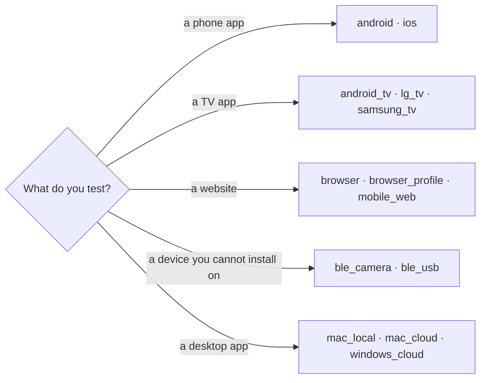

::scene{name="examples" caption="optics init copies a sample suite into a new project. Only config.yaml says which device it runs on: a phone, a TV, a signed-in browser, a phone driven over Bluetooth or a Windows VM in the cloud."}

Optics ships a sample suite for each platform. Each sample has a `config.yaml` for that platform and a short suite for an app that the platform has, where it has one. Copy one into a new project:

```shell
$ optics init demo --template android
```

The project gets the files of the sample:

```tree
demo/
├── config.yaml                 # the driver and the element sources
├── test_cases/test_cases.csv   # suite setup, the test cases, suite teardown
├── modules/modules.csv         # the steps
└── test_data/elements.csv      # the locators, some with a fallback value
```

`optics init demo` with no `--template` shows a list of the samples in a terminal. `optics quickstart` offers the sample of the platform that you choose.

## Choose an example



| Sample | What the suite does | What you need |
|---|---|---|
| `android` | Opens Settings, scrolls to About phone and finds the build number. Includes an [error definitions](/docs/run/error-detection) file. | Appium, and an Android emulator or phone |
| `ios` | Opens Settings, then General, then About, and goes back. | Appium on a Mac with Xcode, and a simulator or iPhone |
| `android_tv` | Opens TV Settings, then Device Preferences, and opens About with the remote's center key. | Appium, and an Android TV emulator or a TV on `adb` |
| `lg_tv` | Opens a tile in a grid with remote keys, then searches for it with the on-screen keyboard. | Appium 2 with the webOS driver, and a TV in Developer Mode |
| `samsung_tv` | The same flow as `lg_tv`, on a Samsung Tizen TV. | Appium 2 with the Tizen driver, Tizen Studio, and a TV in Developer Mode |
| `browser` | Opens a page and checks its text. | Nothing more: Playwright starts Chromium |
| `browser_profile` | Opens GitHub settings with your Chrome profile, signed in. | Chrome, signed in to GitHub |
| `mobile_web` | Searches Wikipedia in Chrome on Android. | Appium, and an Android emulator or phone |
| `ble_camera` | Opens Settings on an iPhone over Bluetooth, and reads the screen through a webcam. | An airhand dongle and a webcam |
| `ble_usb` | Opens Settings on an Android phone over Bluetooth, and reads the screen over USB. | An airhand dongle, `adb` and USB debugging |
| `mac_local` | Types a note in TextEdit, checks it and clears it. | Appium and appium-xa11y-driver on your Mac |
| `mac_cloud` | Adds 7 and 8 in Calculator on a cloud Mac. | A Mac Host with Appium and an SSH tunnel |
| `windows_cloud` | Adds 7 and 8 in Calculator on a Windows VM. | A Windows Host with Appium and an SSH tunnel |

The TV samples drive Birch, the sample shoe store of these docs. Tizen and webOS drive only a debug build of your own app, so replace the app id and the text in `elements.csv` with the values of your app.

## Phones and TVs

`android`, `ios` and `android_tv` drive the Settings app, which every device has, so you can run them before you change anything. Before the first run, set the device in `config.yaml`:

| Sample | Set |
|---|---|
| `android`, `android_tv` | `deviceName` (or `udid`) to a serial from `adb devices` |
| `ios` | `deviceName` to a simulator name, or `udid` for a real iPhone |
| `lg_tv` | `appium:deviceHost` to the TV's address, and `appium:appId` to your app |
| `samsung_tv` | `appium:deviceAddress`, `appium:rcToken`, `appium:appPackage` and `appium:app` (the `.wgt` file) |

Android TV moves the focus with Android key numbers, such as `23` for the center key. Tizen and webOS take remote key names, such as `RIGHT` and `ENTER`, and Press Element moves the focus for you. [Test TV apps](/docs/platforms/tv) explains both.

## Browsers

`browser` runs as it is. `browser_profile` copies the sign-ins of a Chrome profile into a temporary folder, so the suite starts signed in, and your profile does not change. Set the profile with an environment variable, or edit `config.yaml`:

```shell
$ OPTICS_BROWSER_PROFILE="Profile 1" optics execute demo
```

The value is the profile folder, its name or its account email. [Start signed in with a browser profile](/docs/platforms/web#start-signed-in-with-a-browser-profile) has the details.

## Devices over Bluetooth

The `ble` samples drive a device that has nothing installed. The dongle taps and types, and Optics reads the screen with OCR. The two samples see the screen in different ways:

| Sample | Screen | Keep in step |
|---|---|---|
| `ble_camera` | A webcam aimed at the phone, with `find_screen: brightness` | `frame` equals `out_width` × `out_height` |
| `ble_usb` | `adb` screenshots over USB | `frame` equals the size of the phone's screenshot |

Each step that taps waits first with Assert Presence, because a camera frame shows the screen only at one moment. [Test production devices](/docs/platforms/production) covers the camera, the dongle and the setup.

## Desktops

`mac_local` drives TextEdit on the Mac that runs Optics. The cloud samples drive a Host on another computer through an SSH tunnel, because Appium has no authentication:

:::tabs{group="desktop"}
::tab[macOS]
```shell
$ ssh -N -o ExitOnForwardFailure=yes -L 4734:127.0.0.1:4723 user@cloud-mac
$ optics execute demo
```
::tab[Windows]
```shell
$ ssh -N -o ExitOnForwardFailure=yes -L 4733:127.0.0.1:4723 user@windows-vm
$ optics execute demo
```
:::

The URL comes from `MAC_APPIUM_URL` or `WINDOWS_APPIUM_URL`, with the tunnel port as the default. [Test desktop apps](/docs/platforms/desktop) shows how to set up a Host.

## Make it yours

:::steps
### Check the setup

`optics doctor` checks the driver, the server and the device for the project:

```shell
$ optics doctor demo
```

### Run the sample once

Run it before you change anything. Then a failure after your change comes from your change.

```shell
$ optics execute demo
```

### Point it at your app

Change the app in `config.yaml`, and the locators in `test_data/elements.csv`. Keep the module and test case names, or rename them to match your flow.

### Check your changes without a device

A dry run finds a misspelled keyword, a missing `${name}` or a wrong number of values before anything runs:

```shell
$ optics dry_run demo
```
:::

## See also

:::cards{cols="2"}
- [Write your first test](/docs/get-started/first-test): Build a suite from scratch, step by step.
- [Supported platforms](/docs/platforms/): The driver, the element sources and the limits of each platform.
- [Define elements](/docs/elements/define): Give an element more than one value.
- [optics init](/docs/reference/cli#optics-init): Every option of the command.
:::
